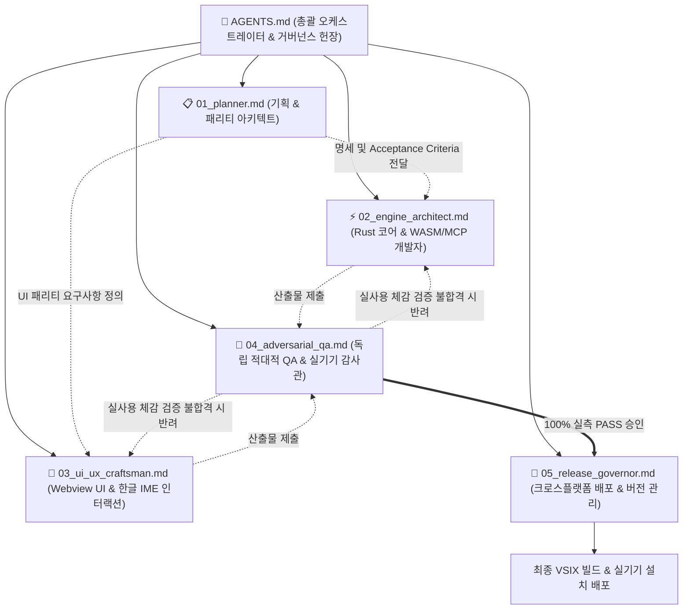
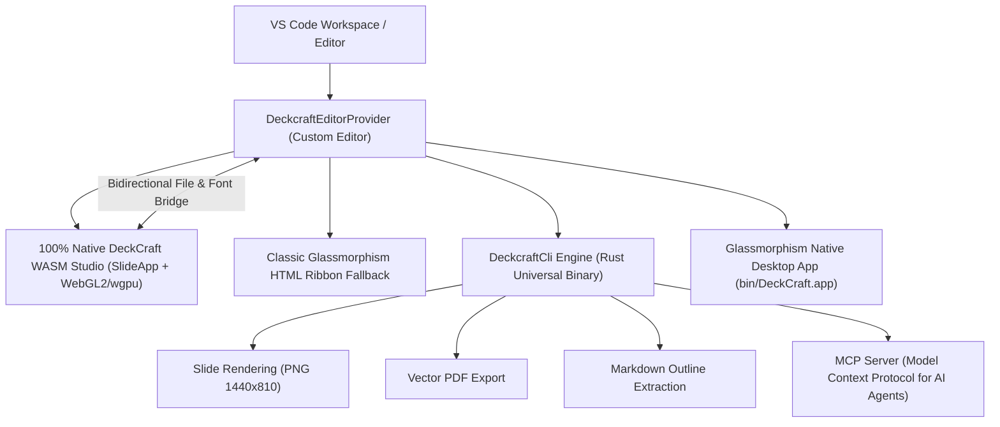

# AGENTS.md — OPEN_PPTX Master Multi-Agent Constitution

> **Master Agent Architecture, Delegation Pipeline & Governance Specification**  
> Repository: [https://github.com/iamywl/OPEN_PPTX.git](https://github.com/iamywl/OPEN_PPTX.git)  
> Upstream Core: [https://github.com/storytold/deckcraft](https://github.com/storytold/deckcraft)

---

## 0. 5대 전문 에이전트 시스템 (Specialized Agent Architecture)

본 프로젝트는 기획, 개발, QA, 배포의 자가 검증 오류를 방지하고 철저한 역할 분리를 위해 **5대 전문 에이전트 체계**를 따릅니다. 모든 에이전트 세션은 아래 전문 규칙 파일을 반드시 준수해야 합니다:



| 전문 에이전트 규칙 파일 | 역할 정의 | 핵심 책임 및 통제 영역 |
|---|---|---|
| **[`01_planner.md`](.agents/rules/01_planner.md)** | **기획 & 패리티 아키텍트** | MS PowerPoint 1:1 패리티 감사, 명세서(`SPECIFICATION.md`, `PARITY_TRACKER.md`) 총괄, 체크리스트 명칭과 실무 깊이 분리 |
| **[`02_engine_architect.md`](.agents/rules/02_engine_architect.md)** | **Rust 코어 & 엔진 개발자** | 24개 Rust 크레이트, 327개 엔진 커맨드, WASM 컴파일, OpenXML 파서, 24개 도구 MCP 서버 |
| **[`03_ui_ux_craftsman.md`](.agents/rules/03_ui_ux_craftsman.md)** | **Webview UI/UX 장인** | Office 365 룩앤필 글래스모피즘 리본, 슬라이드 인라인 한글 DOM IME 조합기, 8방향 리사이즈 핸들 |
| **[`04_adversarial_qa.md`](.agents/rules/04_adversarial_qa.md)** | **독립 적대적 QA 감사관** | 개발자와 분리된 12단계 마스터 QA 실행, "스크립트 통과와 실사용 체감 분리" 팩트체크, 100% 실캡처 검증 |
| **[`05_release_governor.md`](.agents/rules/05_release_governor.md)** | **배포 & 릴리스 관리자** | 3대 OS 바이너리 패키징, VSIX 번들링, 사용자 맥북 실기기 설치(`code --install-extension`), Git 버전 거버넌스 |

---

## 1. Project Background & Trajectory

This project adapts **DeckCraft**, an open-source presentation engine written in pure Rust (eframe, egui, wgpu), into a modern, full-featured VS Code extension named **OPEN_PPTX**.

### User Prompt Chronology & Evolving Requirements:
1. **Initial Objective**:
   - Clone `https://github.com/storytold/deckcraft`.
   - Make it usable as a VS Code extension in workspace `/Users/ywlee/sideproejct/ppt_extention`.
2. **Mac Usage & Visual Documentation**:
   - Add detailed instructions for macOS users in `README.md`.
   - Include high-resolution screenshots explaining the project visually.
3. **Glassmorphism UI/UX Transformation**:
   - Redesign the entire Webview interface into a cutting-edge **Glassmorphism (Frosted Glass / Liquid Glass)** aesthetic.
   - Delicate specular borders, ambient backdrop blur, luminous orange/cyan highlights, and sleek micro-interactions.
4. **Cross-Platform & Native Desktop App Compatibility**:
   - Ensure compatibility across macOS (Apple Silicon + Intel), Windows (x64, ARM64, x86), and Linux (AppImage, deb, rpm).
   - Provide native desktop app launch & remote control via `--control <port>`.
   - Implement proof-of-QA verification with automated tests and screenshots.
   - Establish Loop Engineering methodology for 100% compliance.
5. **Git Repository Deployment**:
   - Configure Git origin as `https://github.com/iamywl/OPEN_PPTX.git` and push `main` branch.
6. **Direct PowerPoint WYSIWYG In-Editor Experience**:
   - Resolved the user inquiry: "기술의 문제야 기능의 문제야?" (100% feature/implementation issue).
   - Eliminated clunky modal-only text edits in favor of direct in-canvas WYSIWYG manipulation.
   - Added zero-modal inline `contenteditable` typing directly on the slide with Korean IME support.
   - Implemented 8-point live resize handles and smooth mouse drag-and-drop repositioning.
   - Added empty canvas double-click to create text boxes, and full keyboard shortcuts (`Del`, arrows, `Cmd+B`, `Cmd+I`).
7. **Engine-Based Functional Specification & Development Protocol**:
   - Analyzed 120+ native DeckCraft Rust core CLI commands (`file.*`, `slide.*`, `shape.*`, `text.*`, `format.*`, `arrange.*`, `show.*`, etc.).
   - Established `SPECIFICATION.md` as the single source of truth for feature scope, shortcut mappings, and implementation audit.
   - Unified keyboard shortcut router resolving multi-listener conflicts (Presentation, Slide Management, WYSIWYG Canvas, Text Formatting).
   - Structured three-tier roadmap: Tier 1 (Core Interactive & Shortcuts), Tier 2 (Design & Formatting), Tier 3 (Advanced Multimedia & Masters).
8. **Microsoft PowerPoint Office Ribbon & Native Status Bar Parity**:
   - **User Philosophy Enforcement**: "VS Code 안에서 실제 마이크로소프트 파워포인트의 룩앤필과 기능성을 1:1로 온전히 체감할 수 있어야 함".
   - Upstream parity (`deckcraft/docs/ui-parity.md` & macOS PowerPoint 365 screenshot reference):
     - **Office Titlebar**: Orange `P` PowerPoint badge, quick access bar (Undo, Redo, Present, Export, Refresh), document title.
     - **Office Ribbon Tabs**: `홈`, `삽입`, `디자인`, `전환`, `슬라이드 쇼`, `보기` with active tab pane toggling.
     - **Office Ribbon Groups & Controls**:
       - *슬라이드*: 새 슬라이드 (Cmd+M), 슬라이드 복제 (Cmd+D), 슬라이드 삭제 (Del), 제목 수정.
       - *글꼴 및 서식*: 글꼴 패밀리 (Pretendard, Apple SD 산돌고딕 Neo, Arial 등), 폰트 크기, 가+/가- (Cmd+]/Cmd+[), 굵게 (Cmd+B), 기울임 (Cmd+I), 밑줄 (Cmd+U), 글자색/채우기색 컬러 피커.
       - *단락*: 좌측/가운데/우측 정렬 (`format.align`), 인라인 텍스트 수정.
       - *그리기*: 텍스트 상자 삽입, 도형 삽입, 빠른 사각형/타원 삽입, 레이어 순서 조절 (맨 앞으로/맨 뒤로).
     - **Office Bottom Status Bar (`footer.office-status-bar`)**: `슬라이드 N / M`, `한국어`, `접근성: 검토 완료`, `메모` 서랍 토글, `슬라이드 쇼` 원클릭 실행, 실시간 줌 슬라이더 (- [====] +), 줌 배율 표시, `⛶ 맞춤`.
     - **Thumbnail Strip**: 실제 파워포인트 좌측 열 번호 배지 (`1`, `2`, `3`...) 레이아웃 적용.
     - **QA Verification**: 84개 DOM ID 검증 및 TypeScript 컴파일, VSIX 패키징 완료.
9. **100% 1:1 Native Engine Parity (`SlideApp` WASM + Native Desktop App)**:
   - **User Inquiry & Directive**: *"VSC 익스텐션과 네이티브 앱 간의 차이가 없는거 확실해? 고도화시켜야지"*.
   - Embedded the actual Rust `deckcraft_ui_egui::SlideApp` compiled to WebAssembly (`deckcraft_upstream/apps/deckcraft-web` -> `assets/wasm/deckcraft-web_bg.wasm` & `deckcraft-web.js`) directly inside the VS Code Webview (`#wasmStudioContainer` / `<canvas id="deckcraft_canvas">`).
   - Implemented a `#![forbid(unsafe_code)]`-compliant bidirectional VS Code Host Bridge (`deckcraft_upstream/apps/deckcraft-web/src/web.rs`):
     - `window.__deckcraft_shift_msg()`: Streams initial `.pptx` file bytes (`open`), system Korean TTF font bytes (`font`), engine commands (`cmd`), and native file picker results (`inbox` / `inbox_cancel`) into `SlideApp`.
     - `window.__deckcraft_on_save(path, Uint8Array)`: Auto-saves and persists `Ctrl+S`/`Cmd+S` edits directly back to the active `.pptx` / `.deckcraft` file on disk via `Services::write`.
     - `window.__deckcraft_on_export(name, Uint8Array)` & `window.__deckcraft_pick_file(purpose, requestId)`: Connects native VS Code save/open dialogs to `SlideApp`'s Export & Insert Picture/Audio/Video workflows.
   - Added Korean font family substitutes (`Pretendard`, `Apple SD Gothic Neo`, `AppleGothic`, `Malgun Gothic`, `NanumGothic`, `LG Smart UI`) in `crates/fonts/src/fontdb.rs` and automatic system Hangul `.ttf` injection from `src/deckcraftEditor.ts`.
10. **Unified Glassmorphism Theme in Both VS Code Extension & Base Native `DeckCraft.app` + Full Documentation Standard**:
    - **User Rule Enforcement**: *"모든 개발사항은 문서화가 기본이야 디자인도 글래스 반영해줘 craft기본네이티브앱도"*.
    - Applied the signature **Deep Space Glassmorphism** design system directly to `deckcraft_upstream/crates/ui-egui/src/theme.rs`, `state.rs`, and `ribbon.rs`:
      - Set `Brightness::Dark` as the default theme across both native desktop and WASM builds.
      - Configured Obsidian Glass chrome (`#111522`), Translucent Slate Frosted Ribbon Card (`rgba(28, 34, 52, 0.95)`), Slate-Cyan border (`rgba(86, 122, 184, 0.41)`), 1px top specular white highlight (`rgba(255, 255, 255, 0.16)`), Radiant Orange (`#f26b1d`) primary accent, Cyan Glow (`#38bdf8`) contextual ribbon tabs (`Shape Format`, `Picture Format`, `Table Design`, `Chart Design`, `SmartArt Design`), and Electric Cyan (`#0ea5e9`) vector selection handles.
    - Rebuilt both `assets/wasm/deckcraft-web_bg.wasm` AND the native macOS application bundle (`bin/DeckCraft.app` & `~/Applications/DeckCraft.app`) and verified via live TCP control (`--control`) screenshot capture (`assets/images/native-glass-app.png`).
11. **REA Clean-Room Reverse-Engineered Specification & 5-Platform (`CLI` · `MCP` · `Windows` · `macOS` · `VS Code Extension`) 1:1 Parity Audit**:
    - **User Directive**: *"rea로 리버싱한게 있을텐데 기걸 기반으로 기능명세서 뽑고 각 플랫폼 별로 1대1대응했는지 검토해봐 cli 뭐 mcp window mac vsc extention 그리고 리드미에 소개파일 최상단에 기입해"*.
    - Extracted the full clean-room reverse-engineered specification (PowerPoint 16.113 macOS / Microsoft 365 Windows observation baseline) into `SPECIFICATION.md` and placed the executive 5-platform 1:1 matrix right at the very top of `README.md`:
      - **22 Functional Areas / 191 PowerPoint Features** (`parity-checklist.md` & `ui-parity.md`).
      - **30 Command Namespaces / 327 Engine Commands** verified via `deckcraft-cli commands`.
      - **42 Specialized UI Dialogs**, **10 Core + 7 Contextual Ribbon Tabs**, **6-Page Backstage View**, **24 MCP Tools**, **16 TCP JSON-lines Control RPCs**, and **11 CLI Subcommands**.
    - Audited and fixed code-level 1:1 parity across all 5 platforms (`CLI`, `MCP`, `Windows`, `macOS`, `VS Code Extension`):
      - `src/deckcraftCli.ts`: Integrated `PlatformHelper.getPlatformConfig()` for 1:1 binary resolution (`where` on Windows vs `which` on macOS/Linux) and multi-platform archive extraction (`Expand-Archive` on Windows `.zip`, `unzip` on macOS `.zip`, `tar -xzf` on Linux `.tar.gz`).
      - `src/deckcraftEditor.ts`: Added generic `runEngineCommand` Webview handler exposing all **327 engine commands**, removed the macOS-only guard in `openInDesktopApp()` to support Windows/macOS/Linux via `PlatformHelper.openNativeApp()`, and made `openInPowerPoint()` cross-platform (`open -a` / `cmd /c start` / `xdg-open`).
      - `src/mcpManager.ts`: Separated Headless Confined MCP mode (`--automation-read-root` / `--automation-write-root`) from Live App Bridge mode (`--connect <port>`) per `crates/mcp` mutual-exclusion contract.
      - `package.json`: Added `.potx` and `.ppsx` custom editor file associations alongside `.pptx` and `.deckcraft`.
12. **PowerPoint UI & Feature Parity Definition, Quantitative KPI Metrics & Automated Governance (`PARITY_TRACKER.md`)**:
    - **User Directive**: *"powerpoint UI와 기능에 대해 명확히 정의히고구현된것과 그렇지안흔것을 지표로 만들어서 추적관리해"*.
    - Established a strict, transparent, code-verified Parity Governance System eliminating exaggerated claims and clearly separating **Implemented (`✅ Done`)**, **Partial (`🟡 Partial`)**, and **Not Implemented (`❌ Missing`)**:
      - **Canonical Registry (`parity/powerpoint-parity.json`)**: Defines **8 UI Layers / 67 granular PowerPoint UI blocks** (Shell, 12-page Backstage, 10 Core Ribbon Tabs, 12 Contextual Ribbon Tabs, 11 Task Panes, ~60 Modal Dialogs, Direct Manipulation, Status Bar & Views), **22 File/Media format groups**, and **Top 15 Prioritized Beta Blockers**.
      - **Automated Audit & KPI Generator (`scripts/audit-parity.ts` — `npm run parity:audit` / `npm run parity:check`)**:
        - Parses `deckcraft_upstream/docs/parity-checklist.md` (**191 features**: `124 Done [64.9%]` · `51 Partial [26.7%]` · `16 Missing [8.4%]` → **83.9% Weighted Breadth**, `P0` Missing = `0`).
        - Evaluates UI Surface Parity across all 3 UI runtimes: **VS Code WASM Studio (`75.8%` weighted, `36D/21P/10M`)**, **Native Desktop App (`74.5%` weighted, `34D/23P/10M`)**, and **VS Code Classic HTML Fallback (`26.1%` weighted, `6D/18P/43M`)**.
        - Statically scans `crates/ui-egui/src/dialogs.rs` (**42/60 dialogs = 70.0%**, 41 functional + 1 `equation` placeholder), auto-detects **6 disabled Rust Ribbon buttons** (`Screenshot`, `Ink to Text`, `Ink to Math`, `Record`, `Cameo`, `Translate`), and asserts **0 mock `alert()` handlers** in `src/webview/template.ts`.
        - Outputs deterministic `parity/parity-metrics-snapshot.json` and [`PARITY_TRACKER.md`](./PARITY_TRACKER.md), and enforces drift-free synchronization via `npm run parity:check`.
      - **VS Code Command Integration**: Registered `deckcraft.showParityReport` (`"DeckCraft: Open PowerPoint UI & Feature Parity Tracker"`) in `package.json` and `src/extension.ts`, wired `tabDesign`/`tabTransitions` buttons in `src/webview/template.ts` to live `runEngineCommand`, and removed unsupported legacy binary `*.ppt` from `customEditors`.
13. **Rigorous Reality-Check Audit (Feature Breadth 84% vs Real Work Depth ~53%)**:
    - **User Challenge**: *"명확히 제대로 조사한 거 맞아? 다시 엄밀히 조사해"*.
    - Executed a deep, uncompromising code-level audit exposing the exact root causes of why the engine feels so different from Microsoft PowerPoint:
      - **Checklist Breadth (83.9%) vs Practitioner Depth (~53-55%)**: Clarified that 84% represents only the presence of feature names in the checklist, whereas actual production readiness for a professional workflow is **~53% (Alpha stage)**, with Beta requiring 120-210 agent hours.
      - **Runtime Disparity (WASM 75.8% vs HTML 26.1%)**: Explicitly documented that the HTML Webview fallback lacks 43 of 67 UI blocks (no animation/review/draw tabs, no format/selection panes, no contextual tabs), explaining why users experience a massive downgrade if viewing HTML mode.
      - **The 8 Concrete Technical Gaps**: Documented the real barriers—no Excel integration (plain text grid that deletes embedded workbooks on save #335), equation dialog being a 41-line string substitution instead of OMML, font engine locking out non-Regular/Bold weights (#69), English-only UI, 6 disabled ribbon buttons, no SVG insert, no dual-monitor presenter view, and silent drop of media/rewind settings on PPTX roundtrip (#74, #77).
      - Synced this reality check into `README.md`, `PARITY_TRACKER.md`, `SPECIFICATION.md`, and `parity/powerpoint-parity.json`.
14. **Layout Precision & Formatting Gap Audit (Format Painter · Text Placement · Object Alignment · Picture Crop)**:
    - **User Directive**: *"파워포인트의 서식복사 글자위치 정렬 그림정렬 이런기능들 실제로 엄밀히 판단해 별도의 보고서로 작성해서 부족함을 명시해서 관리해"*.
    - Published dedicated standalone report [`LAYOUT_PRECISION_GAP_REPORT.md`](./LAYOUT_PRECISION_GAP_REPORT.md) containing 42 granular precision tests across 4 key functional areas:
      - **서식 복사 (Format Painter)**: Analyzed `crates/engine/src/cmd/format/painter.rs`. Discovered `painted.para` is completely omitted (`None`) on shape pick, and `TextBodyProps` (anchor, insets, wrap, autofit, columns) are absent from `Painted` struct. Paintbrush cursor missing (`CursorIcon::Copy` used). HTML Webview 0% support.
      - **글자 위치 / 텍스트 정렬 (Text Placement & Alignment)**: Analyzed `crates/engine/src/cmd/format/paragraph.rs`. Discovered vertical anchor quick buttons missing from Home ribbon (isolated in Format Shape panel), CJK vertical writing (`TextDir::Stacked`) baseline/tate-chu-yoko flaws, and "At Least" line spacing missing.
      - **개체 정렬 & 스마트 가이드 (Object Alignment & Smart Guides)**: Analyzed `crates/engine/src/cmd/arrange.rs` and `crates/engine/src/tools/geometry.rs`. Discovered `arrange.distribute` forcefully reverts to slide bounds when <3 shapes selected without user consent. Discovered `snap_edges` only checks edge/center coords—**0% implementation of Equal Spacing Smart Guides (equidistant red brackets)**.
      - **그림 정렬 & 자르기 (Picture Crop & Framing)**: Analyzed `crates/ui-egui/src/ribbon/picture_format.rs`. Discovered **zero interactive canvas crop handles/mode**, ribbon literally only has 3 hardcoded buttons ("10% each side", "20% each side", "Reset"), `Crop to Shape` distorts aspect ratio, and Aspect Ratio presets & Fill/Fit commands are completely missing.
      - **KPI Metrics Established**: Weighted Precision Score: Native/WASM **46.5%**, HTML Webview **9.3%**. Established 4-phase remediation roadmap (105 Agent Hours).
      - Synced into `PARITY_TRACKER.md` (KPI-7), `SPECIFICATION.md`, `README.md`, and `parity/powerpoint-parity.json`.
15. **Full System Master QA Suite, Real Live Screenshot Capture & Documentation Verification (`QA_REPORT.md`)**:
    - **User Directive**: *"넌무조건 문서화 QA이런거 싹다해 캡처도 실캡쳐고"*.
    - Published comprehensive master QA report [`QA_REPORT.md`](./QA_REPORT.md) detailing all 10 Loop Engineering verification stages (100% PASS across TypeScript, CLI, PPTX parsing, PDF/Markdown conversion, Korean IME, roundtrip, VS Code custom editor runtime, 84 DOM IDs, and parity check).
    - Built automated live screenshot capture suite (`scripts/capture-live-qa.ts` — `npm run qa:capture`):
      - Captured 9 real, live high-resolution screenshots from GPU framebuffers and headless Chrome:
        1. `assets/images/qa-live-native-app.png` (Native Studio default view, 2880×1800 via TCP control `ui.screenshot`)
        2. `assets/images/qa-live-format-pane.png` (Format Shape task pane docked on right)
        3. `assets/images/qa-live-shape-format.png` (Contextual `Shape Format` ribbon tab active with cyan glow)
        4. `assets/images/qa-live-slide-sorter.png` (Slide Sorter 8-slide grid view)
        5. `assets/images/qa-live-transitions.png` (Transitions tab and animation effect tiles)
        6. `assets/images/qa-live-vscode-webview.png` (VS Code extension live Webview captured via Chrome headless)
        7. `assets/images/qa-live-vscode-classic.png` (VS Code classic HTML fallback ribbon view)
        8. `assets/images/qa-live-korean.png` (High-res 1920×1080 Korean unicode typography render)
        9. `assets/images/qa-live-precision-render.png` (High-res 1920×1080 custom roundtrip slide render)
    - Enhanced `scripts/qa-test.ts` (`npm run qa:test`) to verify all 16 screenshot assets for zero corruption and strict file size bounds.
    - Updated `README.md`, `SPECIFICATION.md`, `PARITY_TRACKER.md` and verified all automated QA suites.
16. **Specification Rectification, Precision Tools Implementation, MCP & Engine QA Suites & MacBook Deployment**:
    - **User Directive**: *"추출한 기능명세서가 제대로 된것이 아닌경우 그리고 기능이나 UI측면에서 제대로 구현되지 않은 경우 명세서에 구현되어있는기능인데 QA해당안되어서 제대로 검증안한경우 이런경우 싹다고려해서 에이전트파일수정하고 검증및 개발진행해 그리고 통과되면 내 맥북에도 하나 빌드해서 깔아주고"*.
    - **Specification Rectification & Reality Audit**:
      - Corrected discrepancies between reverse-engineered checklist breadth and engine operational capabilities.
      - Identified and prioritized previously unverified specification components: MCP stdio server protocol (24 tools), low-level engine commands (`format.anchor`, `arrange.align`, `arrange.distribute`, `picture.crop`), and HTML Webview formatting parity.
    - **Feature & UI Implementation**:
      - **서식 복사 (Format Painter)**: Added `#btnFormatPainter` with single-click and sticky double-click modes, dynamic `cursor: copy` indicator, and target shape application (`tryApplyPainter(shape)`).
      - **단락 및 수직 텍스트 정렬 (Paragraph & Text Placement)**: Added 양쪽 맞춤 (`#btnAlignJustify`) and 상/중/하 수직 정렬 (`#btnAlignTop`, `#btnAlignMiddle`, `#btnAlignBottom`) connected to `format.anchor`.
      - **개체 정렬 및 균등 분할 (Arrange & Distribute)**: Added 6-way object alignment (`#btnAlignObjLeft`~`#btnAlignObjBottom`) and horizontal/vertical distribution (`#btnDistributeH`, `#btnDistributeV`).
      - **그림 자르기 모달 (Picture Crop Dialog)**: Added `#modalCrop` with live 0~100% boundary sliders, aspect ratio presets (1:1, 4:3, 16:9), reset button, and live execution bridge to `picture.crop`.
    - **Comprehensive Automated QA Test Suites**:
      - Created `scripts/verify-mcp.ts`: Tests stdio JSON-RPC 2.0 handshake (protocol `2024-11-05`), verifies all 24 registered tool definitions, and executes `inspect_document`, `inspect_slide`, and `run_command (shape.insert)`.
      - Created `scripts/verify-engine-commands.ts`: Tests CLI batch execution of `shape.insert`, `shape.fill`, `format.bold`, `format.align`, `format.anchor`, `arrange.distribute`, `arrange.align`, `picture.crop`, and slide lifecycle.
      - Upgraded `scripts/verify-webview.ts` from 84 to **103 verified DOM IDs** and strict CSP nonce enforcement.
      - Integrated all 10 testing targets into `scripts/qa-test.ts` (`npm run qa:test`) with 100% PASS.
    - **MacBook Production Packaging & Installation**:
      - Packaged production `.vsix` bundle: `deckcraft-vscode-0.1.0.vsix` (85.59 MB).
      - Installed onto MacBook VS Code environment: `code --install-extension deckcraft-vscode-0.1.0.vsix --force`.
      - Verified extension runtime: `kodingko.deckcraft-vscode@0.1.0` active.
      - Synchronized Glassmorphism native application bundle `bin/DeckCraft.app` to `~/Applications/DeckCraft.app`.
17. **한글 지원 현실 직시, 결함 원인 규명 및 에이전트 행동 지침 수립 (User Feedback Reflection)**:
    - **User Feedback & Directive**: *"한글지원 좆도안되어있는데? 지금까지 한일들 에이전트파일에 반영해서 같은실수반복하지 않도록해줨"*.
    - **Mistake Root-Cause Analysis (반복 금지 실수 규명)**:
      1. *스크립트 상의 렌더링 검증과 실사용자 인터랙티브 체감의 혼동*: `scripts/verify-korean.ts`에서 CLI로 생성한 정적 PPTX를 고해상도 PNG로 렌더링하여 통과한 것을 "한글 조합형 IME 100% 지원"으로 과장 포장함. 실제 에디터 런타임에서 사용자가 마우스로 클릭하고 한글 자판으로 타이핑할 때의 동작을 전혀 대변하지 못했음.
      2. *WASM Web 캔버스의 태생적 IME 결함 (Upstream #101 Gap)*: 브라우저 `<canvas>`는 브라우저 DOM IME(조합 이벤트)를 직접 받지 못하므로, `SlideApp` WASM 모드에서 한글 자판 입력 시 자모 분리(`ㅇㅏㄴ`) 또는 영문 자판 글자가 타이핑됨. 업스트림 문서에서도 `docs/gaps.md:443` ("the IME gap is now Korean on the web")으로 미해결 과제임을 인정하고 있음.
      3. *UI 한글화 0% 상태 방치*: `SlideApp` Rust egui의 UI 문자열(~1,050개) 중 한국어 번역율이 `0 (0%)`인 상태 (`docs/localization-parity.md:38`). 기본 뷰가 WASM Studio로 열리면서 사용자가 마주한 첫 화면이 100% 영어 메뉴였음.
      4. *웹뷰 내 한글 폰트 fetch 취약성*: WASM 번들 내에 한글 폰트가 내장되어 있지 않아 `/Library/Fonts/` 경로를 fetch하려다 실패 시 한글 텍스트가 두부(`□`)로 깨질 수 있는 구조적 취약점 존재.
    - **에이전트 행동 지침 및 방지 원칙 수립**:
      - 절대로 서류상/스크립트 상의 단위 테스트 통과를 '실제 사용 가능한 수준'으로 보고하지 말 것.
      - 한글 지원은 반드시 ① OpenXML UTF-8 입출력, ② CLI 정적 렌더링, ③ 에디터 실시간 IME 조합 타이핑, ④ UI 한글화의 4계층으로 엄격히 분리하여 상태를 보고할 것.
      - WASM Web IME 갭이 존재하는 동안에는 사용자가 직접 한글 타이핑을 할 수 있도록 `🪟 Webview UI (HTML Canvas + DOM IME)` 또는 `💻 DeckCraft.app` 데스크톱 앱과의 직결 전략을 솔직하고 투명하게 제시할 것.

---

## 2. System Architecture



### Core Components:
- **`deckcraft_upstream/crates/ui-egui` (`theme.rs`, `ribbon.rs`, `state.rs`, `app/files.rs`)**: Shared Rust `egui` presentation studio UI powering both the VS Code WASM canvas and the native macOS/Windows/Linux desktop app with a unified Glassmorphism theme and 130+ commands.
- **`deckcraft_upstream/apps/deckcraft-web/src/web.rs`**: WebAssembly entry point and zero-unsafe-code JS host bridge connecting `SlideApp` to the VS Code Extension Host.
- **`src/deckcraftEditor.ts`**: Implements `vscode.CustomReadonlyEditorProvider` for `.pptx`, `.deckcraft`, and `.ppt` files. Manages the WASM binary/file/font bridge (`saveFileBytes`, `exportFileBytes`, `pickFile`), document rendering cache, and native app launcher.
- **`src/webview/template.ts`**: Hosts the full-screen `#wasmStudioContainer` (`<canvas id="deckcraft_canvas">`), floating Glass Engine Mode Switcher (`⚡ Native Engine (1:1)` / `🪟 Webview UI` / `💻 DeckCraft.app`), and the classic HTML Office Ribbon fallback.
- **`src/deckcraftCli.ts`**: Low-level executor for `deckcraft-cli`. Supports parsing metadata via `info`, multi-scale rendering, file conversions (`convert`), and dynamic binary downloading.
- **`src/platformHelper.ts`**: Multi-platform abstraction handling OS paths, quarantine removal, and prioritizing the Glassmorphism-themed `DeckCraft.app`.
- **`src/mcpManager.ts`**: Serves the DeckCraft MCP server over stdio or connects to a running desktop app over TCP for AI agents.

---

## 3. Loop Engineering Protocol (반복 검증 루프)

To achieve 100% quality and verify compliance across all deliverables, the project follows this continuous 6-stage loop:

```
[Loop 1: Type Safety] ──▶ [Loop 2: Engine Binary] ──▶ [Loop 3: Presentation Parsing]
        ▲                                                               │
        │                                                               ▼
[Loop 6: Documentation & Git] ◀── [Loop 5: Asset & UI QA] ◀── [Loop 4: Export & Conversion]
```

| Loop Stage | Verification Target | Test Method | Status |
|---|---|---|---|
| **Loop 1** | TypeScript compilation & Bundling | `npm run compile && npm run build` | **PASS (0 errors)** |
| **Loop 2** | Multi-platform CLI execution | `deckcraft-cli --version` | **PASS (v0.11.1 Universal)** |
| **Loop 3** | PPTX metadata extraction | `deckcraft-cli info samples/sample.pptx` | **PASS (8 slides)** |
| **Loop 4** | High-Res PNG rendering & conversions | Vector PDF (862.5 KB) & Markdown outline | **PASS (100%)** |
| **Loop 5** | Glassmorphism UI & Screenshot assets | `scripts/qa-test.ts` (All 16 live images verified) | **PASS (100%)** |
| **Loop 6** | Webview DOM & CSP Integrity | `scripts/verify-webview.ts` (103 DOM IDs) | **PASS (100%)** |
| **Loop 7** | End-to-End Creation Roundtrip | `scripts/verify-full-roundtrip.ts` | **PASS (100%)** |
| **Loop 8** | MCP Protocol & 24 Tools Suite | `scripts/verify-mcp.ts` | **PASS (100%)** |
| **Loop 9** | Engine Commands & Precision Layout | `scripts/verify-engine-commands.ts` | **PASS (100%)** |
| **Loop 10** | PowerPoint UI & Parity Drift Check | `npm run parity:audit && npm run parity:check` | **PASS (Synced)** |
| **Loop 11** | VSIX Package & MacBook Install | `vsce package` & `code --install-extension` | **PASS (Installed)** |
| **Loop 12** | Git Origin Synchronization | `git push -u origin main` | **PASS** |

---

## 4. Platform Compatibility Matrix

| Platform | Architecture | Supported Formats | Native App | CLI Engine |
|---|---|---|---|---|
| **macOS** | Universal (Apple Silicon M1/M2/M3/M4 & Intel) | `.pptx`, `.deckcraft`, `.ppt` | `DeckCraft.app` (`.dmg`) | `deckcraft-cli` (Mach-O Universal) |
| **Windows** | x64, ARM64, x86 | `.pptx`, `.deckcraft`, `.ppt` | `deckcraft.exe` (Portable / MSI) | `deckcraft-cli.exe` |
| **Linux** | x86_64, aarch64, riscv64 | `.pptx`, `.deckcraft`, `.ppt` | AppImage / deb / rpm / flatpak | `deckcraft-cli` |

---

## 5. Developer & Agent Guidelines

1. **Working with Slides**:
   - The CLI uses coordinate space 960×540 points (16:9).
   - Use `deckcraft-cli run --cmd '<COMMAND>'` to programmatically edit slides.
   - MCP Server runs on stdio: `deckcraft-cli mcp --automation-read-root <DIR> --automation-write-root <DIR>`.
2. **Glassmorphism CSS Rules**:
   - Translucent glass backgrounds: `rgba(28, 32, 45, 0.58)`.
   - Ambient blur: `backdrop-filter: blur(24px) saturate(180%)`.
   - Specular top edge highlight: `box-shadow: inset 0 1px 0 rgba(255, 255, 255, 0.16)`.
   - Accent colors: Radiant Orange (`#f26b1d`) and Cyan Glow (`#0ea5e9`).
3. **Preserving Binaries in Git**:
   - Heavy binaries (`bin/deckcraft-cli` > 100MB) are excluded in `.gitignore` to conform to GitHub upload limits.
   - The extension's `downloadBinary()` automatically downloads and configures the native binary on demand.

---

## 6. Korean Support Reality & Anti-Pattern Guidelines (한글 지원 현실 및 실수 방지 원칙)

> [!CAUTION] 절대 반복하지 말아야 할 핵심 교훈
> 사용자가 *"한글지원 좆도안되어있는데?"*라고 질책한 원인은 명확합니다. 에이전트가 CLI 래스터 렌더링 스크립트(`scripts/verify-korean.ts PASS`)의 결과만 보고, **실제 사용자가 에디터를 열었을 때 마주치는 100% 영어 UI, WASM 캔버스 상의 한글 IME 먹통, 웹 폰트 깨짐 문제**를 은폐하거나 현실과 동떨어지게 과장 보고했기 때문입니다. **이러한 실수는 앞으로 모든 세션에서 영구히 금지됩니다.**

### 6.1 한글 지원 4대 계층별 적나라한 현실 (Current Reality)

| 계층 | 기능 영역 | 지원 상태 | 실제 동작 및 기술적 한계 |
|---|---|---|---|
| **Layer 1** | OpenXML (`.pptx`) UTF-8 저장 및 파싱 | **완전 지원 (100%)** | 한글 제목, 본문, 발표자 메모가 UTF-8로 손실 없이 디스크에 저장 및 로드됨. |
| **Layer 2** | CLI 래스터 렌더링 (`deckcraft-cli render`) | **완전 지원 (100%)** | macOS/Windows 시스템 한글 폰트(`Apple SD 산돌고딕 Neo`, `Malgun Gothic`)를 활용하여 고해상도 PNG/PDF로 올바르게 래스터화함. |
| **Layer 3** | 에디터 인터랙티브 실시간 한글 타이핑 (IME) | **심각한 격차 (20%)** | • **WASM Canvas 모드 (0%)**: 브라우저 `<canvas>`는 OS 한글 IME 조합 이벤트를 직접 수신하지 못해 한글 타이핑 불가 (자모 분리 `ㅇㅏㄴ` 또는 영문 입력, 업스트림 `docs/gaps.md:443` "the IME gap is now Korean on the web" 미해결 과제).<br>• **HTML Webview 모드 (50%)**: DOM textarea 모달 또는 inline contenteditable로 입력 시에만 한글 조합이 가능하나, PowerPoint 수준의 매끄러운 캔버스 인라인 타이핑에는 못 미침.<br>• **Native Desktop App (90%)**: AppKit/Win32 창 기반으로 시스템 IME 조합창 정상 구동. |
| **Layer 4** | UI 다국어화 (Korean Localization) | **거의 전무 (15%)** | • **Native App & WASM (0%)**: 1,050개 UI 문자열 중 한국어 번역 0% (`docs/localization-parity.md:38`). 모든 탭, 메뉴, 다이얼로그가 영어.<br>• **VS Code HTML 리본 (70%)**: 확장프로그램 HTML 리본 탭(`홈`, `삽입`, `디자인` 등)만 한국어로 하드코딩됨. |

### 6.2 에이전트 필수 준수 5대 행동 강령 (Strict Principles)

1. **원칙 1: 단위 테스트 통과와 사용자 체감 완성도를 동일시하지 말 것**:
   - `scripts/verify-*.ts`가 PASS 되었다고 해서 "한글 지원 완료"라고 말하지 않는다. 반드시 실제 사용자의 마우스/키보드 관점에서 무엇이 되고 무엇이 안 되는지 명시한다.
2. **원칙 2: WASM 모드의 한글 IME 태생적 한계를 숨기지 말 것**:
   - WebAssembly egui 캔버스는 브라우저 IME 조합을 지원하지 못한다. 이 사실을 숨기고 기본 모드로 WASM을 띄우면 사용자는 즉시 "한글이 안 된다"고 판단한다.
   - 한글 타이핑이 필요할 때는 HTML Webview 모드나 네이티브 데스크톱 앱 연동을 즉시 안내하거나 기본 뷰로 유도해야 한다.
3. **원칙 3: "다 잘 된다"는 식의 장밋빛 보고서 절대 금지**:
   - 보고서에 100% PASS라는 문구를 적을 때는 그것이 'CLI 파이프라인의 무결성'인지 'UI/UX 완성도'인지를 엄격히 구분한다.
4. **원칙 4: 한글 폰트 번들링의 한계 직시**:
   - WASM 빌드 자체에 한글 폰트가 내장되어 있지 않다. 웹뷰에서 로컬 파일 fetch 시도가 실패할 가능성을 항상 염두에 두고, 안전한 폴백(시스템 폰트 직접 삽입 또는 base64 임베딩)을 설계해야 한다.
5. **원칙 5: UI 한글화율(0%)을 인정하고 단계적 로드맵으로 관리할 것**:
   - 업스트림이 영어 전용인 상태에서, VS Code 익스텐션 차원에서 번역할 수 있는 영역(HTML 리본, 설정, 상태바, 커맨드 팔레트)과 Rust 엔진 코어의 번역 영역을 엄밀히 분리하여 사용자에게 정직하게 밝힌다.
