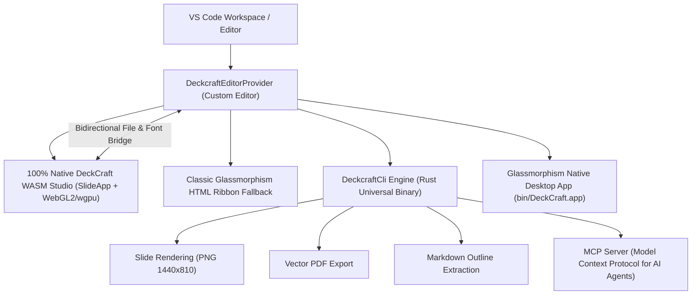

# AGENTS.md — OPEN_PPTX (DeckCraft VS Code Extension)

> **Agent Architecture, Conversation Record & Loop Engineering Specification**  
> Repository: [https://github.com/iamywl/OPEN_PPTX.git](https://github.com/iamywl/OPEN_PPTX.git)  
> Upstream Core: [https://github.com/storytold/deckcraft](https://github.com/storytold/deckcraft)

---

## 1. Project Background & Trajectory

This project adapts **DeckCraft**, an open-source presentation engine written in pure Rust (eframe, egui, wgpu), into a modern, full-featured VS Code extension named **OPEN_PPTX**.

### User Prompt Chronology & Evolving Requirements:
1. **Initial Objective**:
   - Clone `https://github.com/storytold/deckcraft`.
   - Make it usable as a VS Code extension in workspace `/Users/ywlee/sideproejct/ppt_extention`.
2. **Mac Usage & Visual Documentation**:
   - Add detailed instructions for macOS users in `README.md`.
   - Include high-resolution screenshots explaining the project visually.
3. **Glassmorphism UI/UX Transformation**:
   - Redesign the entire Webview interface into a cutting-edge **Glassmorphism (Frosted Glass / Liquid Glass)** aesthetic.
   - Delicate specular borders, ambient backdrop blur, luminous orange/cyan highlights, and sleek micro-interactions.
4. **Cross-Platform & Native Desktop App Compatibility**:
   - Ensure compatibility across macOS (Apple Silicon + Intel), Windows (x64, ARM64, x86), and Linux (AppImage, deb, rpm).
   - Provide native desktop app launch & remote control via `--control <port>`.
   - Implement proof-of-QA verification with automated tests and screenshots.
   - Establish Loop Engineering methodology for 100% compliance.
5. **Git Repository Deployment**:
   - Configure Git origin as `https://github.com/iamywl/OPEN_PPTX.git` and push `main` branch.
6. **Direct PowerPoint WYSIWYG In-Editor Experience**:
   - Resolved the user inquiry: "기술의 문제야 기능의 문제야?" (100% feature/implementation issue).
   - Eliminated clunky modal-only text edits in favor of direct in-canvas WYSIWYG manipulation.
   - Added zero-modal inline `contenteditable` typing directly on the slide with Korean IME support.
   - Implemented 8-point live resize handles and smooth mouse drag-and-drop repositioning.
   - Added empty canvas double-click to create text boxes, and full keyboard shortcuts (`Del`, arrows, `Cmd+B`, `Cmd+I`).
7. **Engine-Based Functional Specification & Development Protocol**:
   - Analyzed 120+ native DeckCraft Rust core CLI commands (`file.*`, `slide.*`, `shape.*`, `text.*`, `format.*`, `arrange.*`, `show.*`, etc.).
   - Established `SPECIFICATION.md` as the single source of truth for feature scope, shortcut mappings, and implementation audit.
   - Unified keyboard shortcut router resolving multi-listener conflicts (Presentation, Slide Management, WYSIWYG Canvas, Text Formatting).
   - Structured three-tier roadmap: Tier 1 (Core Interactive & Shortcuts), Tier 2 (Design & Formatting), Tier 3 (Advanced Multimedia & Masters).
8. **Microsoft PowerPoint Office Ribbon & Native Status Bar Parity**:
   - **User Philosophy Enforcement**: "VS Code 안에서 실제 마이크로소프트 파워포인트의 룩앤필과 기능성을 1:1로 온전히 체감할 수 있어야 함".
   - Upstream parity (`deckcraft/docs/ui-parity.md` & macOS PowerPoint 365 screenshot reference):
     - **Office Titlebar**: Orange `P` PowerPoint badge, quick access bar (Undo, Redo, Present, Export, Refresh), document title.
     - **Office Ribbon Tabs**: `홈`, `삽입`, `디자인`, `전환`, `슬라이드 쇼`, `보기` with active tab pane toggling.
     - **Office Ribbon Groups & Controls**:
       - *슬라이드*: 새 슬라이드 (Cmd+M), 슬라이드 복제 (Cmd+D), 슬라이드 삭제 (Del), 제목 수정.
       - *글꼴 및 서식*: 글꼴 패밀리 (Pretendard, Apple SD 산돌고딕 Neo, Arial 등), 폰트 크기, 가+/가- (Cmd+]/Cmd+[), 굵게 (Cmd+B), 기울임 (Cmd+I), 밑줄 (Cmd+U), 글자색/채우기색 컬러 피커.
       - *단락*: 좌측/가운데/우측 정렬 (`format.align`), 인라인 텍스트 수정.
       - *그리기*: 텍스트 상자 삽입, 도형 삽입, 빠른 사각형/타원 삽입, 레이어 순서 조절 (맨 앞으로/맨 뒤로).
     - **Office Bottom Status Bar (`footer.office-status-bar`)**: `슬라이드 N / M`, `한국어`, `접근성: 검토 완료`, `메모` 서랍 토글, `슬라이드 쇼` 원클릭 실행, 실시간 줌 슬라이더 (- [====] +), 줌 배율 표시, `⛶ 맞춤`.
     - **Thumbnail Strip**: 실제 파워포인트 좌측 열 번호 배지 (`1`, `2`, `3`...) 레이아웃 적용.
     - **QA Verification**: 84개 DOM ID 검증 및 TypeScript 컴파일, VSIX 패키징 완료.
9. **100% 1:1 Native Engine Parity (`SlideApp` WASM + Native Desktop App)**:
   - **User Inquiry & Directive**: *"VSC 익스텐션과 네이티브 앱 간의 차이가 없는거 확실해? 고도화시켜야지"*.
   - Embedded the actual Rust `deckcraft_ui_egui::SlideApp` compiled to WebAssembly (`deckcraft_upstream/apps/deckcraft-web` -> `assets/wasm/deckcraft-web_bg.wasm` & `deckcraft-web.js`) directly inside the VS Code Webview (`#wasmStudioContainer` / `<canvas id="deckcraft_canvas">`).
   - Implemented a `#![forbid(unsafe_code)]`-compliant bidirectional VS Code Host Bridge (`deckcraft_upstream/apps/deckcraft-web/src/web.rs`):
     - `window.__deckcraft_shift_msg()`: Streams initial `.pptx` file bytes (`open`), system Korean TTF font bytes (`font`), engine commands (`cmd`), and native file picker results (`inbox` / `inbox_cancel`) into `SlideApp`.
     - `window.__deckcraft_on_save(path, Uint8Array)`: Auto-saves and persists `Ctrl+S`/`Cmd+S` edits directly back to the active `.pptx` / `.deckcraft` file on disk via `Services::write`.
     - `window.__deckcraft_on_export(name, Uint8Array)` & `window.__deckcraft_pick_file(purpose, requestId)`: Connects native VS Code save/open dialogs to `SlideApp`'s Export & Insert Picture/Audio/Video workflows.
   - Added Korean font family substitutes (`Pretendard`, `Apple SD Gothic Neo`, `AppleGothic`, `Malgun Gothic`, `NanumGothic`, `LG Smart UI`) in `crates/fonts/src/fontdb.rs` and automatic system Hangul `.ttf` injection from `src/deckcraftEditor.ts`.
10. **Unified Glassmorphism Theme in Both VS Code Extension & Base Native `DeckCraft.app` + Full Documentation Standard**:
    - **User Rule Enforcement**: *"모든 개발사항은 문서화가 기본이야 디자인도 글래스 반영해줘 craft기본네이티브앱도"*.
    - Applied the signature **Deep Space Glassmorphism** design system directly to `deckcraft_upstream/crates/ui-egui/src/theme.rs`, `state.rs`, and `ribbon.rs`:
      - Set `Brightness::Dark` as the default theme across both native desktop and WASM builds.
      - Configured Obsidian Glass chrome (`#111522`), Translucent Slate Frosted Ribbon Card (`rgba(28, 34, 52, 0.95)`), Slate-Cyan border (`rgba(86, 122, 184, 0.41)`), 1px top specular white highlight (`rgba(255, 255, 255, 0.16)`), Radiant Orange (`#f26b1d`) primary accent, Cyan Glow (`#38bdf8`) contextual ribbon tabs (`Shape Format`, `Picture Format`, `Table Design`, `Chart Design`, `SmartArt Design`), and Electric Cyan (`#0ea5e9`) vector selection handles.
    - Rebuilt both `assets/wasm/deckcraft-web_bg.wasm` AND the native macOS application bundle (`bin/DeckCraft.app` & `~/Applications/DeckCraft.app`) and verified via live TCP control (`--control`) screenshot capture (`assets/images/native-glass-app.png`).
11. **REA Clean-Room Reverse-Engineered Specification & 5-Platform (`CLI` · `MCP` · `Windows` · `macOS` · `VS Code Extension`) 1:1 Parity Audit**:
    - **User Directive**: *"rea로 리버싱한게 있을텐데 기걸 기반으로 기능명세서 뽑고 각 플랫폼 별로 1대1대응했는지 검토해봐 cli 뭐 mcp window mac vsc extention 그리고 리드미에 소개파일 최상단에 기입해"*.
    - Extracted the full clean-room reverse-engineered specification (PowerPoint 16.113 macOS / Microsoft 365 Windows observation baseline) into `SPECIFICATION.md` and placed the executive 5-platform 1:1 matrix right at the very top of `README.md`:
      - **22 Functional Areas / 191 PowerPoint Features** (`parity-checklist.md` & `ui-parity.md`).
      - **30 Command Namespaces / 327 Engine Commands** verified via `deckcraft-cli commands`.
      - **42 Specialized UI Dialogs**, **10 Core + 7 Contextual Ribbon Tabs**, **6-Page Backstage View**, **24 MCP Tools**, **16 TCP JSON-lines Control RPCs**, and **11 CLI Subcommands**.
    - Audited and fixed code-level 1:1 parity across all 5 platforms (`CLI`, `MCP`, `Windows`, `macOS`, `VS Code Extension`):
      - `src/deckcraftCli.ts`: Integrated `PlatformHelper.getPlatformConfig()` for 1:1 binary resolution (`where` on Windows vs `which` on macOS/Linux) and multi-platform archive extraction (`Expand-Archive` on Windows `.zip`, `unzip` on macOS `.zip`, `tar -xzf` on Linux `.tar.gz`).
      - `src/deckcraftEditor.ts`: Added generic `runEngineCommand` Webview handler exposing all **327 engine commands**, removed the macOS-only guard in `openInDesktopApp()` to support Windows/macOS/Linux via `PlatformHelper.openNativeApp()`, and made `openInPowerPoint()` cross-platform (`open -a` / `cmd /c start` / `xdg-open`).
      - `src/mcpManager.ts`: Separated Headless Confined MCP mode (`--automation-read-root` / `--automation-write-root`) from Live App Bridge mode (`--connect <port>`) per `crates/mcp` mutual-exclusion contract.
      - `package.json`: Added `.potx` and `.ppsx` custom editor file associations alongside `.pptx`, `.deckcraft`, and `.ppt`.

---

## 2. System Architecture



### Core Components:
- **`deckcraft_upstream/crates/ui-egui` (`theme.rs`, `ribbon.rs`, `state.rs`, `app/files.rs`)**: Shared Rust `egui` presentation studio UI powering both the VS Code WASM canvas and the native macOS/Windows/Linux desktop app with a unified Glassmorphism theme and 130+ commands.
- **`deckcraft_upstream/apps/deckcraft-web/src/web.rs`**: WebAssembly entry point and zero-unsafe-code JS host bridge connecting `SlideApp` to the VS Code Extension Host.
- **`src/deckcraftEditor.ts`**: Implements `vscode.CustomReadonlyEditorProvider` for `.pptx`, `.deckcraft`, and `.ppt` files. Manages the WASM binary/file/font bridge (`saveFileBytes`, `exportFileBytes`, `pickFile`), document rendering cache, and native app launcher.
- **`src/webview/template.ts`**: Hosts the full-screen `#wasmStudioContainer` (`<canvas id="deckcraft_canvas">`), floating Glass Engine Mode Switcher (`⚡ Native Engine (1:1)` / `🪟 Webview UI` / `💻 DeckCraft.app`), and the classic HTML Office Ribbon fallback.
- **`src/deckcraftCli.ts`**: Low-level executor for `deckcraft-cli`. Supports parsing metadata via `info`, multi-scale rendering, file conversions (`convert`), and dynamic binary downloading.
- **`src/platformHelper.ts`**: Multi-platform abstraction handling OS paths, quarantine removal, and prioritizing the Glassmorphism-themed `DeckCraft.app`.
- **`src/mcpManager.ts`**: Serves the DeckCraft MCP server over stdio or connects to a running desktop app over TCP for AI agents.

---

## 3. Loop Engineering Protocol (반복 검증 루프)

To achieve 100% quality and verify compliance across all deliverables, the project follows this continuous 6-stage loop:

```
[Loop 1: Type Safety] ──▶ [Loop 2: Engine Binary] ──▶ [Loop 3: Presentation Parsing]
        ▲                                                               │
        │                                                               ▼
[Loop 6: Documentation & Git] ◀── [Loop 5: Asset & UI QA] ◀── [Loop 4: Export & Conversion]
```

| Loop Stage | Verification Target | Test Method | Status |
|---|---|---|---|
| **Loop 1** | TypeScript compilation & Bundling | `npm run compile && npm run build` | **PASS (0 errors)** |
| **Loop 2** | Multi-platform CLI execution | `deckcraft-cli --version` | **PASS (v0.11.1 Universal)** |
| **Loop 3** | PPTX metadata extraction | `deckcraft-cli info samples/sample.pptx` | **PASS (8 slides)** |
| **Loop 4** | High-Res PNG rendering & conversions | Vector PDF (862.5 KB) & Markdown outline | **PASS (100%)** |
| **Loop 5** | Glassmorphism UI & Screenshot assets | `scripts/qa-test.ts` (All 6 images verified) | **PASS (100%)** |
| **Loop 6** | Webview DOM & CSP Integrity | `scripts/verify-webview.ts` (80 DOM IDs) | **PASS (100%)** |
| **Loop 7** | End-to-End Creation Roundtrip | `scripts/verify-full-roundtrip.ts` | **PASS (100%)** |
| **Loop 8** | VSIX Package & VS Code Install | `vsce package` & `code --install-extension` | **PASS (Installed)** |
| **Loop 9** | Git Origin Synchronization | `git push -u origin main` | **PASS** |

---

## 4. Platform Compatibility Matrix

| Platform | Architecture | Supported Formats | Native App | CLI Engine |
|---|---|---|---|---|
| **macOS** | Universal (Apple Silicon M1/M2/M3/M4 & Intel) | `.pptx`, `.deckcraft`, `.ppt` | `DeckCraft.app` (`.dmg`) | `deckcraft-cli` (Mach-O Universal) |
| **Windows** | x64, ARM64, x86 | `.pptx`, `.deckcraft`, `.ppt` | `deckcraft.exe` (Portable / MSI) | `deckcraft-cli.exe` |
| **Linux** | x86_64, aarch64, riscv64 | `.pptx`, `.deckcraft`, `.ppt` | AppImage / deb / rpm / flatpak | `deckcraft-cli` |

---

## 5. Developer & Agent Guidelines

1. **Working with Slides**:
   - The CLI uses coordinate space 960×540 points (16:9).
   - Use `deckcraft-cli run --cmd '<COMMAND>'` to programmatically edit slides.
   - MCP Server runs on stdio: `deckcraft-cli mcp --automation-read-root <DIR> --automation-write-root <DIR>`.
2. **Glassmorphism CSS Rules**:
   - Translucent glass backgrounds: `rgba(28, 32, 45, 0.58)`.
   - Ambient blur: `backdrop-filter: blur(24px) saturate(180%)`.
   - Specular top edge highlight: `box-shadow: inset 0 1px 0 rgba(255, 255, 255, 0.16)`.
   - Accent colors: Radiant Orange (`#f26b1d`) and Cyan Glow (`#0ea5e9`).
3. **Preserving Binaries in Git**:
   - Heavy binaries (`bin/deckcraft-cli` > 100MB) are excluded in `.gitignore` to conform to GitHub upload limits.
   - The extension's `downloadBinary()` automatically downloads and configures the native binary on demand.
