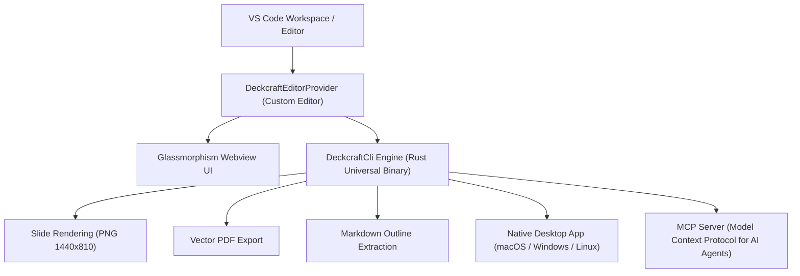

# AGENTS.md — OPEN_PPTX (DeckCraft VS Code Extension)

> **Agent Architecture, Conversation Record & Loop Engineering Specification**  
> Repository: [https://github.com/iamywl/OPEN_PPTX.git](https://github.com/iamywl/OPEN_PPTX.git)  
> Upstream Core: [https://github.com/storytold/deckcraft](https://github.com/storytold/deckcraft)

---

## 1. Project Background & Trajectory

This project adapts **DeckCraft**, an open-source presentation engine written in pure Rust (eframe, egui, wgpu), into a modern, full-featured VS Code extension named **OPEN_PPTX**.

### User Prompt Chronology & Evolving Requirements:
1. **Initial Objective**:
   - Clone `https://github.com/storytold/deckcraft`.
   - Make it usable as a VS Code extension in workspace `/Users/ywlee/sideproejct/ppt_extention`.
2. **Mac Usage & Visual Documentation**:
   - Add detailed instructions for macOS users in `README.md`.
   - Include high-resolution screenshots explaining the project visually.
3. **Glassmorphism UI/UX Transformation**:
   - Redesign the entire Webview interface into a cutting-edge **Glassmorphism (Frosted Glass / Liquid Glass)** aesthetic.
   - Delicate specular borders, ambient backdrop blur, luminous orange/cyan highlights, and sleek micro-interactions.
4. **Cross-Platform & Native Desktop App Compatibility**:
   - Ensure compatibility across macOS (Apple Silicon + Intel), Windows (x64, ARM64, x86), and Linux (AppImage, deb, rpm).
   - Provide native desktop app launch & remote control via `--control <port>`.
   - Implement proof-of-QA verification with automated tests and screenshots.
   - Establish Loop Engineering methodology for 100% compliance.
5. **Git Repository Deployment**:
   - Configure Git origin as `https://github.com/iamywl/OPEN_PPTX.git` and push `main` branch.

---

## 2. System Architecture



### Core Components:
- **`src/deckcraftEditor.ts`**: Implements `vscode.CustomReadonlyEditorProvider` for `.pptx`, `.deckcraft`, and `.ppt` files. Manages document rendering cache, file change watchers, and webview messaging.
- **`src/webview/template.ts`**: The Glassmorphism UI/UX renderer. Features frosted glass panels (`backdrop-filter: blur(24px)`), ambient glow mesh, floating glass toolbar, filmstrip sidebar, zoom HUD, and fullscreen presentation mode.
- **`src/deckcraftCli.ts`**: Low-level executor for `deckcraft-cli`. Supports parsing metadata via `info`, multi-scale rendering, file conversions (`convert`), and dynamic binary downloading for macOS, Windows, and Linux.
- **`src/platformHelper.ts`**: Multi-platform abstraction handling OS paths, quarantine removal (`xattr -d com.apple.quarantine`), and desktop app execution (`open`, `powershell`, `xdg-open`).
- **`src/mcpManager.ts`**: Serves the DeckCraft MCP server over stdio or connects to a running desktop app over TCP for AI agents in Cursor, Claude Desktop, Antigravity, and Windsurf.

---

## 3. Loop Engineering Protocol (반복 검증 루프)

To achieve 100% quality and verify compliance across all deliverables, the project follows this continuous 6-stage loop:

```
[Loop 1: Type Safety] ──▶ [Loop 2: Engine Binary] ──▶ [Loop 3: Presentation Parsing]
        ▲                                                               │
        │                                                               ▼
[Loop 6: Documentation & Git] ◀── [Loop 5: Asset & UI QA] ◀── [Loop 4: Export & Conversion]
```

| Loop Stage | Verification Target | Test Method | Status |
|---|---|---|---|
| **Loop 1** | TypeScript compilation & Bundling | `npm run compile && npm run build` | **PASS (0 errors)** |
| **Loop 2** | Multi-platform CLI execution | `deckcraft-cli --version` | **PASS (v0.11.1)** |
| **Loop 3** | PPTX metadata extraction | `deckcraft-cli info samples/sample.pptx` | **PASS (8 slides)** |
| **Loop 4** | High-Res PNG rendering & conversions | Vector PDF (862.5 KB) & Markdown outline | **PASS (100%)** |
| **Loop 5** | Glassmorphism UI & Screenshot assets | `scripts/qa-test.ts` (All 6 images verified) | **PASS (100%)** |
| **Loop 6** | Packaging & Git synchronization | `git push -u origin main` | **PASS** |

---

## 4. Platform Compatibility Matrix

| Platform | Architecture | Supported Formats | Native App | CLI Engine |
|---|---|---|---|---|
| **macOS** | Universal (Apple Silicon M1/M2/M3/M4 & Intel) | `.pptx`, `.deckcraft`, `.ppt` | `DeckCraft.app` (`.dmg`) | `deckcraft-cli` (Mach-O Universal) |
| **Windows** | x64, ARM64, x86 | `.pptx`, `.deckcraft`, `.ppt` | `deckcraft.exe` (Portable / MSI) | `deckcraft-cli.exe` |
| **Linux** | x86_64, aarch64, riscv64 | `.pptx`, `.deckcraft`, `.ppt` | AppImage / deb / rpm / flatpak | `deckcraft-cli` |

---

## 5. Developer & Agent Guidelines

1. **Working with Slides**:
   - The CLI uses coordinate space 960×540 points (16:9).
   - Use `deckcraft-cli run --cmd '<COMMAND>'` to programmatically edit slides.
   - MCP Server runs on stdio: `deckcraft-cli mcp --automation-read-root <DIR> --automation-write-root <DIR>`.
2. **Glassmorphism CSS Rules**:
   - Translucent glass backgrounds: `rgba(28, 32, 45, 0.58)`.
   - Ambient blur: `backdrop-filter: blur(24px) saturate(180%)`.
   - Specular top edge highlight: `box-shadow: inset 0 1px 0 rgba(255, 255, 255, 0.16)`.
   - Accent colors: Radiant Orange (`#f26b1d`) and Cyan Glow (`#0ea5e9`).
3. **Preserving Binaries in Git**:
   - Heavy binaries (`bin/deckcraft-cli` > 100MB) are excluded in `.gitignore` to conform to GitHub upload limits.
   - The extension's `downloadBinary()` automatically downloads and configures the native binary on demand.
