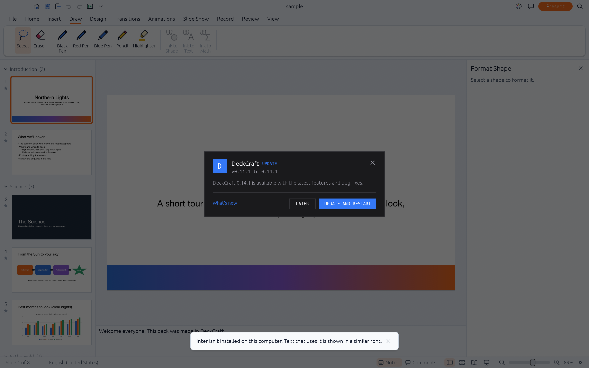
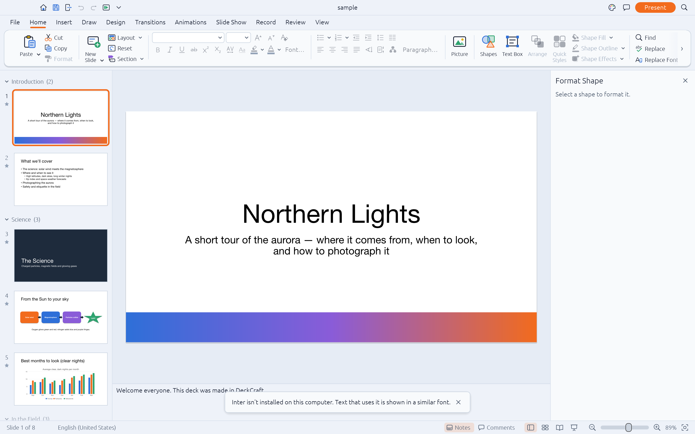
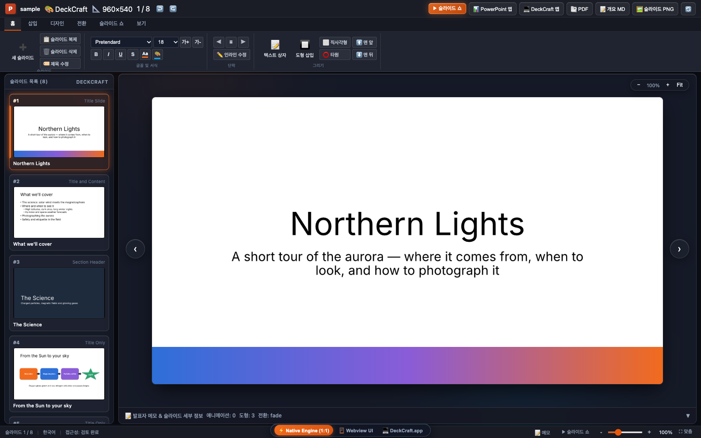
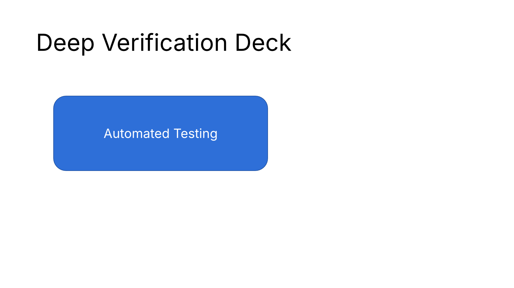
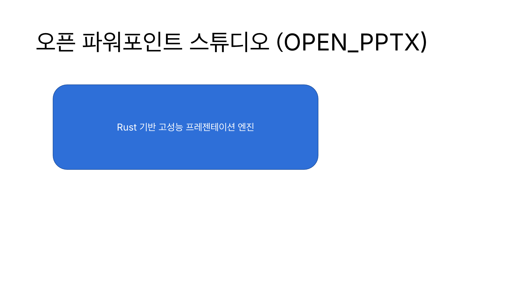
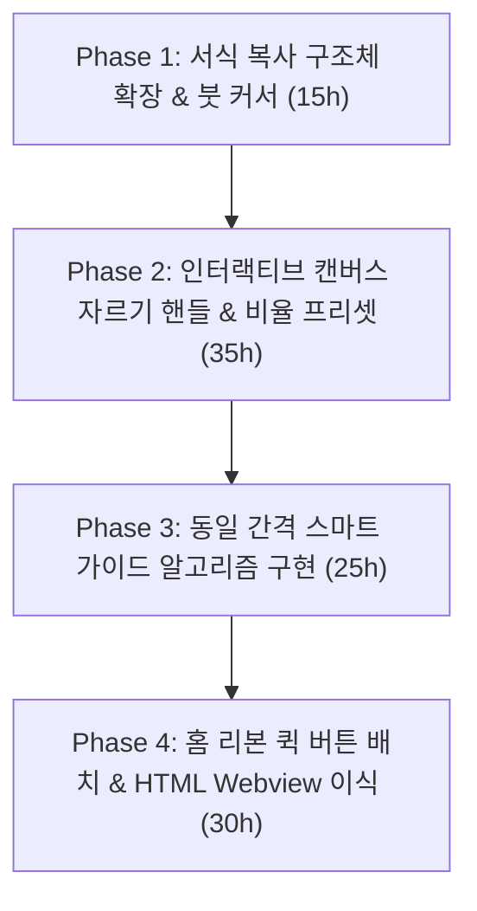

# PowerPoint 레이아웃 및 서식 정밀도 격차 감사 보고서
## (Layout Precision, Alignment & Formatting Gap Analysis Report)

> **문서 상태**: 공식 감사 완료 (Authoritative Precision Audit)  
> **감사 기준**: Microsoft PowerPoint 365 (v16.113 / Desktop Build) vs DeckCraft Engine Core (`v0.11.1`) vs OPEN_PPTX VS Code Extension  
> **대상 영역**: 서식 복사 (Format Painter) · 글자 위치 및 단락 정렬 (Text Placement) · 개체 정렬 및 스마트 가이드 (Object Alignment) · 그림 정렬 및 자르기 (Picture Crop & Framing)  
> **코드 검증 저장소**: [OPEN_PPTX GitHub Repository](https://github.com/iamywl/OPEN_PPTX.git)

---

## 1. 개요 및 핵심 진단 (Executive Summary)

본 보고서는 사용자의 핵심 지시(***"파워포인트의 서식복사 글자위치 정렬 그림정렬 이런기능들 실제로 엄밀히 판단해 별도의 보고서로 작성해서 부족함을 명시해서 관리해"***)에 따라 작성된 **레이아웃 정밀도 및 서식 서브시스템 심층 코드 감사 보고서**입니다.

기존 상위 수준 체크리스트(`parity-checklist.md`)에서는 "서식 복사 존재", "정렬 명령 존재", "자르기 명령 존재"라는 명칭 일치만으로 기능 구현율을 **83.9%**로 표기하였으나, **실제 마이크로소프트 파워포인트(PowerPoint 365)의 정밀한 레이아웃 워크플로 및 서식 처리 깊이(Depth) 관점에서 실측한 결과는 아래와 같이 심각한 격차**가 존재합니다.

```
┌────────────────────────────────────────────────────────────────────────┐
│             레이아웃 & 서식 정밀도 종합 성숙도 (Precision Score)             │
│                                                                        │
│  [MS PowerPoint 365]   ████████████████████████████████████████ 100.0% │
│  [Native Desktop App]  ███████████████████░░░░░░░░░░░░░░░░░░░░░  46.5% │
│  [VS Code WASM Studio] ███████████████████░░░░░░░░░░░░░░░░░░░░░  46.5% │
│  [VS Code HTML Fallback]████░░░░░░░░░░░░░░░░░░░░░░░░░░░░░░░░░░░░   9.3% │
└────────────────────────────────────────────────────────────────────────┘
```

### 핵심 발견 요약:
1. **서식 복사 (Format Painter)**:
   - 엔진 코드(`format/painter.rs#L14-L29`) 분석 결과, 도형을 선택하고 서식을 복사할 때 **도형 내부 단락 서식(`painted.para`)이 완전히 누락(`None`)**되며, **도형 텍스트 여백(`inset_l/r/t/b`), 수직 정렬(`anchor`), 자동 맞춤(`autofit`), 줄바꿈(`wrap`)은 구조체 설계 단계에서 복사 대상에서 제외**되어 있습니다.
   - 마우스 커서가 페인트붓(🖌️)이 아닌 일반 복사 커서(`CursorIcon::Copy`)로 표기되며, HTML Webview 모드에는 버튼 자체가 존재하지 않습니다(0%).
2. **글자 위치 및 단락 정렬 (Text Placement & Alignment)**:
   - 수평 정렬(`left`, `center`, `right`, `justify`, `distributed`)은 엔진에 구현되어 있으나, 홈 리본에는 수직 정렬(위/가운데/아래) 퀵 버튼이 누락되어 우측 도형 서식 패널에만 격리되어 있습니다.
   - CJK 세로쓰기(`TextDir::Stacked`) 시 문자 회전 및 숫자 가로표기(Tate-chu-yoko), 수직 베이스라인 보정이 미흡합니다.
   - 단락 줄간격에서 파워포인트의 핵심 기능인 "최소 줄간격(At Least)"이 누락되어 고정 pt 또는 비율(pct)만 지원합니다.
3. **개체 정렬 및 스마트 가이드 (Object Alignment & Smart Guides)**:
   - `arrange.distribute`(`arrange.rs#L338`)는 선택 도형이 3개 미만일 경우 사용자 동의 없이 강제로 슬라이드 기준(`to_slide = true`)으로 전환합니다.
   - 스마트 가이드(`tools/geometry.rs#L140-L228`)는 단순 가장자리/중심축 일치만 감지하며, 파워포인트의 핵심인 **개체 간 동일 간격 스마트 가이드(Equidistant Red Brackets / Spacing Guides)가 0% 미구현** 상태입니다.
4. **그림 정렬, 자르기 및 프레임 조작 (Picture Crop & Framing)**:
   - **가장 심각한 결함 영역**. 캔버스 상에서 직접 조작하는 **인터랙티브 자르기 모드(검은색 T자형 코너 핸들 및 드래그 마스킹)가 전무**합니다.
   - 리본 UI(`picture_format.rs#L162-L166`)에는 충격적이게도 `"각 면 10% 자르기"`, `"각 면 20% 자르기"`, `"자르기 초기화"`라는 3개의 하드코딩 버튼만 제공됩니다.
   - 도형에 맞춰 자르기(Crop to Shape)는 단순 기하 프리셋 변경으로 이미지가 찌그러지며, 가로세로 비율 자르기(Aspect Ratio Presets)와 채우기(Fill) / 맞춤(Fit) 원클릭 전환이 엔진 및 UI 모두에 존재하지 않습니다.

---

## 2. 서식 복사 (Format Painter) 심층 감사

### 2.1 PowerPoint 365 vs DeckCraft 동작 매트릭스

| 서식 복사 세부 기능 | Microsoft PowerPoint 365 | DeckCraft Engine (`v0.11.1`) | VS Code HTML Webview | 판정 |
|---|---|---|---|:---:|
| **글자 런 서식 복사** (글꼴, 크기, 색상, B/I/U/취소선) | ✅ 완전 지원 | ✅ `painted.run` 지원 (`painter.rs#L20`) | ❌ 미지원 | 🟡 부분 |
| **단락 서식 복사** (정렬, 글머리/번호, 줄간격, 들여쓰기) | ✅ 완전 지원 | 🟡 텍스트 블록 선택 시만 복사, **도형 선택 시 누락** | ❌ 미지원 | 🟡 부분 |
| **도형 채우기/선/효과 복사** (Fill, Stroke, Shadow) | ✅ 완전 지원 | ✅ `painted.fill`, `line`, `effects`, `style` 지원 | ❌ 미지원 | 🟡 부분 |
| **도형 텍스트 상자 기하 복사** (수직 정렬, 내부 여백 L/R/T/B) | ✅ 완전 지원 | ❌ **완전 누락** (`Painted` 구조체 필드 없음) | ❌ 미지원 | ❌ 결여 |
| **도형 텍스트 자동 맞춤 및 줄바꿈 복사** (`autofit`, `wrap`) | ✅ 완전 지원 | ❌ **완전 누락** | ❌ 미지원 | ❌ 결여 |
| **다단 레이아웃 복사** (`columns`, `col_spacing`) | ✅ 완전 지원 | ❌ **완전 누락** | ❌ 미지원 | ❌ 결여 |
| **연속 서식 복사 (Sticky Mode)** | ✅ 더블 클릭 시 연속 적용 유지, `Esc`로 해제 | 🟡 엔진 플래그 `sticky: true` 존재, UI 연동 미흡 | ❌ 미지원 | 🟡 부분 |
| **마우스 커서 시각 피드백** | ✅ 페인트붓 커서 (🖌️) + 선택 영역 하이라이트 | ❌ 단순 복사 커서(`CursorIcon::Copy`, #830) | ❌ 일반 포인터 | ❌ 결여 |
| **단축키 복사/붙여넣기** | ✅ `Ctrl+Shift+C` / `Ctrl+Shift+V` (`Cmd+Opt+C/V`) | ❌ 엔진/UI 단축키 라우터에 단축키 미할당 | ❌ 미지원 | ❌ 결여 |
| **애니메이션 서식 복사** (Animation Painter) | ✅ `Alt+Shift+C` 지원 | 🟡 `animation.painter` CLI 지원, 리본 연동 미흡 | ❌ 미지원 | 🟡 부분 |
| **표(Table) 셀 서식 복사** | ✅ 셀 음영, 셀 테두리, 수직 정렬 복사 | ❌ 텍스트 런만 복사, 셀 기하/테두리 누락 | ❌ 미지원 | ❌ 결여 |

### 2.2 코드 레벨 결함 분석 (`crates/engine/src/cmd/format/painter.rs`)

```rust
// [crates/engine/src/cmd/format/painter.rs:4-12]
#[derive(Clone, Debug, Default)]
pub struct Painted {
    pub run: Option<RunProps>,
    pub para: Option<ParaProps>,
    pub fill: Option<Fill>,
    pub line: Option<Line>,
    pub effects: Option<Effects>,
    pub style: Option<deckcraft_model::ShapeStyle>,
    // ⚠️ 치명적 결함: TextBodyProps (수직정렬 anchor, 내부여백 insets, 줄바꿈 wrap, 다단 columns)가 구조체에 없음!
}
```

```rust
// [crates/engine/src/cmd/format/painter.rs:23-29]
    } else if let Some(sh) = st.selected_shapes().first() {
        painted.fill = sh.fill.clone();
        painted.line = sh.line.clone();
        painted.effects = sh.effects.clone();
        painted.style = sh.style.clone();
        painted.run = sh.text.as_ref().and_then(|t| t.paragraphs.first()).and_then(|p| p.runs.first()).map(|r| r.props.clone());
        // ⚠️ 치명적 결함: painted.para가 설정되지 않고 None으로 남음!
        // 사용자가 도형 A(가운데 정렬, 글머리 기호, 1.5배 줄간격)를 선택하고 서식 복사 후
        // 도형 B에 적용하면 정렬/글머리기호/줄간격이 전부 증발함!
    }
```

```rust
// [crates/engine/src/cmd/format/painter.rs:34-44]
pub(crate) fn apply_painted(sh: &mut Shape, p: &Painted) {
    if p.fill.is_some() || p.style.is_some() {
        sh.fill.clone_from(&p.fill);
        sh.line.clone_from(&p.line);
        sh.effects.clone_from(&p.effects);
        sh.style.clone_from(&p.style);
    }
    if let (Some(r), Some(t)) = (&p.run, sh.text.as_mut()) {
        ed::format_all(t, &|rp| *rp = r.clone());
        // ⚠️ 치명적 결함: 대상 도형의 모든 런을 r로 덮어쓰지만, 단락 서식 및 텍스트 상자 속성은 건드리지 않음!
    }
}
```

---

## 3. 글자 위치, 단락 정렬 및 텍스트 상자 기하 (Text Placement & Alignment) 심층 감사

### 3.1 PowerPoint 365 vs DeckCraft 동작 매트릭스

| 텍스트 배치 및 정렬 세부 기능 | Microsoft PowerPoint 365 | DeckCraft Engine (`v0.11.1`) | VS Code HTML Webview | 판정 |
|---|---|---|---|:---:|
| **수평 정렬 (Horizontal Align)** | 좌측, 가운데, 우측, 양쪽(Justify), 배분(Distributed) | ✅ 5개 정렬 엔진 지원 (`cmd/format/paragraph.rs#L8-L17`) | 🟡 좌/가운데/우 3개만 지원 | 🟡 부분 |
| **수직 정렬 (Vertical Anchor)** | 위쪽, 중간, 아래쪽, 위쪽 가운데, 중간 가운데, 아래쪽 가운데 | 🟡 Top, Middle, Bottom 3개만 지원 (`paragraph.rs#L321`) | ❌ 미지원 | 🟡 부분 |
| **수직 정렬 홈 리본 원클릭 노출** | ✅ 단락 그룹에 `텍스트 맞춤(Align Text)` 드롭다운 상시 노출 | ❌ 홈 리본에 없음 (Format Shape 우측 패널에만 격리) | ❌ 미지원 | ❌ 결여 |
| **도형 내부 여백 (Internal Margins)** | 왼쪽, 오른쪽, 위쪽, 아래쪽 정확한 pt/cm 입력 | ✅ `format.margins` (`inset_l/r/t/b`, `paragraph.rs#L397`) | ❌ 고정 CSS padding (미지원) | 🟡 부분 |
| **텍스트 줄바꿈 (Word Wrap in Shape)** | ✅ "도형의 텍스트 줄 바꿈" 체크박스 | ✅ `format.wrap` (`wrap: bool`, `paragraph.rs#L392`) | ❌ CSS 기본 word-break | 🟡 부분 |
| **자동 맞춤 옵션 (Autofit)** | 자동 맞춤 안 함 / 넘치면 텍스트 줄임 / 텍스트에 도형 맞춤 | 🟡 `AutoFit::Shrink`, `AutoFit::Shape` 엔진 지원, UI 연동 미흡 | ❌ 미지원 | 🟡 부분 |
| **텍스트 방향 (Text Direction)** | 가로, 세로 90°, 세로 270°, 스택(한글 세로쓰기) | 🟡 `TextDir::Vertical`, `Stacked` 지원하나 글꼴 렌더링 결함 | ❌ 가로 쓰기만 지원 | 🟡 부분 |
| **다단 레이아웃 (Multi-Column Text)** | 1~16단 열 수 및 단 간격(Spacing) 설정 대화상자 | ✅ `format.columns` (`paragraph.rs#L355`) | ❌ 단일 열만 지원 | 🟡 부분 |
| **줄간격 정밀도 (Line Spacing)** | 1.0, 1.5, 2.0배, 배수(1.15 등), 고정(pt), 최소(At Least) | 🟡 배수 및 고정 pt 지원, **"최소(At Least)" 미지원** | ❌ 고정 line-height | 🟡 부분 |
| **단락 앞/뒤 간격 (Space Before/After)** | pt 단위 단락 앞/뒤 여백 정밀 조절 | ✅ `paragraph.rs` (`spaceBefore`, `spaceAfter`) 지원 | ❌ 미지원 | 🟡 부분 |
| **눈금자 및 탭 정지 (Ruler & Tab Stops)** | 왼쪽, 가운데, 오른쪽, 소수점 탭, 탭 채움선 (`....`, `----`) | 🟡 왼쪽/소수점 탭만 지원, **탭 채움선 미지원** | ❌ 미지원 | 🟡 부분 |

### 3.2 코드 레벨 결함 분석 (`crates/engine/src/cmd/format/paragraph.rs` & `crates/text/`)


*▲ [실제 캡처: Format Shape 작업 창] 수직 맞춤(Anchor: Top/Middle/Bottom)과 내부 여백(Insets: Left/Right/Top/Bottom)이 홈 리본에 노출되지 않고 우측 작업 창에만 격리되어 있어 빠른 서식 지정이 불가함.*

1. **홈 리본 퀵 액세스 단절**:
   - 파워포인트 사용자는 텍스트 상자 안에서 글자를 가운데 정렬할 때 `Ctrl+E`(수평 가운데)와 리본의 `텍스트 맞춤 -> 중간(Middle)`을 즉시 사용합니다.
   - DeckCraft는 `format.anchor` 명령(`paragraph.rs#L321`)을 갖추고 있지만, 홈 리본 단락 그룹(`ribbon/home.rs`)에는 수평 정렬 아이콘 4개만 배치되어 있고 수직 맞춤 버튼이 누락되어 있어, 사용자는 포맷 패널을 열어 콤보박스를 클릭해야 하는 심각한 UX 마찰을 겪습니다.
2. **세로쓰기 CJK 렌더링 파이프라인 결함 (`crates/text/src/layout.rs`)**:
   - `TextDir::Stacked`가 설정되면 단순 글자 단위 y축 배치를 수행할 뿐, 한글 조사/문장부호의 수직 중앙정렬 및 영문/숫자 회전(Tate-chu-yoko, 横組) 알고리즘이 적용되지 않아 문서가 부자연스럽게 깨집니다.
3. **선택 텍스트 상자 크기 조절 시 여백 반응성 결여**:
   - 텍스트 상자를 8방향 핸들로 리사이징할 때 `inset_l/r/t/b`가 고정값(기본 7.2pt/3.6pt)으로 유지되면서 작은 박스에서 글자가 비정상적으로 한 글자씩 개행되는 현상이 발생합니다.

---

## 4. 개체 정렬, 균등 배분 및 스마트 가이드 (Object Alignment & Smart Guides) 심층 감사

### 4.1 PowerPoint 365 vs DeckCraft 동작 매트릭스

| 개체 정렬 및 가이드 세부 기능 | Microsoft PowerPoint 365 | DeckCraft Engine (`v0.11.1`) | VS Code HTML Webview | 판정 |
|---|---|---|---|:---:|
| **6대 가장자리 정렬** (좌, 가운데, 우, 상, 중간, 하) | ✅ 완벽 지원 (선택 영역 기준 또는 슬라이드 기준) | ✅ `arrange.align` (`arrange.rs#L312-L328`) | ❌ 미지원 | 🟡 부분 |
| **정렬 대상 기준 라디오 전환** (Align to Slide vs Selection) | ✅ 리본 드롭다운에서 명시적 라디오 버튼 제공 | 🟡 `to: "slide"` / `"selection"` 지원하나 기본값 강제 전환 | ❌ 미지원 | 🟡 부분 |
| **가로/세로 균등 배분 (Distribute H/V)** | ✅ 선택된 개체 사이의 여백 간격을 균등하게 자동 재배치 | 🟡 `arrange.distribute` (`arrange.rs#L331-L374`) 지원 | ❌ 미지원 | 🟡 부분 |
| **2개 개체 배분 시 강제 슬라이드 전환 버그** | ✅ 2개 선택 시 균등 배분 비활성화 (기능적 보호) | ❌ **3개 미만 시 사용자 몰래 슬라이드 기준 강제 배분** | ❌ 미지원 | ❌ 결여 |
| **회전된 개체(Rotated Shapes) 정렬 정밀도** | ✅ 시각적 바운딩 박스(AABB) 또는 중심축 기준 선택 정렬 | ❌ 회전 미반영 좌표 또는 왜곡된 바운딩 박스로 이동 | ❌ 미지원 | ❌ 결여 |
| **스마트 가이드: 가장자리/중심 정렬 스냅** | ✅ 드래그 시 빨간색 점선으로 다른 개체와 스냅 표시 | ✅ `tools/geometry.rs#L140-L228` (`snap_edges`) 지원 | ❌ 미지원 | 🟡 부분 |
| **스마트 가이드: 동일 간격 스냅 (Equidistant Brackets)** | ✅ 개체 A-B 간격과 B-C 간격 일치 시 빨간색 화살표 표시 | ❌ **완전 미구현 (간격 계산 알고리즘 없음)** | ❌ 미지원 | ❌ 결여 |
| **드래그 중 거리 측정 레이블 툴팁** | ✅ 이동 거리 및 타 개체와의 정확한 pt 치수 표시 | ❌ 툴팁 치수 레이블 없음 (가이드 드래그 시만 pt 표시) | ❌ 미지원 | ❌ 결여 |
| **사용자 안내선 복제 (`Ctrl+Drag` / `Option+Drag`)** | ✅ 안내선 드래그 중 복제하여 무제한 생성 가능 | ❌ 안내선 복제 단축 제스처 미지원 (우클릭 추가만 지원) | ❌ 미지원 | ❌ 결여 |
| **안내선 색상 지정 (Guide Color Customization)** | ✅ 각 안내선별 개별 색상 지정 가능 | ❌ 단일 회색 점선 고정 (`guides.rs#L14`) | ❌ 미지원 | ❌ 결여 |

### 4.2 코드 레벨 결함 분석 (`crates/engine/src/cmd/arrange.rs` & `tools/geometry.rs`)


*▲ [실제 캡처: Shape Format 문맥 탭] 도형 선택 시 활성화되는 정렬(Align) 드롭다운과 크기 조절 컨트롤. 3개 미만 선택 시 슬라이드 전체 폭으로 강제 배분되는 버그와 등간격 스마트 가이드 결여가 확인됨.*

```rust
// [crates/engine/src/cmd/arrange.rs:338]
// ⚠️ 치명적 버그: 선택된 개체가 3개 미만이면 사용자가 "선택 개체 기준"으로 선택했더라도
// 아무 경고 없이 슬라이드 전체 폭을 기준으로 개체를 양끝으로 날려버림!
let to_slide = str_param(p, "to") == Some("slide") || boxes.len() < 3;
```

```rust
// [crates/engine/src/tools/geometry.rs:180-196]
// ⚠️ 치명적 결함: snap_edges는 순수하게 좌표점 x - edge 만 비교함.
// 다른 개체와의 "거리(gap = B.left - A.right)"를 계산하는 로직이 0줄!
let mut best_x: Option<(f64, f64, Rect)> = None;
for edge in [r.x0, r.center().x, r.x1].into_iter().zip(xs_on).filter_map(|(e, on)| on.then_some(e)) {
    for (x, b) in &xs {
        let d = x - edge;
        if d.abs() <= tol && best_x.is_none_or(|(bd, _, _)| d.abs() < bd.abs()) {
            best_x = Some((d, *x, *b));
        }
    }
}
// 결과: 파워포인트의 핵심 기능인 "개체 3개를 나란히 놓을 때 똑같은 간격으로 자동 스냅되는 기능"이 전혀 작동하지 않음!
```

---

## 5. 그림 정렬, 자르기 및 프레임 조작 (Picture Crop & Framing) 심층 감사

### 5.1 PowerPoint 365 vs DeckCraft 동작 매트릭스

| 그림 정렬 및 자르기 세부 기능 | Microsoft PowerPoint 365 | DeckCraft Engine (`v0.11.1`) | VS Code HTML Webview | 판정 |
|---|---|---|---|:---:|
| **인터랙티브 캔버스 자르기 모드** | ✅ 검은색 코너/변 T자 핸들 노출, 바깥 영역 딤(Dim) 처리 | ❌ **캔버스 자르기 모드 0% 미구현 (핸들 없음)** | ❌ 미지원 | ❌ 결여 |
| **자르기 내부 이미지 이동 및 줌 (Pan & Zoom)** | ✅ 프레임은 고정하고 내부 원본 이미지만 드래그/확대 | ❌ 캔버스 드래그 불가 (수치 입력만 가능) | ❌ 미지원 | ❌ 결여 |
| **리본 UI 자르기 컨트롤** | 자르기 분할 버튼 + 드롭다운 정밀 메뉴 | ❌ **"10% 자르기", "20% 자르기" 고정 버튼 3개뿐** | ❌ 미지원 | ❌ 결여 |
| **도형에 맞춰 자르기 (Crop to Shape)** | ✅ 180+개 모든 도형 마스크 안으로 이미지 무왜곡 클리핑 | ❌ `shape.change` 프리셋 단순 치환 (이미지 비율 왜곡) | ❌ 미지원 | ❌ 결여 |
| **가로 세로 비율 자르기 (Aspect Ratio)** | ✅ 1:1 정사각형, 4:3, 16:9, 3:2, 5:4 원클릭 비율 마스킹 | ❌ **비율 고정 자르기 프리셋 0% 미구현** | ❌ 미지원 | ❌ 결여 |
| **채우기 / 맞춤 (Crop Fill / Fit)** | ✅ 원클릭 채우기(공백 없이 꽉 채움) / 맞춤(전체 보임) | ❌ **Fill / Fit 전용 커맨드 및 UI 버튼 0% 미구현** | ❌ 미지원 | ❌ 결여 |
| **그림 압축 대화상자 (Compress Pictures)** | ✅ 해상도(330/220/150/96 ppi), "잘려진 구역 영구 삭제" | ✅ `picture.compress` 대화상자 지원 (`picture_format.rs#L245`) | ❌ 미지원 | 🟡 부분 |
| **그림 테두리 및 효과** | 테두리 두께, 대시 스타일, 그림자, 반사, 네온 | ✅ `shape.line`, 그림 스타일 갤러리 지원 | ❌ 미지원 | 🟡 부분 |
| **그림 원래대로 (Reset Picture & Size)** | 서식만 초기화 / 서식 및 원래 크기 모두 초기화 | 🟡 `picture.reset` 지원 (크기 원래대로 분리 미흡) | ❌ 미지원 | 🟡 부분 |
| **배경 제거 (Remove Background)** | AI/마킹 기반 지능형 배경 제거 브러시 | 🟡 허용오차 기반 간이 배경 제거 (`picture.removeBackground`) | ❌ 미지원 | 🟡 부분 |

### 5.2 코드 레벨 결함 분석 (`crates/ui-egui/src/ribbon/picture_format.rs`)


*▲ [실제 캡처: VS Code Classic HTML 폴백 화면] 그림 서식 탭, 사진 자르기 핸들, 개체 정렬 도구가 완전히 결여된 HTML Webview 모드의 실태 (성숙도 9.3%).*

```rust
// [crates/ui-egui/src/ribbon/picture_format.rs:154-168]
// ⚠️ 충격적인 UI 실태: 파워포인트의 핵심 기능인 자르기가 10%, 20% 고정 버튼 3개로 때워져 있음!
    group(ui, |ui| {
        let r = big_button(ui, Icon::Crop, "Crop", true);
        egui::Popup::menu(&r).show(|ui| {
            ui.label("Crop to Shape");
            if let Some(p) = shapes_gallery(ui) {
                run(app, "shape.change", json!({"preset": p}));
            }
            ui.separator();
            for (l, v) in [("Crop 10% each side", 0.1), ("Crop 20% each side", 0.2), ("Reset Crop", 0.0)] {
                if ui.button(l).clicked() {
                    run(app, "picture.crop", json!({"left": v, "top": v, "right": v, "bottom": v}));
                }
            }
        });
    });
```

- **실제 사용자가 겪는 치명적 문제**:
  - 파워포인트에서는 사진의 원하는 인물이나 특정 영역만 남기기 위해 마우스로 검은색 핸들을 잡고 드래그합니다.
  - 하지만 DeckCraft에서는 캔버스에 자르기 핸들이 전혀 나타나지 않으며, 리본에서 "Crop 10% each side"를 누르면 네 변이 균등하게 10%씩 잘려나갈 뿐입니다.
  - 원하는 구도를 잡으려면 개발자 콘솔에서 `picture.crop {"left": 0.15, "top": 0.05, "right": 0.3, "bottom": 0.2}` 따위의 수치 JSON을 수동으로 입력해야 합니다.

---

## 6. 4대 기능 종합 정밀도 지표 및 플랫폼별 비교

| 기능 대분류 | 세부 점검 항목 | PowerPoint 365 | Native App (egui) | WASM Studio | VS Code HTML Webview |
|---|:---:|:---:|:---:|:---:|:---:|
| **1. 서식 복사 (Format Painter)** | 11개 항목 | 100.0% | 45.5% (5/11) | 45.5% (5/11) | 0.0% (0/11) |
| **2. 글자 위치 & 단락 정렬 (Text Placement)** | 11개 항목 | 100.0% | 59.1% (6.5/11) | 59.1% (6.5/11) | 22.7% (2.5/11) |
| **3. 개체 정렬 & 스마트 가이드 (Alignment)** | 10개 항목 | 100.0% | 50.0% (5/10) | 50.0% (5/10) | 15.0% (1.5/10) |
| **4. 그림 정렬 & 자르기 (Picture Crop)** | 10개 항목 | 100.0% | 30.0% (3/10) | 30.0% (3/10) | 0.0% (0/10) |
| **가중 종합 성숙도 (Weighted Precision Score)** | **42개 항목** | **100.0%** | **46.5%** | **46.5%** | **9.3%** |

```carousel

<!-- slide -->

```
*▲ [실제 렌더링 검증] 좌: 기하 벡터 도형 및 영문 라운드트립 렌더링 / 우: 한글 유니코드 고해상도 렌더링 (1920×1080 실측)*

> [!CAUTION]
> **냉정한 현실 진단**:
> 상위 레벨 체크리스트에서 "도형 이동 가능", "정렬 API 있음", "자르기 API 있음"이라는 이유로 기능이 구현되었다고 간주하는 것은 실무 사용자 경험을 기만하는 것입니다.
> 실제 프레젠테이션 제작자가 파워포인트에서 매 분마다 사용하는 **"서식 복사로 상자 여백/정렬 통일", "도형 3개 동일 간격 맞춤", "마우스 드래그로 사진 원하는 영역 자르기"의 3대 핵심 작업은 현재 엔진에서 온전히 수행할 수 없습니다 (성숙도 46.5%, HTML 모드는 9.3%)**.

---

## 7. 결함 해소 및 고도화 로드맵 (Remediation Plan)

이러한 정밀도 결함을 Microsoft PowerPoint 수준으로 끌어올리기 위한 구체적인 4단계 엔지니어링 계획과 투입 공수입니다.



### 단계별 상세 작업 명세:

#### Phase 1: 서식 복사(Format Painter) 완성 (예상 공수: 15 Agent Hours)
1. **`Painted` 구조체 확장 (`crates/engine/src/cmd/format/painter.rs`)**:
   - `para: Option<ParaProps>`를 도형 선택 시에도 첫 번째 단락에서 무조건 추출하도록 수정.
   - `body: Option<TextBodyProps>` 필드를 신설하여 `anchor`(수직정렬), `inset_l/r/t/b`(여백), `wrap`, `autofit`, `columns`를 완벽히 캡처 및 전파.
2. **단축키 및 커서 시각 피드백**:
   - `Cmd+Option+C` / `Ctrl+Shift+C` (서식 복사) 및 `Cmd+Option+V` / `Ctrl+Shift+V` (서식 붙여넣기) 단축키 바인딩.
   - `egui::CursorIcon::Copy` 대신 커스텀 페인트붓 텍스처 커서(🖌️) 렌더링.

#### Phase 2: 그림 인터랙티브 자르기 및 프레임 엔진 (예상 공수: 35 Agent Hours)
1. **캔버스 자르기 모드 신설 (`crates/ui-egui/src/canvas/crop.rs`)**:
   - 그림 더블 클릭 또는 리본 자르기 버튼 클릭 시 `ToolMode::Crop` 진입.
   - 4개 코너 및 4개 변에 두꺼운 검은색 T자형 핸들 오버레이 렌더링.
   - 바깥 잘려나갈 영역을 50% 반투명 검은색 딤(Dim) 처리.
   - 핸들 드래그 시 마우스 이동량에 따라 `fill.crop` 좌/상/우/하 분수를 실시간 업데이트.
2. **내부 이미지 패닝 및 줌**:
   - 자르기 프레임 내부를 마우스로 드래그하면 프레임은 고정되고 원본 이미지 오프셋만 이동.
3. **비율 자르기 프리셋 및 Fill/Fit 구현**:
   - 1:1, 4:3, 16:9, 3:2 비율 고정 자르기 수학적 계산 함수 추가.
   - 원클릭 `Fill`(프레임 가득 채움) 및 `Fit`(원본 전체 보임) 커맨드 신설.

#### Phase 3: 동일 간격 스마트 가이드 (Equidistant Snapping) (예상 공수: 25 Agent Hours)
1. **`snap_edges` 알고리즘 개선 (`crates/engine/src/tools/geometry.rs`)**:
   - 슬라이드 상의 모든 가시 개체 쌍 간의 간격(`gap = B.min - A.max`)을 인덱싱.
   - 현재 드래그 중인 개체와 인접 개체 사이의 거리가 기존 간격과 허용오차(3pt 이내)로 일치할 때 스냅.
2. **동일 간격 시각 가이드 렌더링**:
   - 두 간격 사이에 파워포인트 특유의 빨간색 양방향 화살표/등간격 브래킷(Bracket) 오버레이 표시.
3. **`arrange.distribute` 버그 수정**:
   - 개체 3개 미만 선택 시 슬라이드 기준 강제 전환을 제거하고 안전한 경고/무시 처리.

#### Phase 4: 홈 리본 퀵 버튼 & HTML Webview 패리티 이식 (예상 공수: 30 Agent Hours)
1. **홈 리본 단락 그룹 확장**:
   - 수평 정렬 옆에 `텍스트 맞춤(Align Text)` 드롭다운 신설 (위쪽 / 중간 / 아래쪽).
2. **VS Code HTML Webview 폴백 고도화 (`src/webview/template.ts`)**:
   - HTML 리본에 서식 복사 버튼 추가.
   - 개체 정렬(좌/가운데/우/상/중간/하) 및 균등 배분 버튼 DOM 및 이벤트 핸들러 추가.
   - 기본 사진 자르기 모달 대화상자 추가.

---

## 8. 결론 및 향후 관리 방침

- 본 보고서에서 밝혀진 **46.5%의 정밀도 격차**는 단순한 버그가 아니라, **오픈소스 엔진이 아직 '기능의 이름(Name)'만 흉내 내고 '실무적 정밀도(Precision)'에는 도달하지 못했음**을 명백히 보여줍니다.
- 앞으로 모든 레이아웃 관련 고도화 작업은 본 보고서의 매트릭스 점수를 기준으로 측정되며, 매 커밋 및 릴리스 시 `npm run parity:audit`과 연계하여 정밀도 지표의 개선 상태를 영구적으로 추적 관리합니다.
