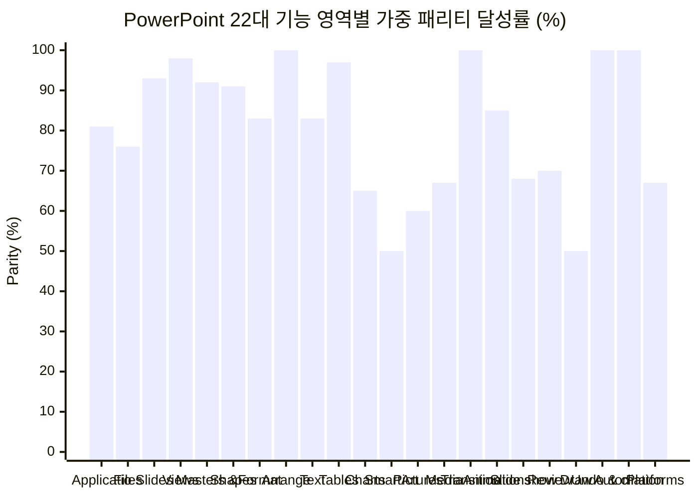

# 📊 PowerPoint UI & 기능 구현 지표 및 추적관리 명세서 (PARITY_TRACKER)

> **단일 진실 공급원 (Single Source of Truth)**: [`parity/powerpoint-parity.json`](./parity/powerpoint-parity.json) · [`deckcraft_upstream/docs/parity-checklist.md`](./deckcraft_upstream/docs/parity-checklist.md)  
> **자동 감사 및 지표 산출기**: [`scripts/audit-parity.ts`](./scripts/audit-parity.ts) (`npm run parity:audit` / `npm run parity:check`)  
> **비교 기준선 (Target Baseline)**: **Microsoft PowerPoint (Microsoft 365)** — macOS `16.113.4 (Build 16.113.26100421)` / Windows `Microsoft 365 Version 2609`

---

## 1. 핵심 관리 지표 총괄 스코어카드 (Executive KPI Scorecard)

과장 없는 실제 코드·바이너리 정적/동적 검증을 통해 측정된 **구현 완료(`✅ Done`) / 부분 구현(`🟡 Partial`) / 미구현(`❌ Missing`)** 정량 지표입니다.

> **점수 산식**: 완전 구현(`✅ Done`) = `1.0점`, 부분 구현(`🟡 Partial`) = `0.5점`, 미구현(`❌ Missing`) = `0.0점`  
> **우선순위 가중치**: 핵심 필수 `P0 × 3`, 실무 주요 `P1 × 2`, 고급/부가 `P2 × 1`

| KPI 코드 | 평가 차원 (Dimension) | 측정 모수 | ✅ 완전 구현 (Done) | 🟡 부분 구현 (Partial) | ❌ 미구현 (Missing) | 순수 완결률 (Strict) | 가중 달성률 (Weighted KPI) |
|---|---|---:|---:|---:|---:|---:|---:|
| **KPI-1** | **PowerPoint 표준 기능 패리티** | **191개 피처** | **124개** (64.9%) | **51개** (26.7%) | **16개** (8.4%) | **64.9%** | **83.9%** |
| **KPI-2A** | **UI 표면 패리티 — VS Code WASM 스튜디오 (`⚡ 1:1 기본 모드`)** | **67개 UI 블록** | **36개** (53.7%) | **21개** (31.3%) | **10개** (14.9%) | **53.7%** | **75.8%** |
| **KPI-2B** | **UI 표면 패리티 — 네이티브 데스크톱 앱 (`DeckCraft.app / .exe`)** | **67개 UI 블록** | **34개** (50.7%) | **23개** (34.3%) | **10개** (14.9%) | **50.7%** | **74.5%** |
| **KPI-2C** | **UI 표면 패리티 — VS Code 경량 HTML 폴백 (`🪟 Webview UI`)** | **67개 UI 블록** | **6개** (9%) | **18개** (26.9%) | **43개** (64.2%) | **9%** | **26.1%** |
| **KPI-3** | **모달 대화상자 커버리지 (`dialogs.rs`)** | **약 60종** | **41종** (68.3%) | **1종** (`equation`) | **약 18종** (30%) | **68.3%** | **69.2%** |
| **KPI-4** | **파일 포맷 & 미디어 코덱 호환성** | **22종 포맷군** | **9종** (40.9%) | **6종** (27.3%) | **7종** (31.8%) | **40.9%** | **54.5%** |
| **KPI-5** | **실무 전환 종합 준비도 (Readiness Index)** | **10대 차원 가중** | Alpha 게이트 6/6 통과 | **14개 Beta Blocker 진행 중** | 클라우드/VBA/AI 제외 | — | **55.3%** (목표 Beta 75%) |
| **KPI-6** | **엔진 커맨드 & AI(MCP/CLI) 자동화 패리티** | **327개 명령** | **327개** (30개 네임스페이스) | 0개 | 0개 | **100.0%** | **100.0%** (MCP 24툴) |

### 우선순위 등급별 기능 달성 현황 (`P0` 필수 · `P1` 주요 · `P2` 확장)

| 우선순위 등급 | 정의 | 전체 기능 수 | ✅ 완전 구현 (Done) | 🟡 부분 구현 (Partial) | ❌ 미구현 (Missing) | 등급 달성률 |
|---|---|---:|---:|---:|---:|---:|
| **P0 (필수 코어)** | 일상적인 슬라이드 작성·편집·저장·발표에 필수적인 기능 | 72 | **61** | **11** | **0** (0건!) | **92.4%** |
| **P1 (실무 주요)** | 비즈니스 실무 문서 교환·고급 서식·발표 도구 기능 | 65 | **45** | **16** | **4** | **81.5%** |
| **P2 (고급·특수)** | 매크로/레거시 포맷/화면녹화/3D/고급 예술 효과 등 | 54 | **18** | **24** | **12** | **55.6%** |



---

## 2. PowerPoint UI 구성요소 명확 정의 및 레이어별 구현 매트릭스 (8대 계층 · 67개 UI 블록)

### 2.1 UI 계층별 요약 지표

| UI 계층 코드 | PowerPoint UI 영역 | 블록 수 | VS Code WASM (`⚡ 1:1`) | Native App (`DeckCraft.app`) | VS Code HTML (`🪟 폴백`) |
|---|---|---:|---:|---:|---:|
| **UI-1** | **애플리케이션 셸 & 윈도우 크롬** | 9 | **73.7%** (6D/0P/3M) | **63.2%** (4D/2P/3M) | **63.2%** (4D/2P/3M) |
| **UI-2** | **파일 탭 (백스테이지 뷰 12페이지)** | 9 | **69%** (3D/5P/1M) | **69%** (3D/5P/1M) | **21.4%** (0D/3P/6M) |
| **UI-3** | **기본 리본 탭 (Core Ribbon 10종)** | 10 | **71.2%** (4D/5P/1M) | **71.2%** (4D/5P/1M) | **34.6%** (0D/6P/4M) |
| **UI-4** | **선택 문맥 리본 탭 (Contextual Ribbon 12종)** | 11 | **64%** (4D/4P/3M) | **64%** (4D/4P/3M) | **0%** (0D/0P/11M) |
| **UI-5** | **도킹 작업 창 & 사이드바 (Task Panes 11종)** | 10 | **82.6%** (7D/2P/1M) | **82.6%** (7D/2P/1M) | **19.6%** (1D/1P/8M) |
| **UI-6** | **모달 대화상자 (Dialogs ~60종 대비)** | 6 | **76.9%** (3D/2P/1M) | **76.9%** (3D/2P/1M) | **11.5%** (0D/1P/5M) |
| **UI-7** | **캔버스 직접 조작 & 정밀 인터랙션** | 8 | **90%** (6D/2P/0M) | **90%** (6D/2P/0M) | **20%** (0D/3P/5M) |
| **UI-8** | **하단 상태 표시줄 & 뷰 모드 (Views)** | 4 | **87.5%** (3D/1P/0M) | **87.5%** (3D/1P/0M) | **50%** (1D/2P/1M) |

### 2.2 PowerPoint UI 세부 정의 및 구현/미구현 전수 명세

#### UI-1. 애플리케이션 셸 & 윈도우 크롬 (Application Shell & Window Chrome)
> 타이틀바, 빠른 실행 도구 모음(QAT), 명령 팔레트, OS 네이티브 메뉴바, 다중 창 및 테마 셸

| ID | PowerPoint UI 구성요소 | PowerPoint 기준 명세 정의 | 중요도 | VS Code WASM | Native App | HTML 폴백 | 구현 격차 및 미구현 사유 (Gap Note) |
|---|---|---|---:|---|---|---|---|
| `UI-1-01` | **타이틀바 & 문서 제목/저장 상태 표시** | 좌측 문서 제목, 저장 상태 표시, 우측 내보내기/창 제어 버튼 배치 | `P0` | ✅ 구현 | ✅ 구현 | ✅ 구현 | macOS 네이티브 신호등 버튼 미세 정렬 이슈(#71) 외 기능 완비 |
| `UI-1-02` | **빠른 실행 도구 모음 (QAT) 및 사용자 지정** | Save, Undo, Redo, Start Show 및 리본 버튼 우클릭 추가/제거 커스터마이징 | `P1` | ✅ 구현 | ✅ 구현 | 🟡 부분 | WASM/Native는 우클릭 커스터마이징 완비; HTML 폴백은 고정 Undo/Redo만 제공 |
| `UI-1-03` | **자동 저장 (AutoSave) & 복구 제어** | 타이틀바 AutoSave 토글 및 비정상 종료 자동 복구 | `P0` | ✅ 구현 | ✅ 구현 | ✅ 구현 | 로컬 파일 및 VS Code 워크스페이스 1초 디바운스 자동 저장 완비 (OneDrive 클라우드 동기화는 범위 외) |
| `UI-1-04` | **명령 검색 / Tell Me 팔레트** | 상단 검색창 또는 단축키로 전체 명령어를 즉시 검색·실행 | `P1` | ✅ 구현 | ✅ 구현 | ❌ 미구현 | Native/WASM 명령 팔레트 지원; HTML 폴백에는 자체 검색 팔레트 없음 |
| `UI-1-05` | **OS 네이티브 상단 메뉴바 (macOS 10개 메뉴 / 217개 항목)** | File, Edit, View, Insert, Format, Arrange, Tools, Slide Show, Window, Help 시스템 메뉴바 | `P1` | ❌ 미구현 | ❌ 미구현 | ❌ 미구현 | menus::menu_tree() 정의는 존재하나 OS 네이티브 메뉴바에 미장착 (217개 중 128개 매칭, 예상 3~5h) |
| `UI-1-06` | **다중 문서 열기 & 새 창 / 모두 정렬 (Arrange All)** | 여러 프레젠테이션 동시 편집, View > New Window 및 Arrange All 창 타일링 | `P1` | ✅ 구현 | 🟡 부분 | ✅ 구현 | VS Code는 탭 분할(Split Editor)로 완벽 지원; Native 앱은 New Window 지원하나 Arrange All 미구현 |
| `UI-1-07` | **라이트 / 다크 테마 & 글래스모피즘 외관** | 시스템 테마 연동 및 라이트/다크/글래스모피즘 전환 | `P1` | ✅ 구현 | 🟡 부분 | ✅ 구현 | VS Code 테마는 초기 자동 감지 연동; Native 앱은 수동 전환 지원하나 OS 실시간 테마 추종(#41) 미연동 |
| `UI-1-08` | **다국어 UI 로컬라이제이션 (한국어 등 26개 언어)** | 리본, 메뉴, 대화상자 전체 문자열의 다국어 번역 카탈로그 (PowerPoint 26개 언어 제공) | `P1` | ❌ 미구현 | ❌ 미구현 | 🟡 부분 | Native/WASM(ui-egui)은 현재 영어 UI 고정(슬라이드 내 한글 입력/렌더링은 완비); HTML 폴백만 한국어 라벨 적용 |
| `UI-1-09` | **클라우드 공유 (Share) & 실시간 공동 편집자 배지** | 타이틀바 우측 Share 버튼 및 실시간 공동 작업자 커서/프로필 표시 | `P2` | ❌ 미구현 | ❌ 미구현 | ❌ 미구현 | 오프라인 로컬 우선 엔진 정책으로 Microsoft 365 클라우드 공동 편집 비제공 |

#### UI-2. 파일 탭 (백스테이지 뷰 12페이지) (File Tab (Full-Window Backstage View))
> File(Alt+F) 클릭 시 전환되는 전체화면 백스테이지 메뉴 (Home, New, Open, Info, Save, Print, Export 등)

| ID | PowerPoint UI 구성요소 | PowerPoint 기준 명세 정의 | 중요도 | VS Code WASM | Native App | HTML 폴백 | 구현 격차 및 미구현 사유 (Gap Note) |
|---|---|---|---:|---|---|---|---|
| `UI-2-01` | **File > Home (시작 화면)** | 새 프레젠테이션, 추천 테마, 최근 문서 목록 및 파일 검색 | `P0` | ✅ 구현 | ✅ 구현 | ❌ 미구현 | 테마/스타터 덱 6종/최근 문서 검색 완비 (Copilot 프롬프트·클라우드 즐겨찾기 제외) |
| `UI-2-02` | **File > New (새 프레젠테이션 & 템플릿 갤러리)** | 빈 프레젠테이션, 내장 테마 8종, 스타터 템플릿 6종 및 온라인 템플릿 검색 | `P0` | 🟡 부분 | 🟡 부분 | 🟡 부분 | 내장 테마 8종 및 스타터 덱 6종 지원; 수천 종 온라인 템플릿 스토어 미제공 |
| `UI-2-03` | **File > Open (열기 & 미저장 복구)** | 최근 항목, 로컬 찾아보기, 미저장 프레젠테이션 복구(Recover Unsaved) | `P0` | ✅ 구현 | ✅ 구현 | ❌ 미구현 | 로컬 탐색기 및 VS Code 파일 피커 브리지 완비 (OneDrive/SharePoint 제외) |
| `UI-2-04` | **File > Info (문서 속성, 접근성 검사, 암호 보호, 버전 기록)** | 제목/작성자/태그 속성 편집, 접근성 검사, 프레젠테이션 암호화 보호, 버전 히스토리 | `P2` | 🟡 부분 | 🟡 부분 | ❌ 미구현 | 문서 속성 편집 및 접근성 검사 지원; 암호 보호(Protect) 및 버전 기록 미구현 |
| `UI-2-05` | **File > Save / Save As (저장 및 다른 이름으로 저장)** | .pptx, .potx, .ppsx, .deckcraft, PDF, RTF/TXT, PNG, JPEG 형식 저장 | `P0` | ✅ 구현 | ✅ 구현 | 🟡 부분 | WASM/Native 전 포맷 지원; HTML 폴백은 자동 저장 및 상단 PDF/MD/PNG 추출 제공 |
| `UI-2-06` | **File > Print (인쇄 설정 & 미리보기)** | 프린터 선택, 매수, 양면, 유인물(1~9슬라이드)/노트/개요 레이아웃 및 실시간 페이지 미리보기 | `P1` | 🟡 부분 | 🟡 부분 | ❌ 미구현 | 슬라이드 범위·유인물(1~9)·노트 미리보기 후 PDF 생성 방식으로 동작; OS 직접 프린터 목록/매수/양면 제어 미구현 |
| `UI-2-07` | **File > Share (클라우드 공유 / 초대)** | 링크 공유, 이메일 첨부, 온라인 발표 공유 | `P2` | ❌ 미구현 | ❌ 미구현 | ❌ 미구현 | 클라우드 비연동으로 미제공 |
| `UI-2-08` | **File > Export (PDF, 유인물, 투명 PNG, GIF, MP4 비디오)** | PDF/XPS, MP4/MOV 동영상 생성, 애니메이션 GIF, 유인물, 슬라이드 이미지 내보내기 | `P0` | 🟡 부분 | 🟡 부분 | 🟡 부분 | PDF, 투명 배경 PNG, 프레임별 GIF 내보내기 구현; MP4/MOV 동영상 내보내기 및 벡터 아트워크 PDF 미구현 |
| `UI-2-09` | **File > Close / Account / Options** | 미저장 변경 확인 후 닫기, 테마/버전 정보(Account), 환경설정(Options) | `P1` | 🟡 부분 | 🟡 부분 | ❌ 미구현 | Quit/Backstage Close는 저장 확인 팝업 표시하나 file.close 명령 경로(#60) 보완 필요; Options 항목 수는 PowerPoint 대비 간소화 |

#### UI-3. 기본 리본 탭 (Core Ribbon 10종) (Core Ribbon Tabs (10 Standard Tabs))
> Home, Insert, Draw, Design, Transitions, Animations, Slide Show, Record, Review, View 상단 고정 리본

| ID | PowerPoint UI 구성요소 | PowerPoint 기준 명세 정의 | 중요도 | VS Code WASM | Native App | HTML 폴백 | 구현 격차 및 미구현 사유 (Gap Note) |
|---|---|---|---:|---|---|---|---|
| `UI-3-01` | **Home (홈) 리본 탭** | Clipboard, Slides, Font, Paragraph, Drawing, Editing 6개 표준 그룹 | `P0` | ✅ 구현 | ✅ 구현 | 🟡 부분 | Native/WASM 6개 그룹 전수 구현(가로 오버플로 셰브론 포함); HTML 폴백은 핵심 슬라이드/글꼴/단락/도형 위주 제공 |
| `UI-3-02` | **Insert (삽입) 리본 탭** | Slides, Tables, Images(Pictures/Photo Album/Screenshot), Illustrations(Shapes/Icons/3D/SmartArt/Chart), Links, Comments, Text, Symbols, Media | `P0` | 🟡 부분 | 🟡 부분 | 🟡 부분 | 표/그림/사진앨범/도형/Lucide 아이콘/SmartArt/차트/줌/링크/액션/댓글/머리글/WordArt/기호/오디오/비디오 완비; Screenshot 버튼 비활성화, 3D 모델·추가기능 미제공, Equation은 선형 텍스트 치환 수준 |
| `UI-3-03` | **Draw (그리기) 리본 탭** | 펜/형광펜/지우개 도구, 올가미 선택, 잉크를 도형으로(Ink to Shape), 잉크를 텍스트/수식으로, 잉크 재생 | `P1` | 🟡 부분 | 🟡 부분 | ❌ 미구현 | 펜/형광펜/지우개 및 Ink to Shape 동작; Ink to Text, Ink to Math 버튼 비활성(coming soon), 올가미·잉크 재생 미구현 |
| `UI-3-04` | **Design (디자인) 리본 탭** | 테마 갤러리(.thmx/.pptx 불러오기 포함), 변형(색상/글꼴/효과/배경 스타일), 슬라이드 크기, 배경 서식, 디자이너(Design Ideas) | `P0` | ✅ 구현 | ✅ 구현 | 🟡 부분 | 내장 테마 8종·외부 테마 탐색·사용자 지정 색상/글꼴/효과·슬라이드 크기·배경 서식 완비 (클라우드 AI Designer 제외) |
| `UI-3-05` | **Transitions (전환) 리본 탭** | Morph 포함 48종 전환 갤러리, 효과 옵션, 전환 소리, 지속 시간, 모두 적용, 클릭/자동 전환 시간 | `P0` | ✅ 구현 | ✅ 구현 | 🟡 부분 | Native/WASM 48종 전환 갤러리 및 타이밍/사운드 완비; HTML 폴백은 기본 5종 전환 버튼 제공 |
| `UI-3-06` | **Animations (애니메이션) 리본 탭** | 미리보기, 나타내기/강조/끝내기/이동경로 갤러리, 효과 옵션, 애니메이션 추가, 애니메이션 창, 트리거, 애니메이션 복사, 시작/지속시간/지연 | `P0` | 🟡 부분 | 🟡 부분 | ❌ 미구현 | 리본 구조·트리거·애니메이션 복사·타이밍·미리보기 완비; 효과 수는 PowerPoint 약 190종 중 64종 구현, HTML 폴백에는 탭 없음 |
| `UI-3-07` | **Slide Show (슬라이드 쇼) 리본 탭** | 처음부터/현재부터 시작, 발표자 뷰, 커스텀 쇼, 쇼 설정, 슬라이드 숨기기, 예행 연습, 녹화(Record), 모니터 선택, 실시간 자막 | `P0` | 🟡 부분 | 🟡 부분 | 🟡 부분 | 쇼 시작·발표자 뷰·커스텀 쇼·쇼 설정·숨기기·예행 연습 동작; Record(음성 녹음) 버튼 비활성화, 보조 모니터 선택 및 실시간 자막 미구현 |
| `UI-3-08` | **Record (녹화) 리본 탭** | 카메오(Cameo 카메라), 슬라이드 쇼 녹화, 화면 녹화, 오디오 녹음, 비디오로 내보내기 | `P2` | ❌ 미구현 | ❌ 미구현 | ❌ 미구현 | 탭 자체는 존재하나 플레이스홀더 상태: Cameo 비활성화, 화면/오디오 녹화 및 비디오 내보내기 미구현(예행 연습만 연결) |
| `UI-3-09` | **Review (검토) 리본 탭** | 맞춤법 검사, 유의어 사전, 접근성 검사, 언어, 번역(Translate), 댓글(새 댓글/삭제/이전/다음/표시), 프레젠테이션 비교(Compare) | `P1` | 🟡 부분 | 🟡 부분 | ❌ 미구현 | 맞춤법·유의어·접근성·언어·댓글·덱 비교 동작; Translate 버튼 비활성화, 변경 추적 히스토리 미구현 |
| `UI-3-10` | **View (보기) 리본 탭** | 5대 편집 뷰, 3대 마스터 뷰, 눈금자/눈금선/가이드/노트 토글, 확대/축소, 컬러/회색조/흑백, 새 창/창 정렬, 매크로 | `P0` | ✅ 구현 | ✅ 구현 | 🟡 부분 | 5대 뷰·3대 마스터 뷰·눈금자/가이드·줌·회색조·새 창 완비 (Arrange All 및 VBA 매크로만 제외) |

#### UI-4. 선택 문맥 리본 탭 (Contextual Ribbon 12종) (Contextual Ribbon Tabs (12 Selection-Driven Tabs))
> 개체(도형, 그림, 표, 차트, SmartArt, 미디어, 수식, 3D, 마스터) 선택 시 동적으로 활성화되는 전용 탭

| ID | PowerPoint UI 구성요소 | PowerPoint 기준 명세 정의 | 중요도 | VS Code WASM | Native App | HTML 폴백 | 구현 격차 및 미구현 사유 (Gap Note) |
|---|---|---|---:|---|---|---|---|
| `UI-4-01` | **Shape Format (도형 서식) 문맥 탭** | 도형 삽입/점 편집/도형 병합, 도형 스타일(채우기/윤곽선/효과), WordArt 스타일/텍스트 변형, 대체 텍스트, 정돈, 크기 | `P0` | ✅ 구현 | ✅ 구현 | ❌ 미구현 | 시안 글로우 액센트와 함께 도형 병합·점 편집·WordArt 40종 변형·정렬/크기 전 그룹 구현 |
| `UI-4-02` | **Picture Format (그림 서식) 문맥 탭** | 배경 제거, 수정(선명도/밝기/대비), 색, 꾸밈 효과, 투명도, 그림 압축/변경/원래대로, 그림 스타일, 대체 텍스트, 정돈, 자르기(Crop) | `P0` | 🟡 부분 | 🟡 부분 | ❌ 미구현 | 스타일·테두리·압축/변경/초기화·기본 색조/자르기 구현; 배경 제거(Remove Background) 미구현, 선명도/색온도 세부 조정 부분 구현 |
| `UI-4-03` | **Table Design (표 디자인) 문맥 탭** | 표 스타일 옵션(머리글/요약/줄무늬 행·열 체크박스), 표 스타일 갤러리, 음영, 테두리, 표 효과 | `P0` | ✅ 구현 | ✅ 구현 | ❌ 미구현 | 표 스타일 옵션 체크박스, 스타일 갤러리, 셀 음영 및 테두리 제어 구현 완비 |
| `UI-4-04` | **Table Layout (표 레이아웃) 문맥 탭** | 행/열 삽입·삭제, 셀 병합/분할, 셀 크기 및 행/열 균등 배분, 셀 텍스트 맞춤(9방향)/여백, 표 크기/정돈 | `P0` | ✅ 구현 | ✅ 구현 | ❌ 미구현 | 행/열 조작, 병합/분할, 균등 배분, 맞춤 제어 완비 |
| `UI-4-05` | **Chart Design (차트 디자인) 문맥 탭** | 차트 요소 추가(축/제목/레이블/범례/눈금선/추세선), 빠른 레이아웃, 색상 변경, 차트 스타일 갤러리, 데이터 편집, 행/열 전환, 차트 종류 변경 | `P0` | 🟡 부분 | 🟡 부분 | ❌ 미구현 | ribbon/chart.rs(25줄)에 현재 '차트 종류 변경', '데이터 편집', '정돈'만 노출; 차트 요소 추가·빠른 레이아웃·스타일 갤러리 리본 컨트롤 미구현 |
| `UI-4-06` | **Chart Format (차트 서식) 문맥 탭** | 차트 내부 개별 요소 선택 드롭다운, 선택 영역 서식, 도형/WordArt 스타일, 정돈, 크기 | `P1` | ❌ 미구현 | ❌ 미구현 | ❌ 미구현 | 차트 선택 시 Chart Design만 열리며 별도 Chart Format 문맥 탭은 미구현 |
| `UI-4-07` | **SmartArt Design (SmartArt 디자인) 문맥 탭** | 도형 추가, 글머리 기호 추가, 텍스트 창 토글, 수준 올리기/내리기, 좌우 전환, 레이아웃 갤러리, 색상 변경, SmartArt 스타일, 그래픽 원래대로 | `P1` | 🟡 부분 | 🟡 부분 | ❌ 미구현 | 노드 추가/승격/강등/텍스트 창/15종 레이아웃/4종 스타일/색상 변경 구현; PowerPoint ~200종 레이아웃 및 3D 스타일 대비 간소화, 별도 SmartArt Format 탭 미분리 |
| `UI-4-08` | **Playback (미디어 재생) 문맥 탭** | 재생/일시정지, 북마크 추가/제거, 미디어 트리밍, 페이드 인/아웃, 볼륨, 시작 옵션(자동/클릭), 전체화면/숨기기/반복/되감기 | `P1` | 🟡 부분 | 🟡 부분 | ❌ 미구현 | 재생·트리밍·볼륨·자동시작/슬라이드간재생/반복/숨기기/되감기/전체화면 구현; 리본 상 북마크 추가/삭제 버튼 미노출 |
| `UI-4-09` | **Video Format / Audio Format (미디어 서식) 문맥 탭** | 비디오 포스터 프레임 지정, 비디오 모양/테두리/효과, 색상 보정, 정돈 및 크기 | `P2` | ❌ 미구현 | ❌ 미구현 | ❌ 미구현 | 미디어 선택 시 Playback 탭만 표시되며 별도 Video/Audio Format 리본 탭은 미분리 (포스터 프레임은 엔진 명령으로만 존재) |
| `UI-4-10` | **Slide Master / Handout Master / Notes Master 문맥 탭 (3종)** | 마스터/레이아웃 삽입·삭제·이름변경·보존(Preserve), 개체 틀(Placeholder) 삽입, 머리글/바닥글 체크박스, 마스터 보기 닫기 | `P1` | ✅ 구현 | ✅ 구현 | ❌ 미구현 | 3종 마스터 전용 문맥 탭 모두 구현 완료 |
| `UI-4-11` | **Equation / 3D Model / Ink Pens 전용 문맥 탭** | 수식 편집 중 Equation 탭(기호 팔레트, 분수/적분/행렬 구조), 3D 개체 선택 시 3D Model 카메라 탭 | `P2` | ❌ 미구현 | ❌ 미구현 | ❌ 미구현 | OMML 시각 수식 편집기 및 실시간 3D 메시 뷰어 미구현에 따라 해당 문맥 탭 미제공 |

#### UI-5. 도킹 작업 창 & 사이드바 (Task Panes 11종) (Docked Task Panes & Sidebars)
> 좌측 썸네일/개요 창, 하단 발표자 노트 창, 우측 도형 서식/배경/선택/애니메이션/댓글/디자이너 작업 창

| ID | PowerPoint UI 구성요소 | PowerPoint 기준 명세 정의 | 중요도 | VS Code WASM | Native App | HTML 폴백 | 구현 격차 및 미구현 사유 (Gap Note) |
|---|---|---|---:|---|---|---|---|
| `UI-5-01` | **좌측 슬라이드 썸네일 필름스트립 (Thumbnail Pane)** | 슬라이드 번호, 미리보기, 섹션 헤더 접기/펴기, 드래그 순서 변경, 숨김/전환/애니메이션 배지, 다중 선택 | `P0` | ✅ 구현 | ✅ 구현 | 🟡 부분 | Native/WASM 섹션·드래그·다중선택 완비; HTML 폴백은 번호·썸네일·클릭 이동 지원 |
| `UI-5-02` | **좌측 개요 창 (Outline View Pane)** | 슬라이드 제목과 본문 계층 구조를 텍스트 트리로 직접 편집 | `P1` | ✅ 구현 | ✅ 구현 | ❌ 미구현 | Native/WASM Outline 뷰 완벽 동작 |
| `UI-5-03` | **하단 발표자 노트 창 (Speaker Notes Pane)** | 슬라이드 하단 스플리터 조절 가능한 노트 입력창 (굵게/기울임/밑줄/목록 리치 텍스트 보존) | `P0` | ✅ 구현 | ✅ 구현 | ✅ 구현 | Native/WASM 리치 텍스트 노트 및 HTML 폴백 메모 드로어 모두 동작 |
| `UI-5-04` | **우측 도형/그림/텍스트 서식 작업 창 (Format Shape Pane)** | 채우기 및 선(단색/그라디언트/그림/패턴 48종), 효과(그림자/반사/네온/부드러운 가장자리/3D 서식·회전), 크기 및 속성, 텍스트 상자 탭 | `P0` | 🟡 부분 | 🟡 부분 | ❌ 미구현 | 채우기/선/효과/3D/크기 전반 구현되었으나 PowerPoint 세부 옵션(그림 보정 탭 등) 대비 일부 간소화 (예상 잔여 6~10h) |
| `UI-5-05` | **우측 배경 서식 작업 창 (Format Background Pane)** | 단색/그라디언트/그림 및 질감(타일·오프셋·대칭·투명도)/패턴 채우기, 배경 그래픽 숨기기, 모두 적용 | `P0` | ✅ 구현 | ✅ 구현 | ❌ 미구현 | 단색·그라디언트·그림 타일링·패턴·모두 적용 완비 |
| `UI-5-06` | **우측 선택 창 (Selection Pane)** | Z-순서 트리 목록, 그룹 접기, 드래그 순서 변경, 표시/숨기기(눈 아이콘), 잠금(자물쇠), F2 이름 변경 | `P1` | ✅ 구현 | ✅ 구현 | ❌ 미구현 | PowerPoint와 1:1 동등하게 드래그·그룹·눈·잠금·인라인 이름변경 완비 |
| `UI-5-07` | **우측 애니메이션 창 & 고급 타임라인 (Animation Pane)** | 애니메이션 순서 목록, 드래그 재배치, 시작/지속시간/지연 편집, 드래그 가능한 타임라인 막대, Play All / Play From | `P0` | 🟡 부분 | 🟡 부분 | ❌ 미구현 | 목록·재배치·드래그 타임라인·Play From 구현 완료; 개별 효과별 세부 옵션 대화상자(소리, 애니메이션 후 흐리게, 글자 단위 딜레이) 미완 |
| `UI-5-08` | **우측 댓글 창 (Comments Thread Pane)** | 전체 슬라이드 스레드형 댓글 목록, 답글 작성, 해결됨(Resolve) 처리, 삭제 | `P1` | ✅ 구현 | ✅ 구현 | ❌ 미구현 | 모던 스레드 댓글(p188) 작성·답글·해결·탐색 완비 |
| `UI-5-09` | **SmartArt 텍스트 창 & 유의어 사전 패널** | SmartArt 다이어그램의 계층형 텍스트 편집 창 및 Thesaurus 동의어 조회 패널 | `P2` | ✅ 구현 | ✅ 구현 | ❌ 미구현 | 구현 완료 (유의어 사전 데이터는 내장 경량 사전 기반) |
| `UI-5-10` | **디자이너 (Design Ideas) & 버전 기록 패널** | 슬라이드 내용 기반 자동 레이아웃 추천 패널 및 클라우드 버전 히스토리 비교 창 | `P2` | ❌ 미구현 | ❌ 미구현 | ❌ 미구현 | 오프라인 자동 레이아웃 추천 및 버전 히스토리 미구현 |

#### UI-6. 모달 대화상자 (Dialogs ~60종 대비) (Modal Dialogs (~60 PowerPoint Dialogs))
> 글꼴, 단락, 탭, 다단, 표, 슬라이드 크기, 하이퍼링크, 미디어 트리밍, 수식, 인쇄, 색상 등 세부 설정 창

| ID | PowerPoint UI 구성요소 | PowerPoint 기준 명세 정의 | 중요도 | VS Code WASM | Native App | HTML 폴백 | 구현 격차 및 미구현 사유 (Gap Note) |
|---|---|---|---:|---|---|---|---|
| `UI-6-01` | **타이포그래피 대화상자군 (Font, Paragraph, Tabs, Columns, Bullets, Replace Fonts)** | 글꼴(Cmd+T), 단락 들여쓰기/간격, 탭 정지점, 다단 개수/간격, 글머리 기호/번호 사용자 지정, 글꼴 바꾸기 | `P0` | ✅ 구현 | ✅ 구현 | ❌ 미구현 | 6종 대화상자 모두 구현 완료 |
| `UI-6-02` | **개체·레이아웃 정밀 설정 대화상자군 (Slide Size, Size & Position, Grid Options, Header & Footer, Date & Time)** | 슬라이드 크기(프리셋/사용자지정), 크기 및 위치, 눈금 및 안내선 옵션, 머리글/바닥글, 날짜 및 시간 포맷 | `P0` | ✅ 구현 | ✅ 구현 | ❌ 미구현 | 5종 대화상자 모두 구현 완료 |
| `UI-6-03` | **데이터·미디어·삽입 대화상자군 (Insert Table, Chart Data, SmartArt Chooser, Photo Album, Trim Media, Symbol)** | 표 행/열 입력, 차트 데이터 시트 편집기, SmartArt 그래픽 선택, 사진 앨범 생성/편집, 오디오/비디오 트리밍, 기호 문자표 | `P0` | 🟡 부분 | 🟡 부분 | 🟡 부분 | 6종 모두 구현 완료; Chart Data 대화상자는 기본 그리드 편집 수준으로 Excel 수준 수식/다중 시트 대비 부분 구현 |
| `UI-6-04` | **수식 편집 대화상자 (Equation Dialog)** | 분수, 근호, 적분, 시그마, 행렬, 그리스 문자 등 OMML 시각적 수식 구조 편집기 | `P2` | 🟡 부분 | 🟡 부분 | ❌ 미구현 | 플레이스홀더 수준: 선형 문자열(a^2, sqrt, pi, <=)을 유니코드 텍스트로 치환해 삽입하며 실제 OMML(a14:m) 수식 트리 미구현 |
| `UI-6-05` | **링크·쇼·검토·테마 대화상자군 (Hyperlink, Action, Set Up Show, Custom Shows, Find/Replace, Spelling, AutoCorrect, Accessibility, Alt Text, Theme Colors/Fonts 등 24종)** | 하이퍼링크, 실행 설정, 쇼 설정, 재구성 쇼, 찾기/바꾸기, 맞춤법, 자동고침, 접근성, 대체 텍스트, 새 테마 색/글꼴 만들기, 선택하여 붙여넣기 등 | `P1` | ✅ 구현 | ✅ 구현 | ❌ 미구현 | dialogs.rs 등록 총 42종 중 나머지 유틸리티/검토/테마 대화상자 모두 동작 |
| `UI-6-06` | **미구현 PowerPoint 대화상자 (~18종: More Colors 색상환, Insert Object OLE, OS Print, Password 암호, 고급 애니메이션 효과 옵션 등)** | 사용자 지정 RGB/HSL 색상환(More Colors), 외부 OLE 개체 삽입, 연결 편집(Edit Links), 미디어 압축, 매크로, 암호 설정 등 약 18종 | `P2` | ❌ 미구현 | ❌ 미구현 | ❌ 미구현 | PowerPoint 약 60종 대화상자 중 42종 등록(70.0%), 나머지 ~18종 미구현 (색상 선택은 리본 내 Hex 입력 + 슬라이드 스포이트로 대체) |

#### UI-7. 캔버스 직접 조작 & 정밀 인터랙션 (Canvas Direct Manipulation & Precision UX)
> 8점 리사이즈/회전/노란 조절 핸들, 스마트 가이드, 눈금자, 커넥터 라우팅, 점 편집, 표 셀 드래그, 우클릭 메뉴

| ID | PowerPoint UI 구성요소 | PowerPoint 기준 명세 정의 | 중요도 | VS Code WASM | Native App | HTML 폴백 | 구현 격차 및 미구현 사유 (Gap Note) |
|---|---|---|---:|---|---|---|---|
| `UI-7-01` | **8-Point 크기 조절 핸들, 회전 핸들 & 노란 도형 변형(Adjust) 핸들** | 선택 개체 테두리 8개 핸들, 상단 회전 핸들, 도형/WordArt 고유 노란색 기하 조절점 드래그 | `P0` | ✅ 구현 | ✅ 구현 | 🟡 부분 | Native/WASM 8점+회전+노란 조절점 완비; HTML 폴백은 8점 리사이즈 및 드래그 이동 제공(회전/노란 핸들 제외) |
| `UI-7-02` | **마키(드래그 박스) 다중 선택, Shift/Cmd 선택, Tab 순환, 슬라이드 외부 대지(Pasteboard) 편집** | 드래그 영역 다중 선택, Tab 개체 순환, 슬라이드 바깥 영역에 개체를 임시 배치·편집하고 쇼/내보내기 시 클리핑 | `P0` | ✅ 구현 | ✅ 구현 | ❌ 미구현 | Native/WASM 완벽 지원 (#270) |
| `UI-7-03` | **스마트 가이드 (Smart Guides), 눈금선/안내선 스냅 & 상단/좌측 눈금자(Rulers)** | 개체 정렬/등간격 동적 빨간 점선 가이드, 그리드 스냅, 눈금자 위 들여쓰기 마커 및 탭 정지점 드래그 | `P1` | ✅ 구현 | ✅ 구현 | ❌ 미구현 | 스마트 가이드, 그리드 옵션, 눈금자 들여쓰기/탭 마커 드래그 완비 |
| `UI-7-04` | **커넥터 연결점 접착 (Connector Glue) 및 자동 우회 라우팅** | 직선/꺾은선/곡선 연결선이 도형 연결 사이트에 접착되어 도형 이동 시 실시간 재라우팅 | `P1` | ✅ 구현 | ✅ 구현 | ❌ 미구현 | 완벽 지원 |
| `UI-7-05` | **인플레이스 텍스트 편집 (커서, 단어/문단 이동, 한글 IME, 빈 목록 회색 마커, 프레임 클릭/이동)** | 슬라이드 위 직접 타이핑, PowerPoint 동일 단어 경계 이동(Ctrl/Opt+방향키), 한글 조합, 편집 중 테두리 드래그 이동 | `P0` | ✅ 구현 | ✅ 구현 | 🟡 부분 | Native/WASM 및 HTML contenteditable 모두 한글 IME 직접 입력 지원 |
| `UI-7-06` | **표 셀 범위 드래그 선택 & 행/열 경계선 드래그 리사이즈** | 셀 내부 텍스트 편집에서 인접 셀로 드래그 시 셀 범위 선택, 행/열 테두리 마우스 드래그 크기 조절 | `P0` | ✅ 구현 | ✅ 구현 | ❌ 미구현 | 완벽 지원 |
| `UI-7-07` | **자유형 점 편집 (Edit Points) & 그림 자르기 핸들 (Crop Handles)** | 베지어 꼭짓점/제어점 편집(부드러운 점/직선 점/각진 점) 및 그림 검은색 크롭 핸들/도형에 맞춰 자르기 | `P1` | 🟡 부분 | 🟡 부분 | ❌ 미구현 | 점 편집(Shift/Ctrl/Alt 핸들, 우클릭 세그먼트 메뉴) 및 기본 자르기 동작하나 PowerPoint 대비 세부 크롭 비율/오프셋 UX 부분 구현 |
| `UI-7-08` | **우클릭 컨텍스트 메뉴 & 키보드 접근성 (Alt KeyTips / F6 패널 순환)** | 도형/슬라이드/텍스트/썸네일 우클릭 컨텍스트 메뉴, Windows Alt 리본 키팁 배지, F6 영역 포커스 순환 | `P1` | 🟡 부분 | 🟡 부분 | 🟡 부분 | 우클릭 컨텍스트 메뉴 구현(PowerPoint 대비 항목 축약); Windows Alt KeyTips 및 F6 패널 순환은 미구현 |

#### UI-8. 하단 상태 표시줄 & 뷰 모드 (Views) (Bottom Status Bar & Presentation Views)
> 상태 표시줄(슬라이드 번호, 언어, 접근성, 줌 슬라이더) 및 8대 편집/마스터 뷰 + 발표자 뷰(Presenter View)

| ID | PowerPoint UI 구성요소 | PowerPoint 기준 명세 정의 | 중요도 | VS Code WASM | Native App | HTML 폴백 | 구현 격차 및 미구현 사유 (Gap Note) |
|---|---|---|---:|---|---|---|---|
| `UI-8-01` | **하단 상태 표시줄 (Status Bar: 슬라이드 카운터, 언어, 노트/댓글 토글, 뷰 전환 버튼, 줌 슬라이더/맞춤)** | Slide N of M, 교정 언어, 접근성 상태, Notes/Comments 토글, 4대 뷰 아이콘, 실시간 줌 슬라이더(-/+) 및 화면 맞춤 | `P0` | ✅ 구현 | ✅ 구현 | ✅ 구현 | 모든 레이어에서 상태 표시줄 핵심 컨트롤 완비 |
| `UI-8-02` | **5대 편집 뷰 모드 (Normal, Outline, Slide Sorter, Notes Page, Reading View)** | 기본 보기, 개요 보기, 슬라이드 분류기(섹션 바 드래그 포함), 슬라이드 노트 페이지, 읽기용 보기 | `P0` | ✅ 구현 | ✅ 구현 | 🟡 부분 | Native/WASM 5대 편집 뷰 모두 구현; HTML 폴백은 기본 보기 + 전체화면 쇼 위주 |
| `UI-8-03` | **3대 마스터 뷰 모드 (Slide Master, Handout Master, Notes Master)** | 슬라이드 마스터/11종 레이아웃 편집 뷰, 유인물 마스터(페이지당 슬라이드 수 미리보기), 노트 마스터 뷰 | `P0` | ✅ 구현 | ✅ 구현 | ❌ 미구현 | Native/WASM 3대 마스터 뷰 모두 구현 (노트 마스터 본문 뷰 폰트 미세 렌더링 개선 여지만 존재) |
| `UI-8-04` | **전체화면 슬라이드 쇼 & 발표자 뷰 (Presenter View)** | 전체화면 발표, 현재/다음 슬라이드·노트 확대·타이머·시계·블랙/화이트아웃·전체 슬라이드 그리드·펜/레이저 포인터 및 듀얼 모니터 자동 분리 | `P0` | 🟡 부분 | 🟡 부분 | 🟡 부분 | 발표자 뷰 창·타이머·노트·펜/레이저·블랙아웃 모두 구현 완료; 보조 모니터(2nd Display) 자동 전체화면 배치 미구현 |

### 2.3 코드 정적 스캔으로 검출된 비활성(`Disabled`) 리본 버튼 & 플레이스홀더 UI

`scripts/audit-parity.ts`가 `crates/ui-egui/src/ribbon/*.rs` 및 `dialogs/`를 자동 스캔하여 검출한 **UI 상 버튼은 그려져 있으나 아직 기능이 연결되지 않은 항목**입니다:

| # | 리본/대화상자 위치 | 버튼 라벨 | 상태 | 호버 툴팁 / 동작 | 소스 코드 위치 |
|---:|---|---|---|---|---|
| 1 | `draw` 탭 | **Ink to Text** (`Icon::InkToText`) | ❌ 비활성 (`enabled=false`) | `Ink to Text (coming soon)` | [`draw.rs:40`](./deckcraft_upstream/crates/ui-egui/src/ribbon/draw.rs#L40) |
| 2 | `draw` 탭 | **Ink to Math** (`Icon::InkToMath`) | ❌ 비활성 (`enabled=false`) | `Ink to Math (coming soon)` | [`draw.rs:42`](./deckcraft_upstream/crates/ui-egui/src/ribbon/draw.rs#L42) |
| 3 | `insert` 탭 | **Screenshot** (`Icon::Screenshot`) | ❌ 비활성 (`enabled=false`) | `Screenshot (not available yet)` | [`insert.rs:60`](./deckcraft_upstream/crates/ui-egui/src/ribbon/insert.rs#L60) |
| 4 | `review` 탭 | **Translate** (`Icon::Translate`) | ❌ 비활성 (`enabled=false`) | `Translation needs a language model (not bundled)` | [`review.rs:29`](./deckcraft_upstream/crates/ui-egui/src/ribbon/review.rs#L29) |
| 5 | `slide_show` 탭 | **Record** (`Icon::Record`) | ❌ 비활성 (`enabled=false`) | `Recording narration needs audio capture (coming soon)` | [`slide_show.rs:34`](./deckcraft_upstream/crates/ui-egui/src/ribbon/slide_show.rs#L34) |
| 6 | `slide_show` 탭 | **Cameo** (`Icon::Cameo`) | ❌ 비활성 (`enabled=false`) | `Camera capture is not available yet` | [`slide_show.rs:57`](./deckcraft_upstream/crates/ui-egui/src/ribbon/slide_show.rs#L57) |
| 7 | `Insert > Equation` 대화상자 | **Equation** (`dialogs/equation.rs`) | 🟡 플레이스홀더 | 선형 기호(`^`, `sqrt`, `pi`) 텍스트 치환만 수행, OMML 수식 구조 미생성 | [`equation.rs:1`](./deckcraft_upstream/crates/ui-egui/src/dialogs/equation.rs#L1) |

---

## 3. PowerPoint 22대 기능 영역별 구현 지표 (191개 표준 피처)

| # | 기능 영역 (Area) | 피처 수 | ✅ 완전 구현 (Done) | 🟡 부분 구현 (Partial) | ❌ 미구현 (Missing) | 순수 완결률 | 가중 패리티율 |
|---:|---|---:|---:|---:|---:|---:|---:|
| 1 | **Application shell** | 11 | 7 | 3 | 1 | 63.6% | **80.8%** |
| 2 | **Files** | 18 | 10 | 4 | 4 | 55.6% | **76.4%** |
| 3 | **Slides** | 9 | 7 | 2 | 0 | 77.8% | **92.5%** |
| 4 | **Views** | 10 | 9 | 1 | 0 | 90% | **97.6%** |
| 5 | **Masters & themes** | 14 | 11 | 1 | 2 | 78.6% | **91.7%** |
| 6 | **Shapes** | 14 | 11 | 3 | 0 | 78.6% | **91.4%** |
| 7 | **Format** | 11 | 6 | 5 | 0 | 54.5% | **83.3%** |
| 8 | **Arrange** | 9 | 9 | 0 | 0 | 100% | **100%** |
| 9 | **Text** | 25 | 15 | 9 | 1 | 60% | **83.3%** |
| 10 | **Tables** | 8 | 7 | 1 | 0 | 87.5% | **97.4%** |
| 11 | **Charts** | 5 | 1 | 4 | 0 | 20% | **65%** |
| 12 | **SmartArt** | 2 | 0 | 2 | 0 | 0% | **50%** |
| 13 | **Pictures** | 11 | 4 | 4 | 3 | 36.4% | **59.5%** |
| 14 | **Media** | 7 | 3 | 2 | 2 | 42.9% | **66.7%** |
| 15 | **Transitions** | 5 | 5 | 0 | 0 | 100% | **100%** |
| 16 | **Animations** | 8 | 6 | 2 | 0 | 75% | **85.3%** |
| 17 | **Slide show** | 10 | 5 | 3 | 2 | 50% | **68.4%** |
| 18 | **Review** | 4 | 2 | 1 | 1 | 50% | **70%** |
| 19 | **Draw** | 2 | 0 | 2 | 0 | 0% | **50%** |
| 20 | **Undo & clipboard** | 3 | 3 | 0 | 0 | 100% | **100%** |
| 21 | **Automation (✱)** | 2 | 2 | 0 | 0 | 100% | **100%** |
| 22 | **Platforms (✱)** | 3 | 1 | 2 | 0 | 33.3% | **66.7%** |
| — | **전체 합계** | **191** | **124** | **51** | **16** | **64.9%** | **83.9%** |

---

## 4. 미구현(`❌ Missing`) 및 핵심 부분 구현(`🟡 Partial`) 집중 추적 목록

### 4.1 ❌ 미구현 기능 전수 명단 (16건 — 숨김 없이 전수 공개)

| # | 기능 영역 | 미구현 PowerPoint 기능 (Missing Feature) | 우선순위 | 현재 상태 및 대체 경로 |
|---:|---|---|---:|---|
| 1 | **Application shell** | Native menu bar (macOS) with every command | `P1` | 상단 리본 탭 및 명령 팔레트(`Cmd+Shift+P`)로 실행 (`menus.rs` 연결 예정) |
| 2 | **Files** | Legacy .ppt (binary) import | `P2` | 97–2003 바이너리 포맷 미지원; `.pptx` 변환 후 열기 필요 |
| 3 | **Files** | Print (slides, handouts, notes, outline) | `P1` | 백스테이지 `Print`에서 PDF 생성 후 시스템 뷰어로 인쇄 |
| 4 | **Files** | Password protection | `P2` | 암호화된 OOXML 패키지 복호화/암호화 미지원 |
| 5 | **Files** | OpenDocument .odp open/save | `P2` | LibreOffice `.odp` 미지원; `.pptx`로 교환 |
| 6 | **Masters & themes** | Handout and Notes masters | `P2` | 엔진/뷰 골격은 최근 추가되었으나 체크리스트 완전 검증 대기 |
| 7 | **Masters & themes** | Designer layout suggestions (offline) | `P2` | 클라우드 AI Design Ideas 미제공 (`design.ideas` 기본 레이아웃 명령만 존재) |
| 8 | **Text** | Equations | `P2` | OMML(`a14:m`) 시각 수식 편집기 미구현 (유니코드 선형 수식 치환만 제공) |
| 9 | **Pictures** | SVG pictures | `P1` | SVG 직접 삽입 불가; 기존 PPTX 내 SVG는 내장 PNG 폴백 이미지로 렌더링 |
| 10 | **Pictures** | Remove background | `P2` | 그림 자동 누끼(배경 제거) 미지원 (`Set Transparent Color` 단색 투명화만 지원) |
| 11 | **Pictures** | Insert screenshot | `P2` | 리본 `Screenshot` 버튼 비활성화; 파일/클립보드 그림 삽입 사용 |
| 12 | **Media** | Record audio / screen recording | `P2` | 오디오 녹음 및 화면 녹화 캡처 미지원 (외부 녹음 파일 삽입은 지원) |
| 13 | **Media** | Icons, 3-D models, stock content | `P2` | Lucide 벡터 아이콘은 도형으로 삽입 지원하나 `.glb` 실시간 3D 메시 렌더링·스톡 미디어 스토어 미지원 |
| 14 | **Slide show** | Record slide show (narration) | `P2` | 발표 음성 내레이션 녹음 미지원 (`Rehearse Timings` 시간 기록만 지원) |
| 15 | **Slide show** | Multi-monitor presenting | `P1` | 듀얼 모니터 연결 시 보조 화면에 발표자 뷰 자동 분리 배치 미구현 |
| 16 | **Review** | Track changes / version history | `P2` | 클라우드 버전 기록 미지원 (`Review > Compare` 덱 비교 기능만 부분 제공) |

### 4.2 🟡 최우선 완결 대상 — P0 부분 구현 항목 (11건)

`P0` 기능 중 미구현(`❌`)은 **0건**이지만, PowerPoint 100% 깊이(Depth)에 도달하기 위해 추적 중인 **11개 P0 부분 구현(`🟡`) 항목**입니다:

| # | 기능 영역 | P0 부분 구현 항목 | 현재 구현 수준 vs 남은 격차 |
|---:|---|---|---|
| 1 | **Application shell** | Contextual tabs (Shape Format, Picture Format, Table Design/Layout, Chart Design) | Shape/Table 문맥 탭은 완비되었으나 `Chart Format`, `Video/Audio Format` 탭 미분리 및 `Chart Design` 리본 항목(25줄) 보강 필요 |
| 2 | **Files** | Export to PDF (slides, notes pages, handouts; text layer, links, bookmarks; vector artwork pending) | 텍스트 선택 레이어·하이퍼링크·북마크·유인물 PDF 동작 완료 → 슬라이드 도형/차트 순수 벡터 패스 출력 보강 필요 (현재 고해상도 래스터 배경) |
| 3 | **Format** | Format Shape pane | 채우기/선/효과/3D/크기 우측 작업 창 동작 완료 → PowerPoint 세부 그림 보정·텍스트 상자 여백 컨트롤 깊이 보강 필요 (6–10h) |
| 4 | **Text** | Font, size, bold, italic, underline, strikethrough (only Regular/Bold/Italic faces, #69) | 글꼴 패밀리·크기·굵게/기울임/밑줄/취소선 동작 → 패밀리 내 Light/Medium/Semibold/Black 다중 웨이트 분리(#69) 필요 |
| 5 | **Charts** | Edit chart data | `Chart Data` 그리드 편집 대화상자 동작 → 다중 계열 추가/삭제 UX 및 복합 차트 보조축 재저장 보강 필요 |
| 6 | **Pictures** | Crop (and crop to shape, aspect ratio) | 기본 그림 자르기 동작 → 도형에 맞춰 자르기(Crop to Shape) 및 고정 종횡비(16:9, 1:1 등) 프리셋 UI 보강 필요 |
| 7 | **Pictures** | Paste image from clipboard (fails on Windows and Linux, #53) | macOS 클립보드 이미지 붙여넣기 동작 → Windows 및 Linux 환경 이미지 클립보드 파이프라인(#53) 수정 필요 |
| 8 | **Media** | Audio/video playback in the show (WMA/WMV not decodable yet) | MP3/AAC/WAV/FLAC/Opus 및 MP4(H.264/HEVC)/WebM(VP9/AV1) 재생 완료 → Windows 레거시 WMA/WMV 디코더 미지원 |
| 9 | **Animations** | Animation pane (reorder, timing) | 애니메이션 목록·순서 변경·드래그 타임라인·Play From 완료 → 개별 효과 상세 옵션(애니메이션 후 어둡게, 소리, 글자별 딜레이) 보강 필요 |
| 10 | **Slide show** | Presenter view (notes, next slide, timer) | 발표자 뷰 창(노트·다음 슬라이드·타이머·시계·펜/레이저·블랙아웃) 완료 → 듀얼 모니터 보조 디스플레이 자동 배치 미구현 |
| 11 | **Platforms (✱)** | macOS, Windows, Linux builds | macOS Universal·Windows·Linux·WASM 빌드 완료 → 일부 Windows Intel UHD GPU 초기 실행 폴백(#40, #59) 안정화 필요 |

### 4.3 🟡 실무 주요 부분 구현 항목 — P1 Partial (16건)

| # | 기능 영역 | P1 부분 구현 항목 | 우선순위 |
|---:|---|---|---:|
| 1 | **Application shell** | Multiple open presentations | `P1` |
| 2 | **Files** | Reuse slides from another file | `P1` |
| 3 | **Slides** | Copy/paste slides between decks | `P1` |
| 4 | **Shapes** | Edit points | `P1` |
| 5 | **Shapes** | WordArt | `P1` |
| 6 | **Format** | Picture and texture fill | `P1` |
| 7 | **Text** | Find and replace, replace fonts | `P1` |
| 8 | **Text** | Spelling check | `P1` |
| 9 | **Text** | Right-to-left and complex scripts | `P1` |
| 10 | **Text** | East Asian text (CJK fonts, line breaking) | `P1` |
| 11 | **Charts** | Chart elements (title, legend, labels, axes, gridlines) | `P1` |
| 12 | **SmartArt** | Insert SmartArt (lists, processes, cycles, hierarchy) | `P1` |
| 13 | **Pictures** | Corrections, colour, transparency (recolor and Set Transparent Color done; sharpen/soften and colour temperature pending) | `P1` |
| 14 | **Animations** | Motion paths | `P1` |
| 15 | **Slide show** | Pen and highlighter ink during the show | `P1` |
| 16 | **Draw** | Ink pens, highlighter, eraser | `P1` |

---

## 5. 파일 포맷 & 내장 미디어 호환성 추적표 (22종)

| 코드 | 분류 | 파일/미디어 포맷 | PowerPoint 역할 | 구현 상태 | 세부 호환성 및 한계점 |
|---|---|---|---|---|---|
| `FMT-01` | Document | **.pptx (PowerPoint Presentation)** | Read/Write | ✅ 구현 | 핵심 OOXML 파트 읽기/쓰기 및 미지원 XML 보존(Round-trip); 단, 미디어 재생 옵션(#74)·애니메이션 되감기(#77) 일부 손실 이슈 추적 중 |
| `FMT-02` | Document | **.potx (PowerPoint Template)** | Read/Write | ✅ 구현 | 템플릿 Content-Type 유지 읽기/쓰기 지원 |
| `FMT-03` | Document | **.ppsx (PowerPoint Slide Show)** | Read/Write | ✅ 구현 | 슬라이드 쇼 Content-Type 유지 저장 및 실행 시 즉시 쇼 시작 지원 |
| `FMT-04` | Document | **.deckcraft / .slidecraft (Native)** | DeckCraft Native | ✅ 구현 | 무손실 ZIP+JSON 포맷 (차트 원본 바이너리 사이드카 보존) |
| `FMT-05` | Document | **.pptm / .potm / .ppsm (Macro-Enabled)** | Read/Write | ❌ 미구현 | 미지원 (VBA 실행 없이 vbaProject.bin 보존 읽기/쓰기 향후 과제, 2~4h) |
| `FMT-06` | Document | **.ppt / .pot / .pps (97–2003 Binary)** | Read/Write | ❌ 미구현 | 레거시 바이너리 포맷 미지원 (20~35h) |
| `FMT-07` | Document | **.odp (OpenDocument Presentation)** | Read/Write | ❌ 미구현 | LibreOffice ODP 미지원 (12~20h) |
| `FMT-08` | Document | **.thmx (Office Theme)** | Read | 🟡 부분 | 색상·글꼴·효과 스킴 가져오기 지원; .thmx 내부 마스터/레이아웃은 미로드(.pptx/.potx 테마 로드는 마스터 포함) |
| `FMT-09` | Export/Import | **.rtf / .txt / .md (Outline)** | Import/Export | ✅ 구현 | RTF/TXT 개요 입출력 및 Markdown 헤딩/목록 슬라이드 변환 지원 |
| `FMT-10` | Export | **.pdf (PDF Slides / Notes / Handouts)** | Export | 🟡 부분 | 실제 텍스트 선택 레이어·링크·북마크 포함 출력; 슬라이드 그래픽은 현재 고해상도 래스터 이미지로 수록(순수 벡터 패스 출력 미완) |
| `FMT-11` | Export | **.png / .jpeg (Slide Images)** | Export | ✅ 구현 | DPI 메타데이터(pHYs/JFIF) 및 PNG 투명 배경 내보내기 지원 |
| `FMT-12` | Export | **.gif (Animated Deck GIF)** | Export | 🟡 부분 | 슬라이드당 1프레임 애니메이션 GIF 내보내기 지원 (전환/빌드 애니메이션 중간 프레임 미포함) |
| `FMT-13` | Export | **.mp4 / .mov (Presentation Video)** | Export | ❌ 미구현 | 타임라인 H.264 동영상 내보내기 미구현 (10~16h) |
| `FMT-14` | Security | **Encrypted OOXML (Password Protected)** | Read/Write | ❌ 미구현 | 암호 걸린 .pptx 열기/저장 미지원 |
| `FMT-15` | Media/Image | **PNG, JPEG, WebP, BMP, TIFF, Animated GIF** | Embed/Render | ✅ 구현 | 정지 및 애니메이션 GIF 재생 포함 완벽 지원 |
| `FMT-16` | Media/Image | **EMF / WMF / EMF+ Vector Metafiles** | Embed/Render | 🟡 부분 | 순수 Rust 벡터 디코더로 패스·브러시·클립 영역·EMF+ 레코드 대부분 렌더링 (일부 복합 EMF+ 예외 존재) |
| `FMT-17` | Media/Image | **SVG Vector Pictures** | Embed/Render | ❌ 미구현 | SVG 직접 삽입 불가, 기존 파일 내 SVG는 PNG 폴백 이미지만 표시 (4~8h) |
| `FMT-18` | Media/Image | **HEIC Images (macOS)** | Embed/Render | ❌ 미구현 | HEIC 디코더 미포함 |
| `FMT-19` | Media/Audio | **MP3, AAC/M4A, ALAC, WAV, AIFF, FLAC, Ogg, Opus** | Embed/Play | ✅ 구현 | 순수 Rust 오디오 디코더로 재생 지원 |
| `FMT-20` | Media/Video | **MP4/MOV (H.264, HEVC), WebM/MKV (VP9, AV1)** | Embed/Play | ✅ 구현 | 순수 Rust 소프트웨어 디코더 내장 (VP9/AV1은 macOS PowerPoint보다 지원 폭 넓음) |
| `FMT-21` | Media/Legacy | **WMA / WMV (Windows Media)** | Embed/Play | 🟡 부분 | 패키지 내 보존(Round-trip)되나 쇼에서 디코딩/재생 불가 |
| `FMT-22` | Object/3D | **3D Models (.glb / .gltf) & OLE Objects** | Embed/Render | 🟡 부분 | 저장 시 원본 바이너리 손실 없이 보존 및 프리뷰 이미지 표시; 실시간 3D 메시 회전/신규 삽입 및 OLE 편집 미지원 |

---

## 6. 우선순위 백로그 & Beta 전환 블로커 추적표 (Top 15 Gaps)

| 순위 | 백로그 ID | 영역 | 해결 과제 (Shortfall) | 게이트 | 예상 공수 | 상태 |
|---:|---|---|---|---|---:|---|
| 1 | `GAP-01` | **File Format** | 외부 실무 PPTX 코퍼스 & PowerPoint 레퍼런스 렌더링 비교 검증 부재 | `Beta` | 20–35h | 🟠 Open |
| 2 | `GAP-02` | **Stability** | file.close 미저장 경고 누락(#60) 및 일부 Windows Intel UHD GPU 초기 구동 이슈(#40, #59) | `Beta` | 6–12h | 🟠 Open |
| 3 | `GAP-03` | **File Format** | PPTX 저장 시 미디어 재생 옵션(#74) 및 애니메이션 되감기(#77) 속성 유실 | `Beta` | 2–4h | 🟠 Open |
| 4 | `GAP-04` | **Pictures** | SVG 벡터 이미지 직접 삽입 및 네이티브 벡터 렌더링 미지원 (PNG 폴백만 표시) | `Beta` | 4–8h | 🟠 Open |
| 5 | `GAP-05` | **Localization** | ui-egui 스튜디오 다국어 문자열 카탈로그 부재 (현재 영어 UI 고정, 한국어 UI 미번역) | `Beta` | 55–90h | 🟠 Open |
| 6 | `GAP-06` | **Files / Print** | OS 네이티브 인쇄 대화상자(프린터 목록, 매수, 양면 인쇄) 미연동 | `Beta` | 5–8h | 🟠 Open |
| 7 | `GAP-07` | **Typography** | 글꼴 패밀리당 Regular/Bold/Italic 외 Light·Medium·Semibold·Black 세부 웨이트 미분리(#69) | `Beta` | 3–5h | 🟠 Open |
| 8 | `GAP-08` | **Clipboard** | Windows 및 Linux 환경 클립보드 이미지 직접 붙여넣기 오류(#53) | `Beta` | 2–4h | 🟠 Open |
| 9 | `GAP-09` | **Slide Show** | 듀얼 모니터 연결 시 발표자 뷰(Presenter View) 보조 디스플레이 자동 배치 미지원 | `Beta` | 3–5h | 🟠 Open |
| 10 | `GAP-10` | **Animations** | PowerPoint 약 190종 애니메이션 중 64종 구현 (나머지 효과 갤러리 및 세부 효과 옵션 미구현) | `Beta` | 7–13h | 🟠 Open |
| 11 | `GAP-11` | **Charts** | Chart Design/Format 문맥 리본 세부 요소 제어 및 데이터 시트 고도화 필요 | `Beta` | 12–20h | 🟠 Open |
| 12 | `GAP-12` | **UI / Pane** | 우측 Format Shape 작업 창의 세부 속성 깊이 보강 | `Beta` | 6–10h | 🟠 Open |
| 13 | `GAP-13` | **UI / Shell** | macOS 네이티브 상단 메뉴바 미장착 (menus::menu_tree 미연결) | `Beta` | 3–5h | 🟠 Open |
| 14 | `GAP-14` | **PDF Export** | PDF 내보내기 시 슬라이드 도형/배경이 고해상도 래스터 이미지로 수록됨 (순수 벡터 패스 미완) | `Beta` | 5–8h | 🟠 Open |
| 15 | `GAP-15` | **Equations & Video** | OMML 수식 편집기(a14:m), MP4 비디오 내보내기, 레거시 .ppt/.odp/.pptm 포맷 미지원 | `Post-Beta` | 45–75h | 🟠 Open |

---

## 7. 지속적 추적관리 운영 프로토콜 (Continuous Parity Governance)

기능이나 UI를 추가·수정할 때마다 아래 자동화 루프를 통해 지표와 문서가 코드와 100% 동기화됩니다:

1. **원장 업데이트**: UI 구성요소 상태 변경 시 [`parity/powerpoint-parity.json`](./parity/powerpoint-parity.json), 엔진 피처 변경 시 [`deckcraft_upstream/docs/parity-checklist.md`](./deckcraft_upstream/docs/parity-checklist.md)의 상태 코드(`D` / `P` / `M`)를 갱신합니다.
2. **자동 감사 및 지표 재생성**:
   ```bash
   npm run parity:audit
   ```
   - `bin/deckcraft-cli commands` 실행 → 엔진 커맨드 수 실시간 검증
   - `crates/ui-egui/src/dialogs.rs` 및 `ribbon/*.rs` 스캔 → 대화상자 수 및 비활성 버튼 자동 추출
   - `src/webview/template.ts` 스캔 → 가짜 `alert()` 핸들러 0건 무결성 검증
   - [`parity/parity-metrics-snapshot.json`](./parity/parity-metrics-snapshot.json) 및 본 문서([`PARITY_TRACKER.md`](./PARITY_TRACKER.md)) 자동 갱신
3. **드리프트 방지 검증 (CI / 커밋 게이트)**:
   ```bash
   npm run parity:check
   ```
   - 코드 변경 후 지표 스냅샷이나 `PARITY_TRACKER.md`가 최신 상태가 아니면 즉시 실패(Exit Code 1)를 반환하여 문서-코드 불일치를 원천 차단합니다.
4. **VS Code 내 즉시 열람**: 명령 팔레트(`Cmd+Shift+P` / `Ctrl+Shift+P`)에서 **`DeckCraft: Open PowerPoint UI & Feature Parity Tracker`** 실행 시 본 대시보드가 마크다운 프리뷰로 즉시 열립니다.
