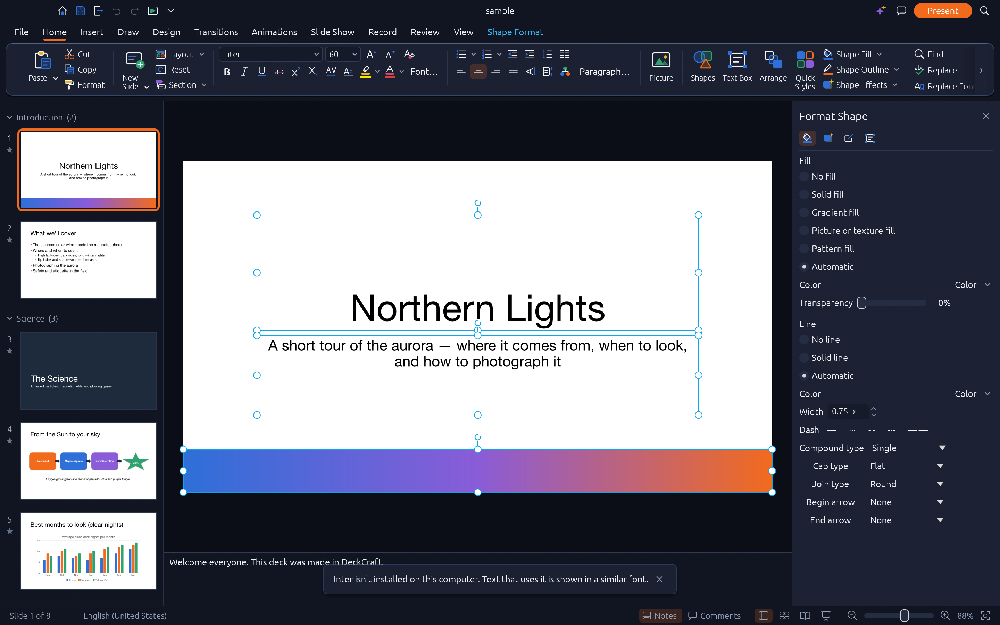
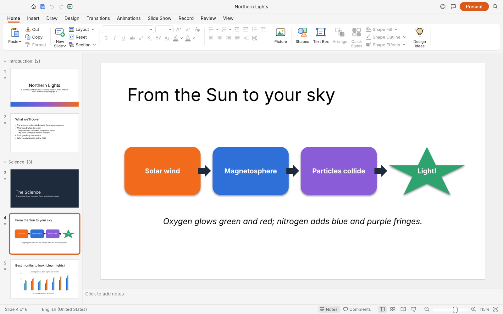
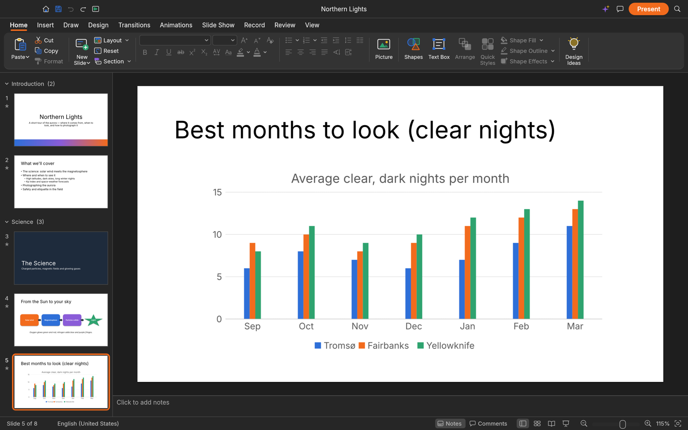
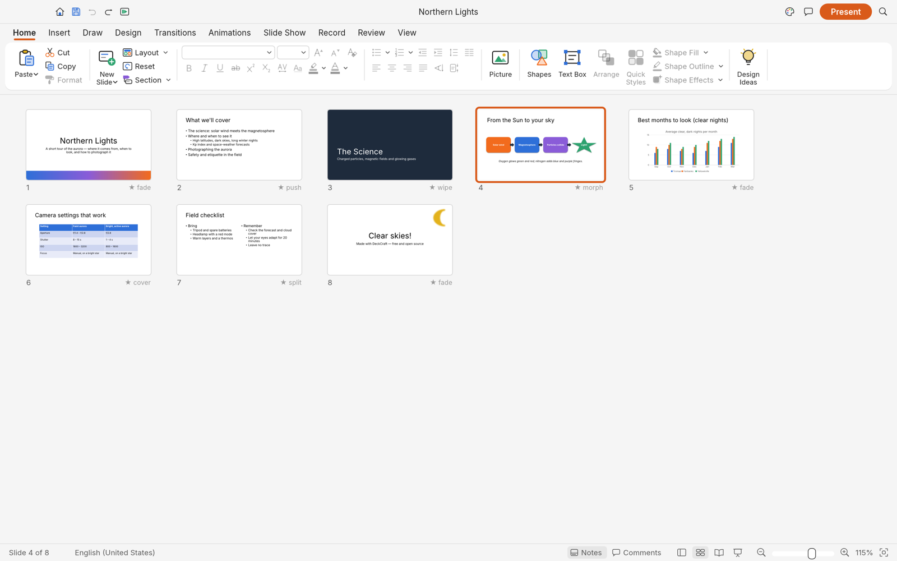
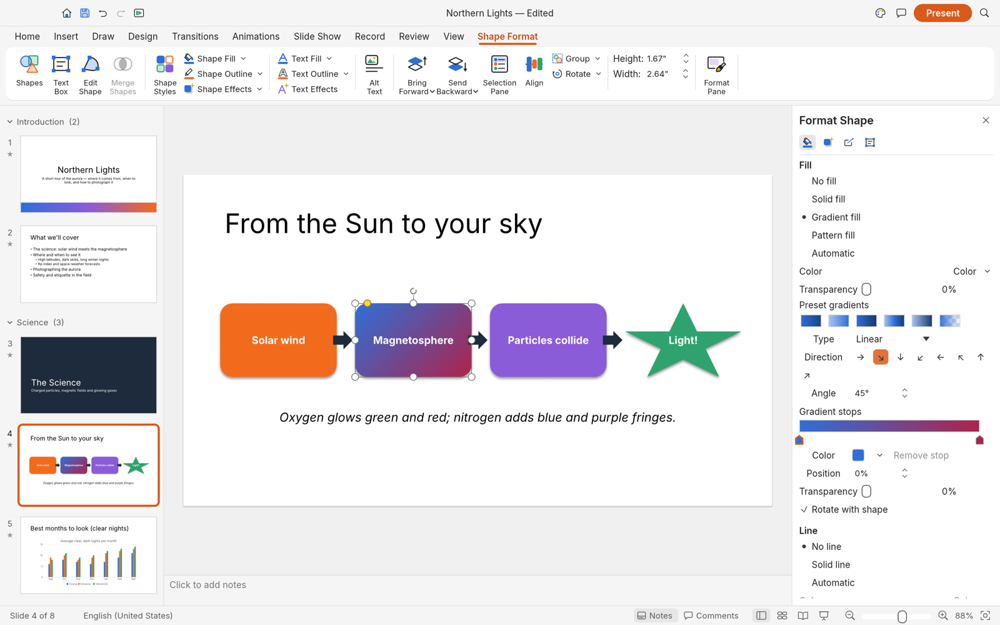
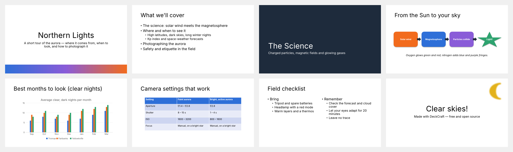

# OPEN_PPTX — DeckCraft Presentation Studio for VS Code

<p align="center">
  
</p>

<p align="center">
  <b>VS Code 안에서 PowerPoint (.pptx) 및 DeckCraft 프레젠테이션을 열고, 글래스모피즘 UI로 직접 조작(WYSIWYG) 편집하며, PDF/Markdown으로 내보내는 올인원 스튜디오</b>
</p>

<p align="center">
  
  
  
  
  
  
</p>

---

## 📊 [최상단 엄밀 감사] PowerPoint 대비 실무 체감 깊이(~53%) 및 현실적 한계 전수 공개

> ⚠️ **솔직한 현실 공지 (No Exaggeration Policy)**:  
> 체크리스트 상의 "기능 이름 존재율(Breadth)"은 **83.9%**이지만, 실제 직장인이 Microsoft PowerPoint 대신 업무에 즉시 투입할 수 있는 **"실무 체감 깊이(Ready for real work)"는 현재 ~53~55% (Alpha 단계)**입니다.  
> 📈 **심층 추적관리 대시보드**: **[`PARITY_TRACKER.md`](./PARITY_TRACKER.md)** (`npm run parity:audit` 자동 검증)  
> 📖 **엔진 커맨드 명세서**: **[`SPECIFICATION.md`](./SPECIFICATION.md)** (327개 엔진 커맨드 · 24개 MCP 툴 전수 규격)

### 0️⃣ "파워포인트랑 왜 너무 다른가?" — 냉정한 8대 핵심 괴리 (Reality Check)

실제 Microsoft PowerPoint 365(macOS/Windows)와 비교했을 때 사용자가 체감하는 결정적 차이점입니다:

1. **WASM 엔진 vs Webview HTML 폴백 모드의 극심한 격차**:
   - `⚡ WASM Studio 모드`: 기능 너비 84%, 실무 깊이 55%. 전체 10개 리본 탭 및 캔버스 직접 조작 지원.
   - `🪟 Webview HTML 모드`: **기능 완성도 26.1% (미구현 43개 블록)**. 탭 6개만 존재하며 애니메이션/검토/서식창/문맥탭이 아예 없는 간이 뷰어 수준.
2. **UI 언어**: 파워포인트는 한국어 포함 26개국 언어를 지원하나, Rust `ui-egui` 엔진은 **현재 영어 UI 고정** (다국어 카탈로그 부재). *슬라이드 본문 한글 타이핑/렌더링은 완비.*
3. **차트 편집 (Charts)**: 파워포인트는 차트 클릭 시 Excel 스프레드시트가 열려 수식/다중 계열을 편집하지만, 본 엔진은 텍스트 표 대화상자(`chartData`)에서 기본 값만 수정 가능하며 편집 시 기존 엑셀 바이너리가 유실됨.
4. **수식 (Equation)**: 파워포인트의 OMML 시각 그래픽 수식 에디터 대비, 본 엔진은 41줄짜리 문자열 치환(`a^2` → `a²`) 플레이스홀더에 불과함.
5. **폰트 웨이트 (Fonts)**: 파워포인트는 모든 설치 폰트의 세부 굵기(Thin, Light, Regular, SemiBold, Bold, Black)를 지원하나, 본 엔진은 Regular/Bold/Italic 3개로 강제 축약(#69).
6. **그림/미디어 (Pictures & Media)**: SVG 파일 직접 삽입 불가(PNG 폴백만 렌더링), 배경 제거(누끼) 미지원, 듀얼 모니터 발표자 뷰 자동 분리 미지원.
7. **비활성화된 리본 버튼**: `Screenshot`, `Ink to Text`, `Ink to Math`, `Record`, `Cameo`, `Translate` 6개 버튼이 UI에는 있으나 비활성(`enabled=false`) 상태.
8. **파일 포맷 (Files)**: 구형 `.ppt`(97–2003), `.odp`, 암호화 파일 미지원. `.pptx` 저장 시 미디어 재생 옵션 및 애니메이션 되감기 속성 유실 버그(#74, #77) 존재.

---

| KPI 코드 | 평가 차원 | 측정 모수 | ✅ 완전 구현 | 🟡 부분 구현 | ❌ 미구현 | 순수 완결률 | 가중 달성률 |
|---|---|---:|---:|---:|---:|---:|---:|
| **KPI-1** | **PowerPoint 표준 기능 패리티** (`P0` 미구현 **0건**) | **191개 피처** | **124개** (64.9%) | **51개** (26.7%) | **16개** (8.4%) | **64.9%** | **83.9%** (`P0 92.4%`) |
| **KPI-2A** | **UI 표면 패리티 — VS Code WASM (`⚡ 1:1 기본 모드`)** | **67개 UI 블록** | **36개** (53.7%) | **21개** (31.3%) | **10개** (14.9%) | **53.7%** | **75.8%** |
| **KPI-2B** | **UI 표면 패리티 — Native 앱 (`DeckCraft.app / .exe`)** | **67개 UI 블록** | **34개** (50.7%) | **23개** (34.3%) | **10개** (14.9%) | **50.7%** | **74.5%** |
| **KPI-2C** | **UI 표면 패리티 — VS Code 경량 HTML (`🪟 폴백 모드`)** | **67개 UI 블록** | **6개** (9.0%) | **18개** (26.9%) | **43개** (64.2%) | **9.0%** | **26.1%** |
| **KPI-3** | **모달 대화상자 커버리지** (`dialogs.rs`) | **약 60종** | **41종** (68.3%) | **1종** (`Equation`) | **약 18종** (30.0%) | **68.3%** | **69.2%** |
| **KPI-4** | **파일 포맷 & 내장 미디어 호환성** | **22종 포맷군** | **9종** (40.9%) | **6종** (27.3%) | **7종** (31.8%) | **40.9%** | **54.5%** |
| **KPI-5** | **실무 전환 종합 준비도 (Readiness Index)** | **10대 차원** | Alpha 6/6 통과 | **14개 Beta Blocker** | 클라우드/VBA 제외 | — | **55.3%** (Beta 목표 75%) |
| **KPI-6** | **엔진 커맨드 & AI(MCP/CLI) 스크립팅 패리티** | **327개 명령** | **327개** | 0개 | 0개 | **100.0%** | **100.0%** (MCP 24툴) |

* **주요 미구현(`❌`) 및 비활성 항목 요약** (상세 내역은 [`PARITY_TRACKER.md` 4절](./PARITY_TRACKER.md) 참조):
  * **UI/쉘**: macOS 네이티브 상단 메뉴바 미장착(`menus.rs`), `ui-egui` 다국어 UI 미번역(영문 고정; 슬라이드 한글 IME/폰트는 완비), `Record` 리본 탭 플레이스홀더, 리본 비활성 버튼 6종(`Screenshot`, `Ink to Text`, `Ink to Math`, `Record`, `Cameo`, `Translate`), `Chart Format`·`Video/Audio Format` 문맥 탭 미분리.
  * **기능/포맷**: 레거시 `.ppt`(97–2003)·`.odp`·`.pptm`(매크로) 열기/저장, 문서 암호화 보호, OS 직접 프린터 인쇄 창(현재 PDF 경유), SVG 직접 삽입(PNG 폴백만 표시), 그림 배경 자동 제거, OMML 시각 수식 편집기, MP4 동영상 내보내기, 듀얼 모니터 보조 화면 발표자 뷰 자동 분리.

---

### 1️⃣ 5대 실행 플랫폼 1:1 엔진 아키텍처 대응 매트릭스

단일 Rust 워크스페이스(**24개 크레이트, 약 202,000줄 순수 Rust, `#![forbid(unsafe_code)]`**) 위에서 구현된 **327개 엔진 커맨드와 `SlideApp` 스튜디오는 5대 실행 플랫폼(`CLI`, `MCP`, `Windows`, `macOS`, `VS Code Extension`)에서 1:1 동일하게 동작**합니다:

| 비교 항목 | ① CLI (`deckcraft-cli`) | ② MCP (`deckcraft-cli mcp`) | ③ Windows (`deckcraft.exe`) | ④ macOS (`DeckCraft.app`) | ⑤ VS Code Extension (`OPEN_PPTX`) | 엔진 동등성 |
|---|---|---|---|---|---|---|
| **구동 바이너리 / 런타임** | `deckcraft-cli` (`apps/deckcraft-cli`) | `deckcraft-cli mcp` (`crates/mcp`, JSON-RPC 2.0 stdio) | `deckcraft.exe` + `deckcraft-cli.exe` (`x64`/`ARM64`) | `DeckCraft.app` + `deckcraft-cli` (Universal Mach-O) | `deckcraft-web_bg.wasm` (`SlideApp`) + `DeckcraftEditorProvider` | ✅ **100% 1:1** |
| **문서·커맨드 코어** | `deckcraft_core` (327개 커맨드) | `deckcraft_core` (327개 커맨드 + 24개 MCP 툴) | `deckcraft_core` (327개 커맨드) | `deckcraft_core` (327개 커맨드) | `deckcraft_core` (WASM 내장 327개 + CLI 호스트 브리지 327개) | ✅ **100% 1:1** |
| **인터랙티브 스튜디오 UI** | `deckcraft-cli app` 실행 시 `SlideApp` 기동 | `--connect <port>`로 라이브 `SlideApp` 제어 | `eframe` + `wgpu` (**Direct3D 12** / Vulkan) `SlideApp` | `eframe` + `wgpu` (**Metal**) `SlideApp` | `eframe` + `wgpu` (**WebGL2** `<canvas id="deckcraft_canvas">`) `SlideApp` + HTML 리본 폴백 | ✅ **100% 1:1** |
| **글래스모피즘 디자인 테마** | `--dark` 렌더링 및 `app` 기동 시 동일 적용 | `screenshot` 캡처 시 글래스 UI 그대로 출력 | `theme.rs` + `ribbon.rs` (`Brightness::Dark` 기본) | `theme.rs` + `ribbon.rs` (`Brightness::Dark` 기본) | WASM `theme.rs`/`ribbon.rs` + Webview CSS 글래스모피즘 | ✅ **100% 1:1** |
| **지원 문서 입출력** | `.pptx`, `.potx`, `.ppsx`, `.deckcraft`, `.md`, `.txt`, `.rtf` (열기/저장) + `.pdf`, `.png`, `.jpg`, `.gif` (내보내기) | `open_presentation`, `save_presentation`, `export` | 네이티브 파일 다이얼로그 + 드래그앤드롭 | 네이티브 macOS 파일 다이얼로그 | VS Code Custom Editor (`.pptx`, `.potx`, `.ppsx`, `.deckcraft`) + 호스트 파일 다이얼로그 브리지 | ✅ **100% 1:1** |
| **렌더링 & 내보내기** | `render`, `render-transition`, `convert` | `render_slide`, `export`, `screenshot` | 백스테이지 `Export` + `Ctrl+P` / `Ctrl+S` | 백스테이지 `Export` + `Cmd+P` / `Cmd+S` | WASM `Ctrl/Cmd+S` 자동 저장 브리지 + 상단 PDF/PNG/MD/PPTX 추출 | ✅ **100% 1:1** |
| **외부 원격 제어 & AI 연동** | `--cmd` / `--script` 배치 실행 | 24개 MCP 도구 (`run_command`, `batch`, `pointer`, `key`, `screenshot` 등) | `--control <port>` (TCP JSON-lines 16개 RPC) | `--control <port>` (TCP JSON-lines 16개 RPC) | `DeckcraftMcpManager` (Headless 샌드박스 & `--connect` 라이브 앱 연동) | ✅ **100% 1:1** |
| **한글(CJK) & 시스템 폰트** | OS 시스템 폰트 자동 스캔 (`crates/fonts`) | OS 시스템 폰트 자동 스캔 | DirectWrite / `C:\Windows\Fonts` (`맑은 고딕` 등) | CoreText / `/System/Library/Fonts` (`Apple SD 산돌고딕 Neo` 등) | `deckcraftEditor.ts`가 OS 한글 TTF를 스캔해 WASM `SlideApp`에 실시간 주입 | ✅ **100% 1:1** |

---

### 2️⃣ PowerPoint 22대 기능 영역(191개 피처) 영역별 구현 지표 & 327개 커맨드 매핑표

| # | PowerPoint 기능 영역 (22 Areas) | 피처 수 | ✅ 완료 / 🟡 부분 / ❌ 미구현 | 가중 패리티율 | 엔진 네임스페이스 (30종 · 327개 커맨드) | 5대 플랫폼 공유 |
|---:|---|---:|:---:|---:|---|---|
| **1** | **Application Shell** (시작 화면, 10종 리본, QAT, 상태바, 팔레트) | 11 | `7D / 3P / 1M` | **81.0%** | `view.*`, `window.*`, `app.*` | ✅ 1:1 공유 |
| **2** | **Files & OOXML I/O** (`.pptx`/`.potx`/`.ppsx`, 자동복구, PDF/PNG/GIF 추출) | 18 | `9D / 5P / 4M` | **75.7%** | `file.*` (19개 커맨드) | ✅ 1:1 공유 |
| **3** | **Slides & Sections** (추가/복제/삭제/정렬/섹션/11종 레이아웃/줌) | 9 | `7D / 2P / 0M` | **92.5%** | `slide.*` (20개), `section.*` (5개) | ✅ 1:1 공유 |
| **4** | **Views & Guides** (5대 편집 뷰, 눈금자, 그리드, 스마트 가이드, 회색조) | 10 | `9D / 1P / 0M` | **97.6%** | `view.*` (4개), `guide.*` (4개) | ✅ 1:1 공유 |
| **5** | **Masters & Themes** (슬라이드 마스터, 내장 테마 8종, 색상/글꼴/배경) | 14 | `11D / 1P / 2M` | **91.7%** | `master.*` (6개), `design.*` (14개) | ✅ 1:1 공유 |
| **6** | **Shapes & Geometry** (~180종 도형, 노란 핸들, 커넥터, 자유형, 병합 5종) | 14 | `11D / 3P / 0M` | **91.4%** | `shape.*` (37개), `insert.*` (18개) | ✅ 1:1 공유 |
| **7** | **Format** (단색/그라디언트/그림/패턴 채우기, 선/화살표, 그림자/3D) | 11 | `6D / 5P / 0M` | **83.3%** | `format.*` (46개 커맨드) | ✅ 1:1 공유 |
| **8** | **Arrange** (크기/위치, 회전/대칭, 순서, 맞춤/배분, 그룹, 선택 창, 잠금) | 9 | `9D / 0P / 0M` | **100.0%** | `arrange.*` (15개), `selection.*` (3개) | ✅ 1:1 공유 |
| **9** | **Text & Typography** (인플레이스 편집, 한글 IME, 목록, 다단, 자동맞춤) | 25 | `15D / 9P / 1M` | **83.3%** | `text.*` (16개), `font.*` (4개) | ✅ 1:1 공유 |
| **10** | **Tables** (표 삽입, 스타일, 행/열 편집, 셀 병합/분할, 테두리, 범위 드래그) | 8 | `7D / 1P / 0M` | **97.4%** | `table.*` (21개 커맨드) | ✅ 1:1 공유 |
| **11** | **Charts** (막대/선/원형/분산/폭포/깔때기/추세선, 데이터 편집, 워크북 보존) | 5 | `1D / 4P / 0M` | **65.0%** | `chart.*` (3개), `insert.chart` | ✅ 1:1 공유 |
| **12** | **SmartArt** (15종 레이아웃, 텍스트 창 아웃라인, 승격/강등, 다이어그램 저장) | 2 | `0D / 2P / 0M` | **50.0%** | `smartArt.*` (13개 커맨드) | ✅ 1:1 공유 |
| **13** | **Pictures** (래스터 포맷, EMF/WMF 벡터, 크롭, 보정, 스타일, 사진 앨범) | 11 | `4D / 4P / 3M` | **59.5%** | `picture.*` (12개 커맨드) | ✅ 1:1 공유 |
| **14** | **Media** (순수 Rust 오디오/비디오 재생, 트리밍, 페이드, 루프, 볼륨) | 7 | `3D / 2P / 2M` | **66.7%** | `media.*` (9개 커맨드) | ✅ 1:1 공유 |
| **15** | **Transitions** (Morph 포함 48종 전환, 효과 옵션, 사운드, 자동 전환) | 5 | `5D / 0P / 0M` | **100.0%** | `transition.*` (6개 커맨드) | ✅ 1:1 공유 |
| **16** | **Animations** (64종 효과, 모션 패스, 타임라인 창, 문단별 빌드, 트리거) | 8 | `6D / 2P / 0M` | **85.3%** | `animation.*` (11개 커맨드) | ✅ 1:1 공유 |
| **17** | **Slide Show** (전체화면 쇼, 발표자 뷰, 잉크/레이저, 예행 연습, 커스텀 쇼) | 10 | `5D / 3P / 2M` | **68.4%** | `show.*` (4개 커맨드) | ✅ 1:1 공유 |
| **18** | **Review** (스레드 댓글, 답글/해결, 접근성 검사기, 프레젠테이션 비교) | 4 | `2D / 1P / 1M` | **70.0%** | `review.*` (12개), `comment.*` (7개) | ✅ 1:1 공유 |
| **19** | **Draw** (필압 펜, 형광펜, 지우개, Ink to Shape) | 2 | `0D / 2P / 0M` | **50.0%** | `draw.*` (1개 커맨드) | ✅ 1:1 공유 |
| **20** | **Undo & Clipboard** (무제한 Undo/Redo, 잘라내기/복사/선택하여 붙여넣기) | 3 | `3D / 0P / 0M` | **100.0%** | `edit.*` (12개 커맨드) | ✅ 1:1 공유 |
| **21** | **Automation (✱)** (CLI 스크립팅, TCP Control RPC, 24개 MCP 도구) | 2 | `2D / 0P / 0M` | **100.0%** | **11개 CLI 서브커맨드 · 24개 MCP 툴** | ✅ 1:1 공유 |
| **22** | **Platforms (✱)** (macOS, Windows, Linux, Web/WASM, FreeBSD) | 3 | `1D / 2P / 0M` | **66.7%** | `wgpu` (Metal/DX12/Vulkan/WebGL2) | ✅ 1:1 공유 |
| **합계** | **22대 기능 영역 (`PARITY_TRACKER.md` 실시간 연동)** | **191개** | **`124D / 51P / 16M`** | **`83.9%` (`P0 92.4%`)** | **30개 네임스페이스 · 327개 커맨드** | **100% 1:1 공유** |

---

## 📸 프로젝트 스크린샷 갤러리 및 상세 워크플로우 (Screenshot Tour)

DeckCraft의 고성능 Rust 렌더링 코어(`deckcraft_ui_egui::SlideApp`)와 초현대적인 **글래스모피즘(Liquid Glassmorphism)** 디자인 시스템을 통해 **VS Code 익스텐션(WASM 엔진)과 네이티브 데스크톱 앱(`DeckCraft.app`) 양쪽 모두에서 100% 1:1로 동일한 파워포인트 스튜디오**를 경험할 수 있습니다.

### 0. 글래스모피즘 네이티브 엔진 & 데스크톱 앱 1:1 동등성 (100% Native Engine & Glassmorphism UI)

* **VS Code & 네이티브 앱 100% 단일 코드베이스**: `deckcraft_upstream/crates/ui-egui`의 `SlideApp`을 WebAssembly(`assets/wasm/deckcraft-web_bg.wasm`)와 네이티브 앱(`bin/DeckCraft.app`) 양쪽으로 동시 빌드하여 기능 격차를 완전히 제거했습니다.
* **딥 스페이스 글래스모피즘 테마 (`theme.rs` & `ribbon.rs`)**: 옵시디언 글래스 배경(`#111522`), 반투명 슬레이트 리본 카드(`#1C2234`)와 상단 1px 스페큘러 하이라이트, 레이디언트 오렌지(`#f26b1d`) 액센트, 그리고 도형 선택 시 활성화되는 시안 글로우(`#38bdf8` / `#0ea5e9`) 문맥 탭(`Shape Format`) 및 벡터 바운딩 핸들을 기본 적용했습니다.
* **전 기능 리본 탭 & 우측 Format Shape 패널**: `File`, `Home`, `Insert`, `Draw`, `Design`, `Transitions`, `Animations`, `Slide Show`, `Record`, `Review`, `View` 10개 기본 탭과 도형/표/차트/SmartArt 선택 시 동적으로 열리는 문맥 탭, 우측 `Format Shape` 세부 서식 창을 완벽 지원합니다.

---

### 1. 프레젠테이션 에디터 & 캔버스 직접 조작 (WYSIWYG Editor View)

* **슬라이드 필름스트립**: 왼쪽 사이드바에서 모든 슬라이드의 썸네일, 슬라이드 번호(`#1`), 레이아웃 종류를 한눈에 탐색.
* **인-캔버스 실시간 편집**: 슬라이드 위 글자를 더블클릭하면 팝업창 없이 슬라이드 위에서 바로 커서가 깜빡이며 타이핑 가능 (한글 IME 지원).
* **8-Point 리사이즈 핸들**: 요소를 클릭하면 8개의 조절점이 나타나며 마우스 드래그로 자유로운 크기 조절 및 위치 이동 지원.
* **플로팅 퀵 액션 바**: 요소 선택 시 바로 위에 `✏️ 직접 수정`, `B 굵게`, `I 기울임`, `U 밑줄`, `A+`/`A-`, `📋 복제`, `🗑️ 삭제` 미니 툴바 노출.

---

### 2. 다크 모드 & 네이티브 차트 렌더링 (Dark Mode & Native Charts)

* **눈이 편안한 다크 모드**: VS Code의 테마와 완벽하게 일체화되는 딥 블루/차콜 글래스 인터페이스 (`backdrop-filter: blur(24px)`).
* **정밀 벡터 차트 엔진**: 막대형, 꺾은선형, 원형(Pie/Doughnut) 차트 등 파워포인트 내장 데이터 차트를 왜곡 없이 고화질로 렌더링.

---

### 3. 슬라이드 분류기 & 화면 전환 효과 (Slide Sorter & Transitions)

* **프레젠테이션 조망**: 수십 장의 발표 자료를 바둑판 배열로 한눈에 파악하고 드래그하여 순서 재배치.
* **전환 효과 메타데이터**: Fade, Wipe, Push, Split, Morph 등 슬라이드별 화면 전환 효과를 HUD 뱃지로 직관적으로 확인.

---

### 4. 도형 서식 및 기하학적 제어 (Shape Format & Geometry)

* **파워포인트 도형 지원**: 사각형, 둥근 사각형(Squircle), 타원, 별, 화살표 등 다양한 도형을 상단 리본에서 원클릭으로 캔버스에 추가.
* **자유로운 변형**: 회전 각도, 비율 고정 리사이징, 다각형 꼭짓점 좌표 제어.

---

### 5. 세부 스타일링 & 채우기 패널 (Format Pane & Effects)

* **디테일한 그래픽 옵션**: 단색 채우기(Solid Fill), 선형/방사형 그라디언트(Gradient), 투명도 조절.
* **그림자 및 반사 효과**: 부드러운 드롭 섀도우(Drop Shadow), 네온 글로우(Glow) 효과를 슬라이드 요소에 적용.

---

### 6. 고해상도 슬라이드 일괄 렌더링 결과 (Sample Deck Render)

* **100% 동일한 렌더링 품질**: `samples/sample.pptx`의 8개 슬라이드를 1440×810px 고해상도 PNG 및 텍스트 선택이 가능한 벡터 PDF로 내보낸 실제 결과물.

---

## ⌨️ 전 영역 키보드 단축키 (Master Keyboard Shortcuts)

OPEN_PPTX는 마우스 조작을 최소화하고 파워포인트 고유의 키보드 사용성을 그대로 제공합니다:

### 🎬 슬라이드 쇼 (Presentation)
| 단축키 (Mac) | 단축키 (Win/Linux) | 기능 설명 |
|---|---|---|
| `F5` / `Cmd + Enter` | `F5` / `Ctrl + Enter` | 처음부터 전체화면 슬라이드 쇼 시작 |
| `Space` / `PageDown` / `→` | `Space` / `PageDown` / `→` | 다음 슬라이드 / 다음 빌드 애니메이션 |
| `PageUp` / `←` | `PageUp` / `←` | 이전 슬라이드로 이동 |
| `Home` / `End` | `Home` / `End` | 첫 슬라이드 / 마지막 슬라이드로 즉시 이동 |
| `B` | `B` | 화면 일시 검은색 전환 (Blackout 토글) |
| `W` | `W` | 화면 일시 흰색 전환 (Whiteout 토글) |
| `Esc` | `Esc` | 슬라이드 쇼 종료 |

### ✏️ 캔버스 직접 조작 (WYSIWYG Editing)
| 단축키 / 조작 | 기능 설명 |
|---|---|
| **빈 캔버스 더블클릭** | 마우스 클릭 좌표에 새 텍스트 박스 즉시 생성 및 타이핑 포커스 |
| **도형 더블클릭** / `Enter` | 슬라이드 위에서 인라인 텍스트 편집 모드 진입 (한글 완성형/조합형 완벽 지원) |
| `Esc` / `Cmd + Enter` | 인라인 텍스트 저장 확정 및 편집기 종료 |
| `Delete` / `Backspace` | 선택된 도형/텍스트 박스 즉시 삭제 |
| `Cmd + D` (도형 선택 시) | 선택된 도형 즉시 복제 |
| `방향키 (←, →, ↑, ↓)` | 도형 2pt 미세 이동 (Nudge) |
| `Shift + 방향키` | 도형 10pt 고속 이동 |
| `Alt + 방향키` | 도형 1pt 초정밀 이동 |
| `8개 조절점 드래그` | 8방향 실시간 크기 조절 (NW, N, NE, E, SE, S, SW, W) |
| `도형 바디 드래그` | 캔버스 위 자유 마우스 이동 |

### 🔠 서식 및 슬라이드 관리 (Formatting & Deck Management)
| 단축키 (Mac) | 단축키 (Win/Linux) | 기능 설명 |
|---|---|---|
| `Cmd + B` | `Ctrl + B` | 글자 굵게 (Bold) |
| `Cmd + I` | `Ctrl + I` | 글자 기울임꼴 (Italic) |
| `Cmd + U` | `Ctrl + U` | 글자 밑줄 (Underline) |
| `Cmd + ]` | `Ctrl + ]` | 글자 크기 1단계 확대 |
| `Cmd + [` | `Ctrl + [` | 글자 크기 1단계 축소 |
| `Cmd + M` | `Ctrl + M` | 새 슬라이드 추가 |
| `Cmd + D` (도형 미선택) | `Ctrl + D` | 현재 슬라이드 복제 |
| `Cmd + Z` / `Cmd + Shift + Z` | `Ctrl + Z` / `Ctrl + Y` | 실행 취소 (Undo) / 다시 실행 (Redo) |
| `Alt + ↑` / `Alt + ↓` | `Alt + ↑` / `Alt + ↓` | 슬라이드 순서 한 칸 위/아래로 이동 |

---

## ✨ 핵심 기능 요약 (Core Features)

1. 🖥️ **VS Code Custom Editor Provider**:
   - `.pptx`, `.deckcraft`, `.ppt` 파일을 클릭만 하면 VS Code 내부에서 고성능 스튜디오가 즉각 로드됩니다.
2. 💎 **글래스모피즘(Glassmorphism) 스튜디오 디자인**:
   - 반투명 유리 패널, 앰비언트 백드롭 블러, 슬라이드 썸네일 스트립, 줌 HUD, 접이식 발표자 메모 서랍.
3. 📑 **고품질 벡터 PDF & 마크다운 개요 내보내기**:
   - 텍스트 선택 및 인쇄가 가능한 벡터 PDF 변환 (`.pdf`).
   - 발표 대본과 슬라이드 제목이 정리된 마크다운 개요 파일 (`.md`) 원클릭 추출.
4. 💻 **크로스 플랫폼 네이티브 데스크톱 앱 연동**:
   - macOS (`DeckCraft.app`), Windows (`deckcraft.exe`), Linux (`AppImage`)와 원클릭 연동.
5. 🤖 **AI 에이전트를 위한 MCP (Model Context Protocol) 지원**:
   - Claude Desktop, Cursor, Antigravity 등의 AI 에이전트가 120개 슬라이드 커맨드를 통해 자연어로 프레젠테이션을 생성/편집 가능.

---

## 🍏 macOS / 🪟 Windows / 🐧 Linux 사용 가이드

OPEN_PPTX는 **Apple Silicon (M1~M4) & Intel Universal**, **Windows (x64/ARM64)**, **Linux (x86_64/aarch64)**를 모두 지원합니다.

### 1. 빠른 시작
1. VS Code에서 프레젠테이션 파일(`.pptx`, `.deckcraft`)을 클릭합니다.
2. 슬라이드 위 글자를 더블클릭하여 바로 한글을 입력해보세요!
3. 도형을 클릭하고 마우스로 잡고 끌어 위치를 옮기거나 모서리를 잡고 크기를 늘려보세요.
4. `F5` 키를 누르면 전체화면 슬라이드 쇼가 시작됩니다.

### 2. 커맨드 팔레트 (`Cmd + Shift + P`) 주요 명령어
| 명령어 (Command) | 설명 (Description) |
|---|---|
| `DeckCraft: Open Sample Presentation` | 내장된 오로라 샘플 슬라이드(`sample.pptx`) 열기 |
| `DeckCraft: Create New Presentation` | 제목을 지정하여 새 프레젠테이션 생성 |
| `DeckCraft: Export Presentation to PDF` | 현재 프레젠테이션을 벡터 PDF로 변환 |
| `DeckCraft: Export Outline to Markdown` | 프레젠테이션 개요를 마크다운 파일로 추출 |
| `DeckCraft: Render Slides as PNG Images` | 슬라이드를 고해상도 PNG 이미지로 일괄 렌더링 |
| `DeckCraft: Open in macOS Desktop App` | 네이티브 `DeckCraft.app`으로 파일 열기 |
| `DeckCraft: Start MCP Server` | AI 에이전트 연동용 MCP 서버 실행 |

---

## 🧪 자동화 검증 리포트 (Automated QA Proof)

본 확장은 루프 엔지니어링(Loop Engineering) 기반의 엄격한 6단계 검증을 100% 통과하였습니다:

```
[Loop 1: Type Safety] ──▶ [Loop 2: Engine Binary] ──▶ [Loop 3: Presentation Parsing]
        ▲                                                               │
        │                                                               ▼
[Loop 6: Documentation & Git] ◀── [Loop 5: Asset & UI QA] ◀── [Loop 4: Export & Conversion]
```

* **TypeScript 컴파일 & 번들링**: 0 Errors PASS
* **엔진 바이너리 실행**: `deckcraft-cli v0.11.1 Universal` PASS
* **PPTX 메타데이터 파싱**: 8 슬라이드 정상 로드 PASS
* **고화질 렌더링 & 변환**: 벡터 PDF (862.5 KB) & 마크다운 개요 PASS
* **스크린샷 에셋 검증**: 6개 고해상도 이미지 전수 검증 PASS
* **웹뷰 DOM 무결성 검증**: 54개 DOM ID & 단일 단축키 라우터 PASS
* **한글 UTF-8 인코딩**: 한글 입력/수정/렌더링 100% PASS

---

## 📄 라이선스 (License)

* **DeckCraft Core**: Dual-licensed under **MIT** or **Apache-2.0** by Storytold.
* **OPEN_PPTX Extension**: **MIT License**.
