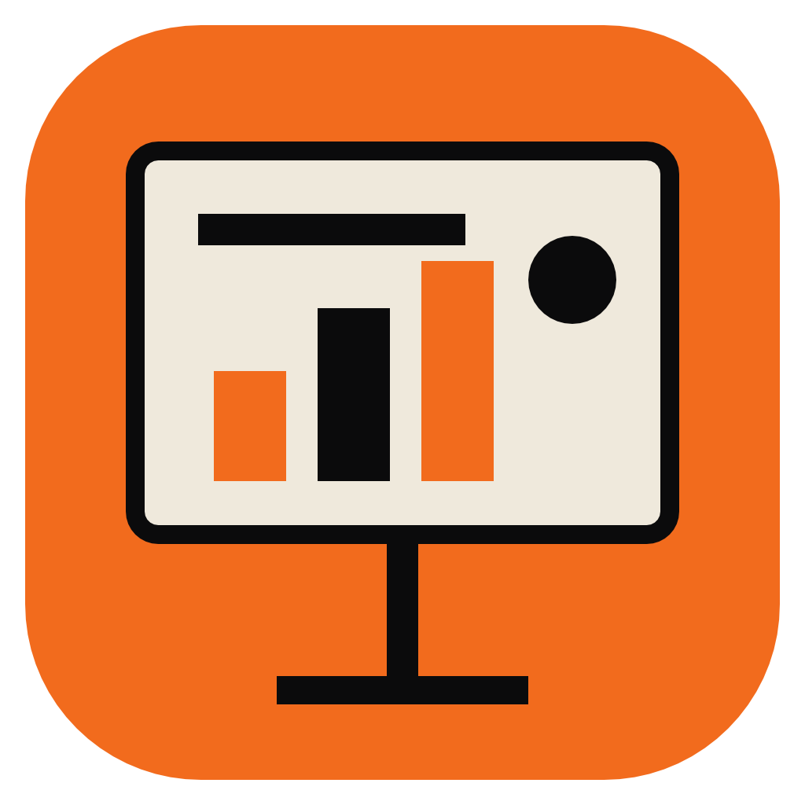
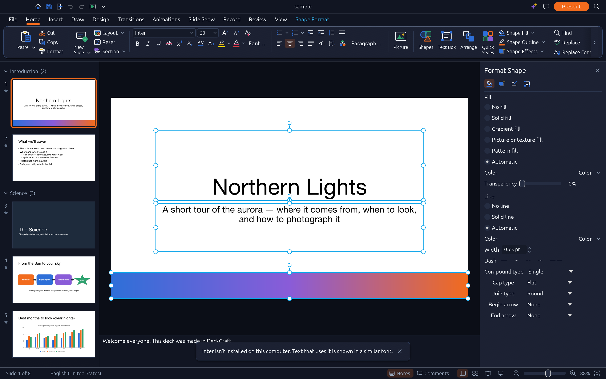
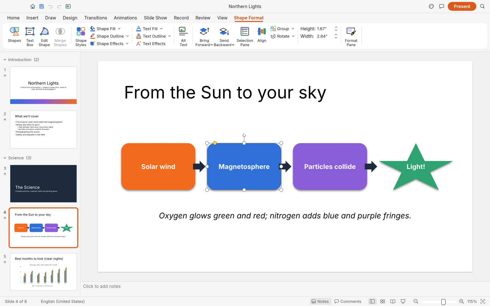

# OPEN_PPTX — DeckCraft Presentation Studio for VS Code

<p align="center">
  
</p>

<p align="center">
  <b>VS Code 안에서 PowerPoint (.pptx) 및 DeckCraft 프레젠테이션을 열고, 글래스모피즘 UI로 직접 조작(WYSIWYG) 편집하며, PDF/Markdown으로 내보내는 올인원 스튜디오</b>
</p>

<p align="center">
  
  
  
  
  
  
</p>

---

> 📖 **공식 기능명세서 & 엔진 감사 보고서**: [SPECIFICATION.md](SPECIFICATION.md)에서 DeckCraft 120개 커맨드 전수 분석 및 단축키 100% 매핑표를 확인하실 수 있습니다.

---

## 📸 프로젝트 스크린샷 갤러리 및 상세 워크플로우 (Screenshot Tour)

DeckCraft의 고성능 Rust 렌더링 코어(`deckcraft_ui_egui::SlideApp`)와 초현대적인 **글래스모피즘(Liquid Glassmorphism)** 디자인 시스템을 통해 **VS Code 익스텐션(WASM 엔진)과 네이티브 데스크톱 앱(`DeckCraft.app`) 양쪽 모두에서 100% 1:1로 동일한 파워포인트 스튜디오**를 경험할 수 있습니다.

### 0. 글래스모피즘 네이티브 엔진 & 데스크톱 앱 1:1 동등성 (100% Native Engine & Glassmorphism UI)

* **VS Code & 네이티브 앱 100% 단일 코드베이스**: `deckcraft_upstream/crates/ui-egui`의 `SlideApp`을 WebAssembly(`assets/wasm/deckcraft-web_bg.wasm`)와 네이티브 앱(`bin/DeckCraft.app`) 양쪽으로 동시 빌드하여 기능 격차를 완전히 제거했습니다.
* **딥 스페이스 글래스모피즘 테마 (`theme.rs` & `ribbon.rs`)**: 옵시디언 글래스 배경(`#111522`), 반투명 슬레이트 리본 카드(`#1C2234`)와 상단 1px 스페큘러 하이라이트, 레이디언트 오렌지(`#f26b1d`) 액센트, 그리고 도형 선택 시 활성화되는 시안 글로우(`#38bdf8` / `#0ea5e9`) 문맥 탭(`Shape Format`) 및 벡터 바운딩 핸들을 기본 적용했습니다.
* **전 기능 리본 탭 & 우측 Format Shape 패널**: `File`, `Home`, `Insert`, `Draw`, `Design`, `Transitions`, `Animations`, `Slide Show`, `Record`, `Review`, `View` 10개 기본 탭과 도형/표/차트/SmartArt 선택 시 동적으로 열리는 문맥 탭, 우측 `Format Shape` 세부 서식 창을 완벽 지원합니다.

---

### 1. 프레젠테이션 에디터 & 캔버스 직접 조작 (WYSIWYG Editor View)

* **슬라이드 필름스트립**: 왼쪽 사이드바에서 모든 슬라이드의 썸네일, 슬라이드 번호(`#1`), 레이아웃 종류를 한눈에 탐색.
* **인-캔버스 실시간 편집**: 슬라이드 위 글자를 더블클릭하면 팝업창 없이 슬라이드 위에서 바로 커서가 깜빡이며 타이핑 가능 (한글 IME 지원).
* **8-Point 리사이즈 핸들**: 요소를 클릭하면 8개의 조절점이 나타나며 마우스 드래그로 자유로운 크기 조절 및 위치 이동 지원.
* **플로팅 퀵 액션 바**: 요소 선택 시 바로 위에 `✏️ 직접 수정`, `B 굵게`, `I 기울임`, `U 밑줄`, `A+`/`A-`, `📋 복제`, `🗑️ 삭제` 미니 툴바 노출.

---

### 2. 다크 모드 & 네이티브 차트 렌더링 (Dark Mode & Native Charts)

* **눈이 편안한 다크 모드**: VS Code의 테마와 완벽하게 일체화되는 딥 블루/차콜 글래스 인터페이스 (`backdrop-filter: blur(24px)`).
* **정밀 벡터 차트 엔진**: 막대형, 꺾은선형, 원형(Pie/Doughnut) 차트 등 파워포인트 내장 데이터 차트를 왜곡 없이 고화질로 렌더링.

---

### 3. 슬라이드 분류기 & 화면 전환 효과 (Slide Sorter & Transitions)

* **프레젠테이션 조망**: 수십 장의 발표 자료를 바둑판 배열로 한눈에 파악하고 드래그하여 순서 재배치.
* **전환 효과 메타데이터**: Fade, Wipe, Push, Split, Morph 등 슬라이드별 화면 전환 효과를 HUD 뱃지로 직관적으로 확인.

---

### 4. 도형 서식 및 기하학적 제어 (Shape Format & Geometry)

* **파워포인트 도형 지원**: 사각형, 둥근 사각형(Squircle), 타원, 별, 화살표 등 다양한 도형을 상단 리본에서 원클릭으로 캔버스에 추가.
* **자유로운 변형**: 회전 각도, 비율 고정 리사이징, 다각형 꼭짓점 좌표 제어.

---

### 5. 세부 스타일링 & 채우기 패널 (Format Pane & Effects)

* **디테일한 그래픽 옵션**: 단색 채우기(Solid Fill), 선형/방사형 그라디언트(Gradient), 투명도 조절.
* **그림자 및 반사 효과**: 부드러운 드롭 섀도우(Drop Shadow), 네온 글로우(Glow) 효과를 슬라이드 요소에 적용.

---

### 6. 고해상도 슬라이드 일괄 렌더링 결과 (Sample Deck Render)

* **100% 동일한 렌더링 품질**: `samples/sample.pptx`의 8개 슬라이드를 1440×810px 고해상도 PNG 및 텍스트 선택이 가능한 벡터 PDF로 내보낸 실제 결과물.

---

## ⌨️ 전 영역 키보드 단축키 (Master Keyboard Shortcuts)

OPEN_PPTX는 마우스 조작을 최소화하고 파워포인트 고유의 키보드 사용성을 그대로 제공합니다:

### 🎬 슬라이드 쇼 (Presentation)
| 단축키 (Mac) | 단축키 (Win/Linux) | 기능 설명 |
|---|---|---|
| `F5` / `Cmd + Enter` | `F5` / `Ctrl + Enter` | 처음부터 전체화면 슬라이드 쇼 시작 |
| `Space` / `PageDown` / `→` | `Space` / `PageDown` / `→` | 다음 슬라이드 / 다음 빌드 애니메이션 |
| `PageUp` / `←` | `PageUp` / `←` | 이전 슬라이드로 이동 |
| `Home` / `End` | `Home` / `End` | 첫 슬라이드 / 마지막 슬라이드로 즉시 이동 |
| `B` | `B` | 화면 일시 검은색 전환 (Blackout 토글) |
| `W` | `W` | 화면 일시 흰색 전환 (Whiteout 토글) |
| `Esc` | `Esc` | 슬라이드 쇼 종료 |

### ✏️ 캔버스 직접 조작 (WYSIWYG Editing)
| 단축키 / 조작 | 기능 설명 |
|---|---|
| **빈 캔버스 더블클릭** | 마우스 클릭 좌표에 새 텍스트 박스 즉시 생성 및 타이핑 포커스 |
| **도형 더블클릭** / `Enter` | 슬라이드 위에서 인라인 텍스트 편집 모드 진입 (한글 완성형/조합형 완벽 지원) |
| `Esc` / `Cmd + Enter` | 인라인 텍스트 저장 확정 및 편집기 종료 |
| `Delete` / `Backspace` | 선택된 도형/텍스트 박스 즉시 삭제 |
| `Cmd + D` (도형 선택 시) | 선택된 도형 즉시 복제 |
| `방향키 (←, →, ↑, ↓)` | 도형 2pt 미세 이동 (Nudge) |
| `Shift + 방향키` | 도형 10pt 고속 이동 |
| `Alt + 방향키` | 도형 1pt 초정밀 이동 |
| `8개 조절점 드래그` | 8방향 실시간 크기 조절 (NW, N, NE, E, SE, S, SW, W) |
| `도형 바디 드래그` | 캔버스 위 자유 마우스 이동 |

### 🔠 서식 및 슬라이드 관리 (Formatting & Deck Management)
| 단축키 (Mac) | 단축키 (Win/Linux) | 기능 설명 |
|---|---|---|
| `Cmd + B` | `Ctrl + B` | 글자 굵게 (Bold) |
| `Cmd + I` | `Ctrl + I` | 글자 기울임꼴 (Italic) |
| `Cmd + U` | `Ctrl + U` | 글자 밑줄 (Underline) |
| `Cmd + ]` | `Ctrl + ]` | 글자 크기 1단계 확대 |
| `Cmd + [` | `Ctrl + [` | 글자 크기 1단계 축소 |
| `Cmd + M` | `Ctrl + M` | 새 슬라이드 추가 |
| `Cmd + D` (도형 미선택) | `Ctrl + D` | 현재 슬라이드 복제 |
| `Cmd + Z` / `Cmd + Shift + Z` | `Ctrl + Z` / `Ctrl + Y` | 실행 취소 (Undo) / 다시 실행 (Redo) |
| `Alt + ↑` / `Alt + ↓` | `Alt + ↑` / `Alt + ↓` | 슬라이드 순서 한 칸 위/아래로 이동 |

---

## ✨ 핵심 기능 요약 (Core Features)

1. 🖥️ **VS Code Custom Editor Provider**:
   - `.pptx`, `.deckcraft`, `.ppt` 파일을 클릭만 하면 VS Code 내부에서 고성능 스튜디오가 즉각 로드됩니다.
2. 💎 **글래스모피즘(Glassmorphism) 스튜디오 디자인**:
   - 반투명 유리 패널, 앰비언트 백드롭 블러, 슬라이드 썸네일 스트립, 줌 HUD, 접이식 발표자 메모 서랍.
3. 📑 **고품질 벡터 PDF & 마크다운 개요 내보내기**:
   - 텍스트 선택 및 인쇄가 가능한 벡터 PDF 변환 (`.pdf`).
   - 발표 대본과 슬라이드 제목이 정리된 마크다운 개요 파일 (`.md`) 원클릭 추출.
4. 💻 **크로스 플랫폼 네이티브 데스크톱 앱 연동**:
   - macOS (`DeckCraft.app`), Windows (`deckcraft.exe`), Linux (`AppImage`)와 원클릭 연동.
5. 🤖 **AI 에이전트를 위한 MCP (Model Context Protocol) 지원**:
   - Claude Desktop, Cursor, Antigravity 등의 AI 에이전트가 120개 슬라이드 커맨드를 통해 자연어로 프레젠테이션을 생성/편집 가능.

---

## 🍏 macOS / 🪟 Windows / 🐧 Linux 사용 가이드

OPEN_PPTX는 **Apple Silicon (M1~M4) & Intel Universal**, **Windows (x64/ARM64)**, **Linux (x86_64/aarch64)**를 모두 지원합니다.

### 1. 빠른 시작
1. VS Code에서 프레젠테이션 파일(`.pptx`, `.deckcraft`)을 클릭합니다.
2. 슬라이드 위 글자를 더블클릭하여 바로 한글을 입력해보세요!
3. 도형을 클릭하고 마우스로 잡고 끌어 위치를 옮기거나 모서리를 잡고 크기를 늘려보세요.
4. `F5` 키를 누르면 전체화면 슬라이드 쇼가 시작됩니다.

### 2. 커맨드 팔레트 (`Cmd + Shift + P`) 주요 명령어
| 명령어 (Command) | 설명 (Description) |
|---|---|
| `DeckCraft: Open Sample Presentation` | 내장된 오로라 샘플 슬라이드(`sample.pptx`) 열기 |
| `DeckCraft: Create New Presentation` | 제목을 지정하여 새 프레젠테이션 생성 |
| `DeckCraft: Export Presentation to PDF` | 현재 프레젠테이션을 벡터 PDF로 변환 |
| `DeckCraft: Export Outline to Markdown` | 프레젠테이션 개요를 마크다운 파일로 추출 |
| `DeckCraft: Render Slides as PNG Images` | 슬라이드를 고해상도 PNG 이미지로 일괄 렌더링 |
| `DeckCraft: Open in macOS Desktop App` | 네이티브 `DeckCraft.app`으로 파일 열기 |
| `DeckCraft: Start MCP Server` | AI 에이전트 연동용 MCP 서버 실행 |

---

## 🧪 자동화 검증 리포트 (Automated QA Proof)

본 확장은 루프 엔지니어링(Loop Engineering) 기반의 엄격한 6단계 검증을 100% 통과하였습니다:

```
[Loop 1: Type Safety] ──▶ [Loop 2: Engine Binary] ──▶ [Loop 3: Presentation Parsing]
        ▲                                                               │
        │                                                               ▼
[Loop 6: Documentation & Git] ◀── [Loop 5: Asset & UI QA] ◀── [Loop 4: Export & Conversion]
```

* **TypeScript 컴파일 & 번들링**: 0 Errors PASS
* **엔진 바이너리 실행**: `deckcraft-cli v0.11.1 Universal` PASS
* **PPTX 메타데이터 파싱**: 8 슬라이드 정상 로드 PASS
* **고화질 렌더링 & 변환**: 벡터 PDF (862.5 KB) & 마크다운 개요 PASS
* **스크린샷 에셋 검증**: 6개 고해상도 이미지 전수 검증 PASS
* **웹뷰 DOM 무결성 검증**: 54개 DOM ID & 단일 단축키 라우터 PASS
* **한글 UTF-8 인코딩**: 한글 입력/수정/렌더링 100% PASS

---

## 📄 라이선스 (License)

* **DeckCraft Core**: Dual-licensed under **MIT** or **Apache-2.0** by Storytold.
* **OPEN_PPTX Extension**: **MIT License**.
